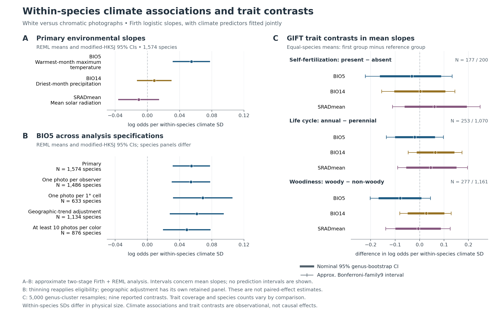

# FCP：447,500枚から推定した種内環境応答と、植物形質・分子機構の対応

2026-10-18。対象は4,475種・447,500枚の真正な実測写真。解析の中心は、各種の中での白―有色の環境対応と、その対応を種間で比較したときの共通性である。

## 今回、実行して得られた結論

**1,574種・86,114枚について気温・降水・日射を同時にモデル化すると、BIO5が高い場所で白と分類されるオッズが高いという、小さな平均的関連が残った。** 観察者別の間引き、1度セル別の間引き、限定的な地理トレンドの追加でも、対応する平均の区間は正だった。一方、最少雨月降水量と年平均日射の平均的関連は明確ではなかった。

**見かけの種別傾きの散らばりを、そのまま生物学的な種間差とはできない。** 傾きの推定誤差を考慮した今回の近似モデルでは、3環境軸とも種間分散の区間に0を含んだ。共通則が全種で成立することも、真の種間差がないことも、ここからは確定しない。

**GIFTの植物形質を実際に取得し、環境応答を特徴づける解析まで実行した。** 自家受精の記録、生活史、木本性について、3形質×3環境軸の9比較を行ったが、いずれも差の95%区間が0を含んだ。この3種類の粗い形質からは、環境応答の差を明瞭には説明できなかった。

**分子側は11分類群・18比較・31比較×器官行を整理し、種・環境データと対応させた。** 発現・変異・遺伝子介入の証拠が環境パネルと対応したのは4種だった。白化の制御点と器官への広がりを比較できる資料になったが、分子機構別の環境応答を多数種で推定できる規模には達していない。

本稿の数値の一次資料は、[環境モデル](../results/fcp_real_447500_environment_model_20261018/)、[GIFT対応と形質比較](../results/fcp_gift_modifiers_20261018/)、[分子対応](../results/fcp_molecular_bridge_20261018/)である。過去の白軸分解と環境差の記述は[先行レポート](FCP_WITHIN_SPECIES_ENVIRONMENT_PIGMENT_MECHANISMS_20261018.md)に保持している。

## 1. 実測データからどこまでを解析したか

447,500枚を読み、元の分類と同じ全7環境変数のcomplete-case規則を維持した。今回の回帰へ入れる変数を3つにしたことを理由に、選択パネルを変更していない。

| 選択段階 | 数 |
|---|---:|
| 原実測写真 | 447,500枚・4,475種 |
| 元の粗い花色分類が得られた写真 | 227,107枚 |
| 7環境変数がそろった分類済み写真 | 227,078枚 |
| ≥40枚、白・有色が各≥5枚の主パネル | **86,114枚・1,574種** |
| 白・有色が各≥10枚の感度パネル | 47,402枚・876種 |

主パネルの観察IDは86,114件すべて異なり、観察者IDの欠測はなかった。主パネルの種数は discovery / validation / prospective / wave4 / new_U100 の順に184 / 167 / 196 / 180 / 847である。対象は観察された白・有色の両方を一定数含む選択パネルであり、全4,475種や自然集団全体の多型頻度を推定する分母ではない。

環境はWorldClim 2.1の1970–2000年平年値、10分グリッドである。BIO5は最暖月の最高気温、BIO14は最少雨月降水量、SRADmeanは12か月平均の日射量。撮影日の天候や花芽形成期の気象を測っておらず、日射量をUV曝露と同一視しない。[WorldClim変数定義](https://www.worldclim.org/data/bioclim.html)、[平年値と単位](https://www.worldclim.org/data/worldclim21.html)を参照。

## 2. 同一種の中で環境応答を推定した

各種について、写真が白に分類された場合を1、その他3色を0とし、次を同時に当てはめた。

\[
\operatorname{logit}\Pr(Y_{si}=1)
=\alpha_s+\beta_{s,T}z_{si,\mathrm{BIO5}}
+\beta_{s,W}z_{si,\mathrm{BIO14}}
+\beta_{s,R}z_{si,\mathrm{SRAD}}.
\]

各説明変数はその種の中で中心化し、その種の主パネルの環境SDで割った。したがって、傾きの単位は**各種で観察された環境の1 SDあたりのlog odds**である。同じ1℃に対する反応を比較しているわけではない。種ごとの元単位のSDと元単位の傾きも保存した。

少数の白型や完全分離による発散を抑えるため、第一段階はFirthのロジスティック回帰とした。第二段階で、得られた種別傾きと近似分散を用いる正規―正規モデルのREML推定を行った。これは**二段階の近似解析**である。写真を一括して推定する一段階の階層二項GLMMを実行したものではない。Firthの原理は[Firth 1993](https://doi.org/10.1093/biomet/80.1.27)、平均の区間に用いたmodified HKSJは[Röver, Knapp & Friede 2015](https://doi.org/10.1186/s12874-015-0091-1)に基づく。

### 2.1 平均的な環境対応

| 環境軸 | 種等重みの傾き平均 | 独立性を仮定した近似95%区間 | REML平均 | modified-HKSJ 95%区間 |
|---|---:|---|---:|---|
| BIO5 | **+0.07756** | [+0.04809, +0.10704] | **+0.05467** | **[+0.03149, +0.07785]** |
| BIO14 | +0.00246 | [−0.02496, +0.02987] | +0.00862 | [−0.01288, +0.03013] |
| SRADmean | −0.02176 | [−0.05341, +0.00990] | −0.01073 | [−0.03610, +0.01463] |

種等重み平均は、選ばれた1,574種の未縮約の傾きを算術平均した値である。REML平均は種の推定精度と推定された種間分散による重みを持つ、作業モデル上の平均である。両者の推定対象を区別する。

BIO5のREML平均をオッズ比へ変換すると**1.0562、区間1.0320–1.0810**である。種等重みの平均log oddsを指数変換すると1.0807で、これは種ごとのオッズ比の幾何平均に対応する。いずれも白型頻度の増加率やパーセントポイントではない。共変量で条件づけた写真上の関連であり、気候が遺伝子頻度を変えた効果とは解釈しない。

種名の属を単位とする1,000回のクラスターブートストラップでも、BIO5の種等重み平均の区間は[+0.04400, +0.10907]だった。BIO14と日射の区間は0を含んだ。この727属による再標本化は一つの分類学的な依存に対する安定性診断で、系統樹を使った補正ではない。

出力：[全モデル集計](../results/fcp_real_447500_environment_model_20261018/meta_summary.csv)、[属再標本化](../results/fcp_real_447500_environment_model_20261018/genus_cluster_bootstrap.csv)。

### 2.2 種ごとの差は、どれほど分離できたか

| 環境軸 | 推定した種間分散 τ² | τ²の近似95%プロファイル区間 |
|---|---:|---|
| BIO5 | 0 | [0, 0.005419] |
| BIO14 | 0 | [0, 0.003281] |
| SRADmean | 0.004902 | [0, 0.020938] |

**3軸とも区間に0を含む。** 前の記述解析に見えた符号や環境差の散らばりは、種別の有限標本誤差も含んでいた。今回、その誤差を超える種間差を明確には分離できなかった。ただし分散の上限は0ではなく、正規近似、第一段階の分散推定、選択された写真という条件にも依存する。生物学的に全種が同じという結論にはならない。

τ²=0での条件付き縮約値は同じ平均へ集まる。その縮約結果から「全種が同方向」と数えることは避け、該当する符号確率は未定義として出力した。保存済みの作業モデルの予測区間もτの不確実性を含まず、τ=0では平均の区間へほぼ縮む。これを未知種で検証された普遍性として用いない。種・属・地域を保留した予測検証は今回実行していない。

### 2.3 観察者・地理・標本数に対する感度

| BIO5のモデル／パネル | 種数 | 写真数 | REML平均 | 95%区間 |
|---|---:|---:|---:|---|
| 主解析 | 1,574 | 86,114 | +0.05467 | [+0.03149, +0.07785] |
| 種×観察者につき1枚 | 1,486 | 79,063 | +0.05408 | [+0.03024, +0.07793] |
| 種×緯度経度1度セルにつき1枚 | 633 | 32,127 | +0.06880 | [+0.03181, +0.10579] |
| 緯度・経度の線形トレンドを追加 | 1,134 | 62,216 | +0.06134 | [+0.02778, +0.09490] |
| 白・有色が各≥10枚 | 876 | 47,402 | +0.04888 | [+0.01934, +0.07842] |

間引く写真は色を見ず、固定したSHA256順位で選んだ。1度セルは50 kmセルではなく、隣接セル間の最短距離も保証しない。間引きは重複的な観察配置を減らす操作であり、観察者や地理の交絡そのものを除去するモデルではない。

間引き後に種の選択規則を再適用したため、パネルの構成も変わる。これと推定方法の差を区別できるよう、感度解析が成立した種だけに主解析を制限した比較も保存した。その同じ種集合におけるBIO5の種等重み平均の変化は、観察者間引き+0.00055、セル間引き+0.00911、地理トレンド追加−0.01066だった。[対応した比較](../results/fcp_real_447500_environment_model_20261018/matched_sensitivity.csv)。

地理モデルでは経度を円周平均の周りへ展開し、規定した地理基底を作れない440種を除いた。これは限定的な線形地理診断で、空間共分散のモデルではない。地理モデルでは高レバレッジの写真を含む種が多く、日射の種等重み平均は不安定だった。日射や3変数の因果的な重要度の順位づけには用いない。

## 3. GIFTの植物形質で環境応答を特徴づけた

公開GIFT 3.2 APIから372,098件の種名レコードと3形質の全ページを取得し、4,475種の名前を一意の完全一致で対応させた。4,334種が一致し、141種は未対応だった。異名、属、科からの推測補完は行っていない。

GIFTの自家受精 `3.1.1`、生活史 `2.1.1`、木本性 `1.1.1` を使用した。`biasref=0`、`biasderiv=0`、カテゴリ合意率≥0.66を規則とし、欠測を形質の不存在に置き換えていない。[GIFT公式API](https://biogeomacro.github.io/GIFT/articles/web_only/GIFT_API.html)、[形質集計と引数の定義](https://biogeomacro.github.io/GIFT/reference/GIFT_traits.html)を参照。

### 3.1 実際に対応した形質数

| 形質 | 全4,475種で既知 | 環境パネル1,574種で既知 | 比較へ使った群 |
|---|---:|---:|---|
| 自家受精の記録 | 1,024 | **377** | present 177 / absent 200 |
| 生活史 | 3,832 | **1,347** | 一年草253 / 多年生1,070 |
| 木本性 | 4,148 | **1,456** | 木本277 / 非木本1,161 |

生活史は二年生22種とvariable 2種、木本性はvariable 18種が既知数に含まれるが、今回の二群比較には含めていない。自家受精のpresent/absentはGIFTの記録カテゴリーであり、実現自殖率、訪花者依存度、各個体群での繁殖様式を直接測った値ではない。

### 3.2 3形質×3環境軸の結果

第一段階の未縮約の種別傾きを使用し、それぞれの群に等しい種重みを与えて平均の差を求めた。各形質で両群を合わせた属集合を5,000回再標本化し、同じ属の重みを両群・3環境軸に共通して適用した。各群≥20種、≥5属を必要とした。区間は推定済み傾きの経験的な属再標本化に基づき、写真を再当てはめする階層モデルではない。

以下は表頭の前者から後者を引いた差と、名目95%ブートストラップ区間である。

| 形質による傾きの差 | BIO5 | BIO14 | SRADmean |
|---|---|---|---|
| 自家受精 present − absent | −0.0315 [−0.1624, +0.0879] | +0.0035 [−0.1040, +0.1052] | +0.0610 [−0.0614, +0.1929] |
| 一年草 − 多年生 | −0.0198 [−0.1003, +0.0630] | +0.0642 [−0.0115, +0.1421] | +0.0458 [−0.0547, +0.1508] |
| 木本 − 非木本 | −0.0790 [−0.1677, +0.0074] | +0.0269 [−0.0486, +0.1013] | −0.0052 [−0.0993, +0.0869] |

**全9比較で0を含んだ。** あらかじめ今回の比較群とした9本に対するBonferroniの名目水準を使った近似区間も、すべて0を含んだ。5,000回では補正区間の尾部が約14番目の順序統計量に相当するため、その尾部精度には限りがある。結果は補正前にも明確ではなく、閾値直前の差を発見として選ぶことはしていない。

この結果は3形質の群が生物学的に同等であるという証明ではない。特に自家受精は利用可能記録が377種に限られ、欠測は無作為とは仮定できない。また3形質は別々に比較しており、互いの関連や地理・コホートの差を同時調整したものではない。

標準化された傾きの比較には、種が観察された気候幅の差も入る。たとえばBIO5の種内SD中央値は一年草3.192℃、多年生2.594℃だった。したがって、今回の形質差は同じ物理的温度増分への生理感受性の差とは限らない。属ブートストラップも全系統依存や傾き推定誤差と生物学的変動の分離を代行しない。

出力：[全種形質対応](../results/fcp_gift_modifiers_20261018/species_trait_join.csv)、[採用した原形質レコード](../results/fcp_gift_modifiers_20261018/gift_matched_source_records.csv)、[コホート別カバレッジ](../results/fcp_gift_modifiers_20261018/trait_coverage.csv)、[9比較の全結果](../results/fcp_gift_modifiers_20261018/slope_modifier_contrasts.csv)。

## 4. 分子・器官の証拠を対応させた

今回の分子作業は、論文中の比較・器官・候補遺伝子・証拠水準を整理し、公式アーカイブのメタデータと実測種名へ対応させるところまで実行した。生のRNA-seqリードを再解析した発現差ではない。

| 証拠の段階 | 件数 |
|---|---:|
| 整理した分類群 | 11 |
| 文献中の比較レコード | 18 |
| 比較×器官行 | 31 |
| 全4,475種に一致した分類群 | 8 |
| 環境1,574種に一致した分類群 | 6 |
| 発現・変異・遺伝子介入の証拠がある環境パネル種 | **4** |

4種は **Gymnadenia rhellicani、Ipomoea purpurea、Orychophragmus violaceus、Primula vulgaris** だった。Moricandia arvensisとVinca minorは化学・可塑性、または熱・水収支の証拠として対応した。4種という数は今回整理した文献の対応数であり、世界に存在する分子研究すべての網羅率を表すものではない。

**文献の種レベル注釈に、撮影個体と実験個体の完全一致を必須条件とはしない。** 同一個体の対応はより強い証拠水準として別に記録し、今回は0だった。多数種モデルを実行しなかった理由は、分子注釈付きの環境対象が4種と少なく、非無作為で証拠水準も異なり、文献の白型が写真中の白型と同じ機構を持つかも未確認だからである。

### 4.1 同じ白方向でも、制御点は異なる

| 種と比較 | 確認された、または候補とされた制御点 | 今回の解釈 |
|---|---|---|
| Gymnadenia rhellicaniの集団内花色差 | GrMYB1の異なる対立遺伝子、GrANS1発現、部分的RNAi応答 | 調節遺伝子を介する証拠。介入は限定的で、個々の変異のレスキュー試験とは異なる |
| Ipomoea purpureaのW座 | Ipmyb1の機能型／非機能型対立遺伝子の対応 | 同一種内の遺伝的な色の差を説明する事例 |
| Orychophragmus violaceusの白花／紫花系統 | OvANSの発現差とプロモーター挿入候補 | 複数器官での発現差。原因塩基の機能的確定として扱わない |
| Eschscholzia californicaの白花系統 | カロテノイド経路PSYのスプライス部位を含む欠失 | アントシアニン以外でも白方向が生じる。複数園芸系統が同じ変異を共有し、独立起源の反復とは数えない |
| Silene littoreaの白花型 | 花弁だけのアントシアニン喪失と、調べた4器官に及ぶ喪失 | 同一種に器官範囲の異なる比較がある。種に一つの「花だけ／全身」のラベルを固定しない |

一次文献：[Gymnadenia](https://doi.org/10.1038/s41467-018-07936-x)、[Ipomoea](https://doi.org/10.1534/genetics.104.034975)、[Orychophragmus](https://doi.org/10.1186/s12870-025-07412-x)、[Eschscholzia](https://doi.org/10.1038/s41598-019-48122-3)、[Silene](https://doi.org/10.1186/s12870-019-2082-6)。

18レコードは18の独立変異起源ではない。同じ研究の器官、同じ白型を使った比較、同じ対立遺伝子は依存関係を明示した。候補発現、変異との関連、遺伝子介入の各水準も区別した。

### 4.2 公開データベースの検索範囲

ENAの植物・転写産物を対象に、研究タイトルのflower/petalとwhite/polymorphismを組み合わせた固定クエリを実行した。結果は**131ラン・15プロジェクト・13登録分類群ラベル**。7種が実測名簿に一致し、環境パネルへ一致したのは2種だった。13ラベルには種より上位や雑種・種内分類群が含まれ、13確定種ではない。

全返却プロジェクトについて、自然変異、園芸・誘発変異、比較の不明確さ、追加本文確認待ちなどの判断を残した。white cloverのような普通名中のwhiteを白―有色の比較へ変換していない。標的アクセッションの追加調査は131ランという検索分母へ混ぜていない。

検索はタイトル依存であり、該当語がない研究やメタデータが不十分な研究を取りこぼす。検索されなかった種を「分子データなし」とはしていない。技術的な再シーケンスと生物学的反復、プール試料の個体数も分けて保存した。

今回の分子―環境の42行の対応表は、先行解析の**7変数の白／有色間環境差**へ結合したものである。今回新たに推定した3変数の条件付き傾きとの機構交互作用モデルではない。

出力：[比較×器官の証拠](../results/fcp_molecular_bridge_20261018/contrast_tissue_evidence.csv)、[全種カバレッジ](../results/fcp_molecular_bridge_20261018/all_4475_species_coverage.csv)、[環境への対応](../results/fcp_molecular_bridge_20261018/species_environment_evidence_bridge.csv)、[ENA検索の全判断](../results/fcp_molecular_bridge_20261018/ena_project_screen.csv)、[一次資料と取得条件](../data/evidence/fcp_molecular_bridge_20261018/README.md)。

## 5. なぜ同一種で分化し、その共通点は何か

問いを、色の違いを**生む仕組み**と、その違いが集団や分布域で**残る仕組み**に分けて考える。

前者には、色素経路の構造遺伝子、調節遺伝子、器官ごとの発現制御、環境による可塑性がある。上の分子比較は複数の遺伝的な制御点を示す。一方、[Boechera strictaの共通圃場研究](https://doi.org/10.1111/nph.14998)は遺伝背景と環境応答の両方を検討しており、[Moricandia arvensisの研究](https://doi.org/10.1002/ajb2.70096)は花弁の可視色とUV関連フェノール類の配分が同じではないことを示す。すべての写真上の白型を、一つの遺伝的欠損へ対応させることはできない。

後者には、環境により色型の適応度差が変わること、訪花者による選択、頻度や遺伝子型に依存した繁殖成功、遺伝子流動や集団史などが候補となる。Gymnadeniaでは焦点集団での訪花者を介したヘテロ接合型の優位が検討されているが、それを全種に移すことはできない。写真の地理的な偏りだけでは、選択と集団構造の寄与を分離できない。

現段階での共通性は、同じ白―有色の表現型方向が、異なる生化学的経路と制御点を通して生じ得ることにある。先行解析の白―有色成分は50 km効果の83.81%だったが、元の異色ペア量でも同成分は79.57%を占めた。83.81%を機構の説明率や白化が独立進化した種の割合には変換しない。[白軸分解の一次出力](../results/fcp_real_447500_white_axis_decomposition_20261018/result.json)。

### 色素のコストと利益の仮説を、判別可能にする

色素の合成・貯蔵・代謝回転、熱・水収支、光や食害への防御、訪花者への信号を分けて測る設計にする。白い花で可視色素が少なくても、他の器官や無色の代謝物への投資が低いとは限らない。今回、合成資源コストや色型別の適応度を測定したわけではない。

| 判別する仮説 | 必要な比較と測定 | 仮説を弱める結果の例 |
|---|---|---|
| 資源投資の節約 | 同じ遺伝背景の有色／白型で、ストレスの少ない条件下の色素・代謝フラックス・成長・繁殖を測る | 色素低下が資源再配分や繁殖の増加を伴わない |
| 防御の利益との交換 | 同じ系統を光・水・食害の処理へ割り付け、損傷、生存、種子数を測る | 色素量と防御が対応せず、処理間で適応度関係も変わらない |
| 熱・水収支の負担 | 花温、吸収率、蒸散、水分状態を測り、光・温度・水条件を操作する | 色に伴う熱負荷や水消費の差を再現できない |
| 繁殖信号の利益 | 訪花者の選好と実際の結実・種子数を、送粉排除／補助受粉条件と比較する | 訪花差が繁殖成功へ結び付かない |
| 器官の独立制御 | 花弁・萼・葉・茎で色素と発現を対応測定する | 花だけの白化と全器官の低下で、予測された防御・環境応答差がない |

ここで求めるのは、単にストレス条件で片方の色型が良いという結果だけでなく、利益と負担のどちらが変化したのか、場合によって適応度の順位が反転するかという証拠である。普遍性の比較単位は独立した種内比較・集団・対立遺伝子に置き、同じ変異や同じ実験を多数回の反復として数えない。

同一種内の比較は、種固有の生態や花構造の基準差を抑える利点がある。ただし種内の集団構造・血縁は残る。また、種別傾きを多数種で比較する段階には系統依存が戻る。今回の属再標本化は限定的な対応であり、将来の系統共分散モデルや属・地域を保留した予測の代わりではない。

## 6. 実行済みの範囲と残った不確実性

| 項目 | 状態 |
|---|---|
| 3環境変数を同時に扱う種内の二項応答モデル | **実行済み：二段階近似** |
| 種間平均・種間分散と不確実性 | **実行済み：REML / modified HKSJ** |
| 観察者・1度セルの間引き、線形地理・各色≥10枚の感度 | **実行済み** |
| GIFT全対象種対応と9形質修飾比較 | **実行済み：差は未分離** |
| 分子・器官・公開アーカイブの対応 | **実行済み：文献とメタデータ** |
| 季節、園芸由来、露出、背景などを含む全写真の調整 | 未実行。全コホートを覆うnear-clip資料もない |
| 系統樹・残差空間共分散を持つ一段階GLMM | 未実行 |
| 未知の種・属・地域での予測検証 | 未実行 |
| 分子機構×環境応答の多数種モデル | 未実行：今回対応した分子注釈は4種 |
| RNA-seq生リードの再解析、原因変異の実験確認 | 未実行 |
| 色素の資源コスト、色型別適応度の実験 | 未実行 |

BIO5との関連が今回の限定的な感度で残ったことは、以前のFCPで報告された、別の推定対象に関する厳しい背景・観察者統制の非支持を取り消さない。今回のモデルはそれらの画像品質統制をすべて実施したものではない。写真の分類、標本選択、残差依存という限界を引き継ぐ。

## 7. 再現方法と検証

実行した主環境モデルのコマンドは次の通り。

```bash
PYTHONPATH=. OPENBLAS_NUM_THREADS=1 python -m scripts.analysis.run_fcp_447500_environment_model_20261018 \
  --photos /workspace/scratch/2b742620c4bf/fcp_inputs/full447500/measured/fcp_all4730_original_method_measured_photos.csv.gz \
  --worldclim-root /workspace/scratch/2b742620c4bf/fcp_inputs/worldclim_frozen \
  --outdir results/fcp_real_447500_environment_model_20261018
```

原写真CSVのSHA256は `8e7f10f0427927208485b2da6fa9c46bb681d6f3611e53b8dfdc606cfc8dabe6`。使用した18枚のTIFFは元の凍結ZIPメンバーとのバイト一致を確認した。環境モデルのコード・実行環境・各出力ハッシュは[実行記録](../results/fcp_real_447500_environment_model_20261018/execution_receipt.json)に保存している。

GIFTの取得と比較、および凍結済み分子資料からの表の再構築は次の通り。再取得したAPI応答が将来変化する可能性に備え、採用した原形質行、全ページのURLとハッシュ、固定した種対応表も保存した。取得キャッシュ全体は解析用入力として別置きである。

```bash
python scripts/data/fetch_fcp_gift_modifiers_20261018.py \
  --cache /workspace/scratch/2b742620c4bf/fcp_inputs/gift_3_2_20261018 \
  --outdir results/fcp_gift_modifiers_20261018

OPENBLAS_NUM_THREADS=1 python scripts/analysis/run_fcp_gift_modifiers_20261018.py \
  --outdir results/fcp_gift_modifiers_20261018 --repetitions 5000

python scripts/analysis/build_fcp_molecular_bridge_20261018.py \
  --outdir /tmp/fcp_molecular_bridge_replay
```

環境実装の独立確認では、二群飽和モデルのFirth閉形式との最大差4.56×10⁻⁹、解析勾配と数値微分の差2.32×10⁻⁹、等分散REML恒等式との差1.67×10⁻⁹を確認した。主パネル全1,574種の当てはめが収束し、保存した全傾き共分散ブロックが正定値だった。第一段階の共分散はFirth解で評価した通常Fisher情報の逆であり、厳密なプロファイル尤度区間ではない。

GIFTは独立に72ページのハッシュと全種の対応を再構築し、3形質の採用値、9比較の分母と平均、同じ属が両群へ入る場合の再標本化算術を確認した。分子表は独立した出力先へ2回構築し、9個の解析CSV/JSONがバイト一致した。これらは数値・対応の検証であり、生物学的な因果性の検証ではない。

既存の頑健性5件・白軸分解4件・環境記述6件と、今回の環境モデル7件・GIFT比較3件の**計25件の対象テストがunittestで通過**した。全リポジトリのテストや新しいGitHub Actionsの通過を意味しない。[環境の独立レビュー](reviews/FCP_ENVIRONMENT_MODEL_REVIEW_20261018.md)、[GIFTの独立レビュー](reviews/FCP_GIFT_MODIFIER_REVIEW_20261018.md)、[統合した主張のレビュー](reviews/FCP_ENVIRONMENT_TRAIT_SYNTHESIS_REVIEW_20261018.md)も保存した。

## 8. 図と資料



図Aは3環境軸のREML平均とmodified-HKSJ 95%区間、図BはBIO5の異なる感度パネル、図CはGIFTの9比較である。図Cの通常95%区間と9比較の近似補正区間を区別した。図の点と区間は保存済みCSVから直接読み込む。新しい種の予測区間は示していない。

- [環境モデルの種別傾きと共分散](../results/fcp_real_447500_environment_model_20261018/species_slopes.csv)
- [GIFT形質付きの種別傾き](../results/fcp_gift_modifiers_20261018/species_slopes_with_traits.csv)
- [9形質比較の推定値・区間・使用種数](../results/fcp_gift_modifiers_20261018/slope_modifier_contrasts.csv)
- [分子比較×器官の証拠表](../results/fcp_molecular_bridge_20261018/contrast_tissue_evidence.csv)
- [分子資料の種対応・集計](../results/fcp_molecular_bridge_20261018/summary.json)

研究の中心的な主張は、選択された写真パネルで小さなBIO5―白方向の平均的関連を推定できたこと、今回の3形質ではその応答差を明瞭に説明できなかったこと、そして分子の比較には色素経路と器官制御の区別が必要なことである。普遍的な適応則や色素コストの実証は、今後の独立した証拠として扱う。
