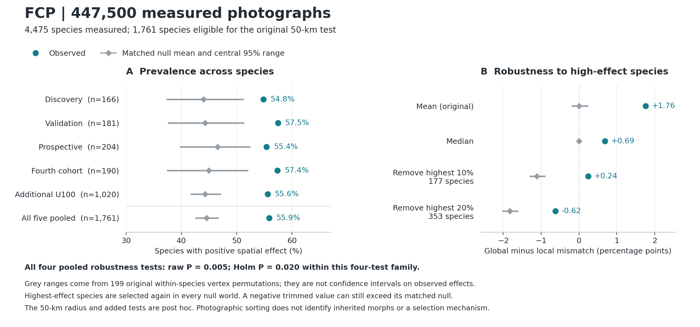

# FCP: geographic photograph-colour sorting beyond high-effect species

**Completed 18 October 2026.** A new local computation from all **447,500 authentic measured photograph rows** reproduced the original five-cohort 50-km inference and the complete historical four-cohort robustness result before extending the distributional tests to all five cohorts. The added tests are explicitly post hoc.

## Scientific result

**The positive mean spatial effect is accompanied by a positive species median and an excess of species with positive effects under the original composition-preserving null. Removing the highest-effect 10% or 20% of species also leaves a statistic above its equivalently selected null distribution.** The photographic pattern therefore extends beyond the upper tail of the species-effect distribution. It remains heterogeneous and does not establish genetically inherited flower-colour polymorphism maintained within natural populations.



## Input and analysis denominators

The source is the [completed original-method measured-data Release](https://github.com/zuizui0223/fcp/releases/tag/fcp-all4730-original-method-actual-colour-results-20261017). The complete 108,115,413-byte archive and the extracted measured CSV were SHA256-verified. These are completed ROI-v4/EfficientSAM measurements, not a photo-ID opportunity list. No original photographs were downloaded again or reclassified for this analysis.

| Stage | Verified denominator |
|---|---:|
| All authentic measured photo terminals read | 447,500 |
| Measured species, exactly 100 photo rows each | 4,475 |
| Photos with a usable original four-state colour label | 227,107 |
| Unclassifiable terminals retained in source accounting | 220,393 |
| Species with at least 40 classifiable photos | 3,297 |
| Species also having at least 30 within-50-km photo pairs | 1,761 |
| Historical first-four-cohort spatial subset | 741 |
| Added fifth-cohort spatial subset | 1,020 |

Photo IDs and observation IDs were both globally unique; the classifiable photo rows had no missing latitude or longitude. All 4,475 species were represented in the input validation, and all 3,297 species eligible for the original spatial pipeline were visited during the replay. The inferential denominator is 1,761 species; it must not be reported as 447,500 independent observations. Unclassifiable photo terminals were not assigned to a colour state.

The five source cohorts contain 500, 500, 499, 498 and 2,478 measured species. Their original spatially eligible counts are 166, 181, 204, 190 and 1,020. The final source retains the earlier exclusion of three newly measured taxa with reused original photo/observation identities.

## What was tested

For species \(s\), the unchanged original statistic is

\[
\Delta_s = D_{\mathrm{global},s}-D_{\leq50\,\mathrm{km},s},
\]

where each \(D\) is the fraction of distinct photograph pairs assigned different coarse colour states. A positive value means that nearby conspecific photographs differ in colour less often than all pairs across that species' sampled range. The finite-pair definition of global diversity is retained.

Within each species, the original colour-state counts, photograph positions and local-pair graph are held fixed. The original 199 complete-vertex colour-label permutations, original stable photo-ID ordering and original random seeds are reused. Species receive equal weight. The null tests the exchangeability of photographic colour labels over the sampled locations; it is not a neutral population-genetic or observation-bias model.

The new primary reporting family contains four statistics on the **pooled 1,761-species effect distribution**: median, fraction with \(\Delta_s>0\), mean after removing the highest-effect 10%, and mean after removing the highest-effect 20%. For each removal fraction, \(\lceil fn\rceil\) species are removed. **The highest-effect species are reselected independently in each null world**, using the same statistic as in the observations.

Upper-tail permutation values use \((1+\#\{T_b\geq T_{obs}\})/200\); the minimum resolvable value is 0.005. Holm correction is applied within these four post hoc pooled tests. Separate four-test Holm families summarize each cohort as exploratory transport checks. These are not corrections across all prior project analyses or a newly preregistered confirmation.

## New pooled results

| Statistic | Observed | Matched null mean | Central 95% of null statistics | Raw upper-tail p | Holm p within the four new pooled tests |
|---|---:|---:|---:|---:|---:|
| Species median | 0.006871278 | 0.000000000 | [0.000000000, 0.000000000] | 0.005 | 0.020 |
| Species with positive effect | 55.8773% | 44.5807% | [42.4730%, 46.7490%] | 0.005 | 0.020 |
| Remove highest 10%: 177 species | 0.002400836 | −0.011097612 | [−0.013029752, −0.008845259] | 0.005 | 0.020 |
| Remove highest 20%: 353 species | −0.006246698 | −0.018277933 | [−0.020266850, −0.016026927] | 0.005 | 0.020 |

The original pooled mean was independently reproduced: **0.017614902**, null mean **0.000044594**, upper-tail p **0.005**. The original mean is a previously frozen test and is not treated as a fifth newly selected robustness statistic. Mean global mismatch was 0.224304520 and mean local mismatch was 0.206689618.

There were **984 positive**, **615 negative**, and **162 exactly zero** observed species effects. The positive-effect proportion exceeded the matched-null mean by **11.2967 percentage points**. This is an aggregate prevalence test; the 984 positive signs are not 984 individually significant species. The matched-null positive fraction is estimated from the actual null worlds and is not assumed to be 50%.

All 199 pooled-null medians equal zero, which is possible for a discrete distribution with ties. This point mass is preserved, not jittered; the upper-tail comparison includes ties. Its degenerate interval is a property of these null statistics, not an absence of uncertainty about biology.

The upper-20% deletion leaves a **negative absolute observed mean**. This must be reported alongside the more negative matched-null mean. Removing high values pushes either distribution down; the valid comparison repeats that selection in the null. The result supports a relative shift after selection, not a claim that all remaining species have positive spatial effects.

## Newly added fifth cohort and historical transport

The fifth cohort contributes 2,478 measured species / 247,800 photos, including 1,020 spatially eligible species. By itself, it has median effect **0.008113630**, positive-effect proportion **55.5882%** versus null mean **44.2709%**, and removal-10%/20% observed means **0.002756730 / −0.006005212**. Each of its four tests has raw p=0.005 and within-cohort Holm p=0.020. Thus the full-data result is accompanied by the same distributional comparisons in the added taxa.

| Cohort | Spatial species | Positive observed effects | Null mean positive fraction | Median effect | Within-cohort Holm p, median / positive fraction / top10 / top20 |
|---|---:|---:|---:|---:|---|
| Discovery | 166 | 54.8193% | 44.0001% | 0.005799093 | 0.030 / 0.030 / 0.020 / 0.020 |
| Validation | 181 | 57.4586% | 44.2877% | 0.007404135 | 0.020 / 0.020 / 0.020 / 0.020 |
| Prospective source cohort | 204 | 55.3922% | 46.5194% | 0.005644141 | 0.020 / 0.020 / 0.020 / 0.020 |
| Fourth cohort | 190 | 57.3684% | 44.9484% | 0.005555766 | 0.020 / 0.020 / 0.020 / 0.020 |
| Additional U100 | 1,020 | 55.5882% | 44.2709% | 0.008113630 | 0.020 / 0.020 / 0.020 / 0.020 |

The old first-four-cohort calculations are backward checks, not new results. Every field under `tests` in the original complete four-cohort JSON was reproduced within absolute tolerance 1e−10, including null quantiles, raw and Holm p-values, and removal counts. The fifth cohort contributes 1,020/1,761 species to the pooled equal-species result; pooling does not give the five cohorts equal weights.

## Ecological interpretation and limits

The strengthened statement is: **conspecific photographed flower colours show a modest geographical sorting pattern distributed across the studied species, with an aggregate shift that is not restricted to the largest individual effects.** The median is smaller than the mean, many effects are negative or zero, and the original mean contrast is about 1.76 percentage points in pairwise mismatch. These magnitudes and the heterogeneity belong beside the p-values.

This analysis does not distinguish spatial environmental variation, migration and drift, phenotypic plasticity, cultivated plants or geographically patterned photographic classification. It does not estimate true morph frequencies, protected polymorphism, local adaptation, gene flow or reproductive isolation. The radius and distributional follow-ups remain post hoc and share the original iNaturalist/ROI measurement ecosystem.

The [existing stricter local site-month analysis](FCP_LOCAL_POLYMORPHISM_MAINTENANCE_VS_SPECIATION_20261018.md) remains separate: its 194-species 5-km, same-year-month, independent-observer test was not supported (p=0.300; at 30 local pairs, 14 species, p=0.275). The new broader-scale robustness result does not change either negative result or turn the atlas into evidence of within-population genetic morph maintenance. No manuscript submission status or frozen prospective H2 decision is changed here.

## Reproduction and inspectable outputs

All outputs are in [`results/fcp_real_447500_robust_matched_null_20261018/`](../results/fcp_real_447500_robust_matched_null_20261018/):

- `result.json`: complete new results, historical checks and input/output hashes.
- `group_statistic_summary.csv`: all five cohorts plus pooled; original mean and four new statistics.
- `species_50km_observed.csv`: observed effects for the 1,761 taxa, with original classifiable/pair counts; no coordinates or observer identifiers.
- `matched_vertex_nulls.npz`: aligned numeric taxon IDs, cohort codes, observations and the 1,761 × 199 null matrix. Load with `allow_pickle=False`.
- `execution_receipt.json`: local execution, library versions, code hashes and independent identity checks.
- `source/`: byte-identical original release receipt and complete historical four-cohort robustness JSON, retained for replay without relying on the lifetime of an Actions artifact.

The input release archive SHA256 is `99f7ee68c3fd009e8ab60fd0cfcdf1fb407e3a8de07edd38341b27889310bc25`. Its measured-CSV SHA256 is `8e7f10f0427927208485b2da6fa9c46bb681d6f3611e53b8dfdc606cfc8dabe6`. The code verifies every required extracted member and the historical full-result SHA before calculation.

From the repository root, after downloading and safely extracting the measured-data Release:

```bash
OPENBLAS_NUM_THREADS=1 OMP_NUM_THREADS=1 PYTHONPATH=. python \
  scripts/analysis/run_fcp_447500_robust_matched_null_20261018.py \
  --extracted-root /path/to/extracted-original-release \
  --historical-result results/fcp_real_447500_robust_matched_null_20261018/source/fcp_original_199700_robust_matched_null_result.json \
  --outdir /path/to/replayed-results

MPLCONFIGDIR=/tmp/fcp-matplotlib python \
  scripts/analysis/plot_fcp_447500_robust_matched_null_20261018.py \
  --results /path/to/replayed-results \
  --outdir /path/to/replayed-figures

PYTHONPATH=. python -m unittest discover -s tests \
  -p test_run_fcp_447500_robust_matched_null_20261018.py -v
```

This execution used Python 3.12 with NumPy 2.3.5, pandas 2.2.3 and SciPy 1.17.0; the exact Python version is in the execution receipt. The original numerical results were checked rather than assuming that installed versions imply reproducibility. The plotted null intervals are central 95% ranges of matched null statistics, not confidence intervals for observed effect sizes.
