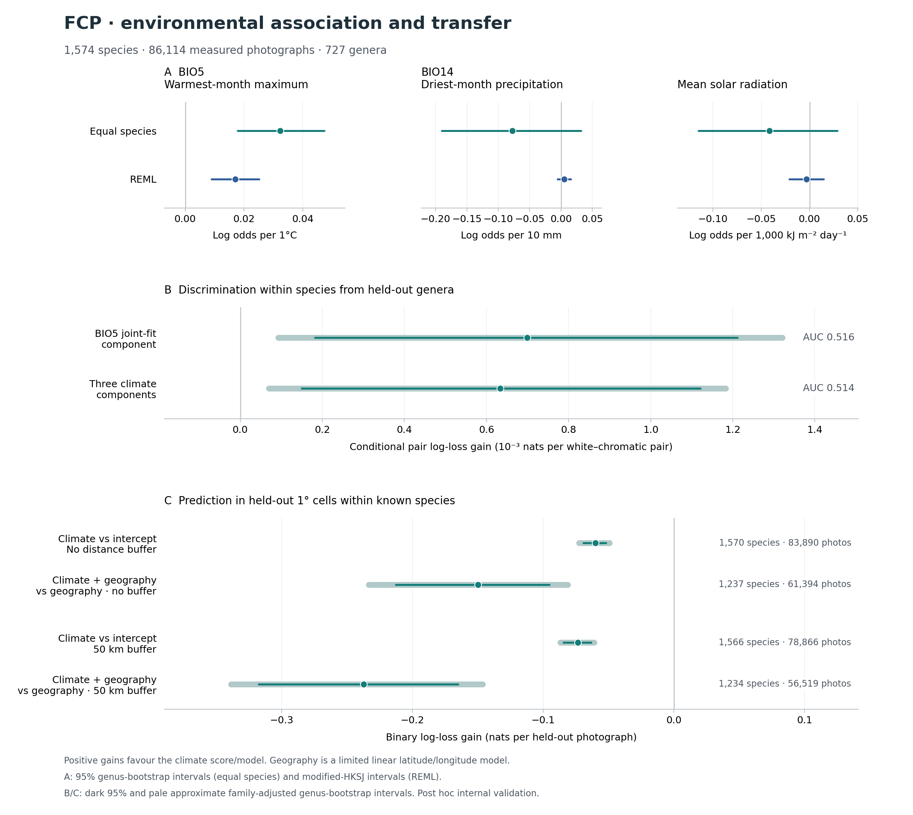
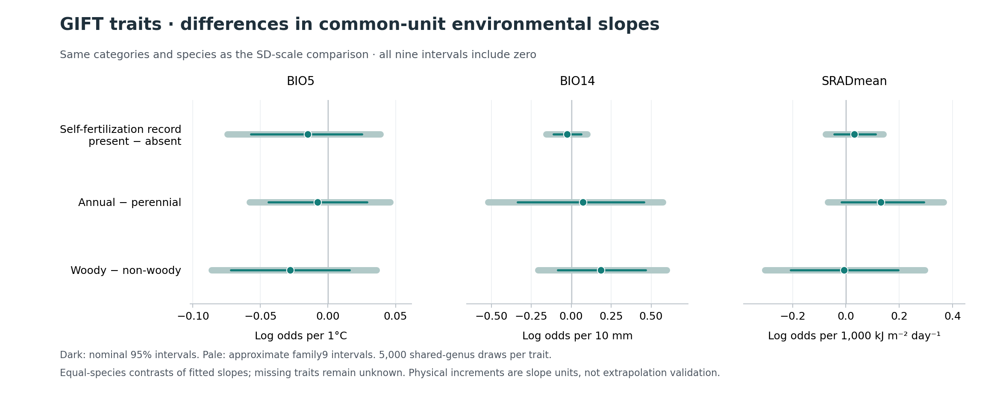

# FCP：共通単位での環境応答、未知の属・場所への予測、分子比較の拡張

2026-10-19。4,475種・447,500枚の真正な実測写真に基づく、種内の白―有色の分化を対象とする追加解析。前回の[環境・GIFT・分子対応](FCP_447500_ENVIRONMENT_MODEL_TRAIT_BRIDGE_20261018.md)を引き継ぎ、同じ1,574種・86,114枚の環境パネルで検証を進めた。

## 今回の生物学的な結論

**最暖月の最高気温（BIO5）と白方向との小さな種内関連は、同じ1℃に単位をそろえても残った。属を丸ごと学習から外しても、白と有色の順位を識別するごく小さな情報が残った。一方、保留した空間セルへの予測では、50 kmバッファー条件を含む四つの規定比較すべてで、種別環境モデルの予測誤差が増えた。**

したがって現段階の主張は、多数種にわたる弱い平均的傾向と、その地域的な予測の限界である。全種の分化を説明する普遍的な適応則や、色素の資源コストの実証には達していない。

植物形質による特徴づけも、種ごとに異なる1 SDではなく同じ環境増分への応答を比較するため、同じ物理単位で再実行した。**自家受精の記録・生活史・木本性と3環境軸の9比較では、今回も差を明瞭に分離できなかった。** 分子側では検索を広げ、原因候補の異なる種内比較と、色型×乾燥処理を再解析するための実試料対応を追加した。分子の詳細と解析済みの範囲は第5節に記す。



## 1. 対象と、比較を固定した時点

元の447,500枚のうち、粗い花色分類と7環境変数が得られた227,078枚から、種あたり分類済み写真≥40枚、白・有色が各≥5枚という既存の条件を維持した。主パネルは**1,574種・86,114枚・727属**。3変数モデルを使うことを理由に、7変数のcomplete-case条件を変更していない。

環境はWorldClim 2.1、1970–2000年平年値、10分グリッドである。BIO5は最暖月の最高気温、BIO14は最少雨月降水量、SRADmeanは12か月平均の日射量。撮影日や花芽形成期の気象、UV強度を直接測っていない。[変数定義](https://www.worldclim.org/data/bioclim.html)、[平年値・単位](https://www.worldclim.org/data/worldclim21.html)。

[追加解析プロトコル](FCP_ENVIRONMENT_TRANSPORT_PROTOCOL_20261019.md)で、共通単位、属・セルの分割、予測モデル、損失、距離バッファー、比較群を新しい結果を見る前に固定した。ただし写真パネルと変数選択は前回すでに調べている。これは既存研究に対する**事後的な内部検証**であり、新規に事前登録した確認研究や、独立したデータ源での検証ではない。

実測の写真を白と分類した場合を1、その他3色を0とする。写真上の分類は、個体の遺伝的な色型、自然集団で維持された多型、同一機構による白化を保証するものではない。選択したパネルから、全4,475種の多型頻度を推定しない。

## 2. 同じ物理単位への換算でも、温度の関連は残る

既存の3変数同時Firth回帰の傾きと3×3共分散を、BIO5は1℃、BIO14は10 mm、日射は1,000 kJ m⁻² day⁻¹あたりに換算した。種s・変数jの元の種内SDをs_j、指定した増分をd_jとすると、

\[
b'_j=b_jd_j/s_j,\qquad V'_{jk}=V_{jk}d_jd_k/(s_js_k).
\]

個々の種のモデルを再当てはめした操作ではない。同じ観察点での予測確率、傾きの符号、Wald統計量は変わらない。一方、種ごとに違うSDで割り直すため、種別傾きの平均の推定対象とREMLの重みは変わる。元の「各種で1 SDあたり」の平均と、今回の「同じ1℃あたり」の平均は異なる問いに答える。

| 環境増分 | 種等重みの平均log odds | 属ブートストラップ95%区間 | REML平均 | modified-HKSJ 95%区間 |
|---|---:|---|---:|---|
| BIO5：1℃ | **+0.03233** | **[+0.01786, +0.04728]** | **+0.01708** | **[+0.00897, +0.02518]** |
| BIO14：10 mm | −0.07761 | [−0.19000, +0.03159] | +0.00486 | [−0.00569, +0.01541] |
| 日射：1,000 kJ m⁻² day⁻¹ | −0.04164 | [−0.11506, +0.02889] | −0.00327 | [−0.02107, +0.01453] |

BIO5の種等重み平均を指数変換したオッズ比の幾何平均は**約1.033**、REML平均では**約1.017**である。「白型の割合が1℃で3.3ポイント上がる」という意味ではない。降水と日射を同時に含む写真上の条件付き関連である。

降水の種等重み平均とREML平均の違いには、観察された気候幅の小さい種の不安定さが関係する。BIO14の種内SDが小さい下位5%の79種は、全種平均−0.07761のうち**−0.08634**を寄与し、独立性を仮定した近似標本分散和の**79.31%**を占めた。最小SDは0.175 mmであり、115種では今回の10 mmという傾きの単位が、その種で観察された降水幅を超えた。これらの種を結果に応じて除いてはいない。

1℃というBIO5の増分は、全対象種で観察されたBIO5の幅以内だった。日射の指定増分は43種で観察幅を超えた。物理単位への換算は、未観察の大きな環境変化に対する外挿を検証する操作ではない。

種間分散の近似プロファイル区間は、今回の3軸でも0を含んだ。これは真の種間差を明瞭に分離できていないことを意味し、全種で同じ生理反応が起きる証明ではない。

一次出力：[主集計](../results/fcp_environment_native_units_20261019/primary_summary.csv)、[種別傾き・共分散](../results/fcp_environment_native_units_20261019/species_slopes.csv)、[気候幅の診断](../results/fcp_environment_native_units_20261019/environment_range_diagnostics.csv)、[小さい気候幅の寄与](../results/fcp_environment_native_units_20261019/range_tail_contributions.csv)。

## 3. 普遍性を、未知の属と未知の場所で別々に検証した

### 3.1 学習に使わない属でも、ごく小さな識別情報が残る

種名の最初の語を属とし、属を丸ごと10群に分けた。各群を予測するとき、その属の全種を係数の学習から外した。残りの属の既存の種別傾きから、共通物理単位でREML平均を推定し、保留した種の写真に適用した。保留種の傾き、色ラベル、白型の比率を使ってスコアを決めていない。

二つのスコアを固定した。一つは3変数同時モデルの**BIO5成分**、もう一つは3成分全部である。BIO5だけを新たに単変量で当てはめた比較ではない。

各種の中で白写真と有色写真の全組合せを作り、白がより高いスコアになるかを評価した。主指標は、スコア差δに対するlog(1+exp(−δ))の平均を、情報がないときのlog(2)から引いた改善量である。種の平均は等重みとした。764,081ペアを独立反復とせず、727属を単位に2,000回再標本化した。

| 保留属へのスコア | 条件付きペアlog loss改善量 | 2比較の近似補正区間 | AUC | AUCの名目95%区間 |
|---|---:|---|---:|---|
| BIO5成分 | **+0.000699 nats** | **[+0.000092, +0.001321]** | **0.51606** | [0.51022, 0.52190] |
| 3環境成分 | **+0.000634 nats** | **[+0.000069, +0.001183]** | **0.51440** | [0.50861, 0.52018] |

全1,574種・86,114枚を評価できた。AUCは0.5が識別情報のない基準なので、未知属に通じる情報は小さい。BIO5成分のAUCが0.5を上回った種は55.40%だったが、これは有限標本で得た種別スコアの割合であり、55.40%の種で遺伝的な温度適応を証明したものではない。

2スコア間の優劣を選択・検定する分析はしていない。3変数を使えば普遍性が強まるという結果にはなっていない。白型の絶対頻度を予測・校正する検証でもない。

### 3.2 空間保留では、種別環境モデルの予測誤差が増えた

全写真の位置を緯度・経度1度のセルへ分け、セルを5群に割り付けた。同一セルの写真を学習と評価へ分けていない。さらに、評価する同種写真から50 km以内にある学習写真を除く条件を追加した。1度セルだけでは、学習写真と評価写真の最短距離は保証されない。

種と評価群ごとに、残った学習写真≥20枚という条件で、切片のみ、3環境変数、線形の緯度・展開経度、地理＋環境の4モデルを当てはめた。説明変数の中心・SDと経度の原点は学習写真だけから求めた。学習写真が全部同じ色になった場合も、数値的に推定可能なら残した。

比較する二つのモデルには同じ学習写真を使用し、評価写真も両モデルで予測可能な同じ写真だけにそろえた。主指標は「基準モデルのbinary log loss−環境を含むモデルのbinary log loss」。各種内では評価写真をまとめて平均し、その後に種へ等しい重みを与えた。**正なら改善、負なら悪化**である。

| 距離条件 | 比較 | 評価種数／写真数 | log loss改善量 | 4比較の近似補正区間 |
|---|---|---:|---:|---|
| セル保留・追加バッファーなし | 環境 vs 切片 | 1,570／83,890 | **−0.05992** | **[−0.07257, −0.04938]** |
| セル保留・追加バッファーなし | 地理＋環境 vs 地理 | 1,237／61,394 | **−0.14978** | **[−0.23332, −0.08117]** |
| セル保留・50 kmバッファー | 環境 vs 切片 | 1,566／78,866 | **−0.07345** | **[−0.08693, −0.06098]** |
| セル保留・50 kmバッファー | 地理＋環境 vs 地理 | 1,234／56,519 | **−0.23732** | **[−0.33889, −0.14620]** |

**四つとも悪化し、副指標のBrier scoreも四つとも悪化した。** 50 km条件では、環境vs切片のlog lossは0.52731から0.60076へ、地理へ環境を加えた比較では0.66176から0.89907へ上がった。

外挿も含まれる。環境モデルの評価写真のうち、いずれかの説明変数が学習範囲外だった割合は、バッファーなしで14.65%、50 km条件で16.48%。地理＋環境モデルでは22.64%、25.79%だった。評価可能な種・写真も変わっているため、二つの距離条件の差を距離そのものの因果効果とはしない。

### 3.3 この二つの結果を、どうつなげて解釈するか

未知属へのスコアは、多数の学習種から求めた小さな共通係数を使う。一方、空間保留では、各種の限られた学習写真から複数の傾きを個別に推定する。**学習の単位、モデル構造、評価する損失が異なるため、二つの改善量を直接差し引いて「一般化の落差」と定量化しない。**

今回の結果からは、小さな平均的関連を個別の種・地域へ移すには、現在の種別モデルの推定精度と説明変数が十分でない、と考えられる。有限標本、外挿、地理や撮影条件の未測定要因は、この不十分さを説明しうる。ただし、それらの寄与を今回の比較で分解したわけではない。

空間予測の不支持は保存し、良い結果だけを選ばない。同時に、今回の四つのモデルが予測を改善しないことを、気候の生理作用が存在しない証拠にも変換しない。種別係数の縮約を用いる別の予測法は、今回の空間比較では試していない。

一次出力：[未知属の集計](../results/fcp_environment_transport_20261019/genus_summary.csv)、[未知属の種別結果](../results/fcp_environment_transport_20261019/genus_species_metrics.csv)、[空間保留の集計](../results/fcp_environment_transport_20261019/spatial_summary.csv)、[空間保留の種別結果](../results/fcp_environment_transport_20261019/spatial_species_metrics.csv)。実際の写真IDと予測値、全当てはめ・除外・外挿の記録も[同ディレクトリ](../results/fcp_environment_transport_20261019/)へ保存した。

## 4. 植物形質で特徴づける結果は、単位をそろえても明瞭にならない

GIFT 3.2の同じ記録・採用規則・種集合を維持し、共通単位へ換算した未縮約の種別傾きで9比較を再実行した。各形質の2群と3軸には、同じ属再標本化の重みを使った。各形質5,000回の再標本化で、名目95%区間と9比較に対する近似補正区間を保存した。

| 前者−後者の傾きの差 | BIO5：1℃ | BIO14：10 mm | 日射：1,000 kJ m⁻² day⁻¹ |
|---|---|---|---|
| 自家受精 present−absent（177／200種） | −0.01495 [−0.05724, +0.02519] | −0.02501 [−0.11244, +0.06171] | +0.03092 [−0.04304, +0.11161] |
| 一年草−多年生（253／1,070種） | −0.00765 [−0.04416, +0.02898] | +0.07345 [−0.33497, +0.45493] | +0.13047 [−0.01722, +0.29213] |
| 木本−非木本（277／1,161種） | −0.02795 [−0.07185, +0.01596] | +0.18475 [−0.08460, +0.46741] | −0.00732 [−0.20659, +0.19675] |

表は名目95%区間。9本とも0を含み、補正後も同じ結論だった。粗い生活史・繁殖記録・木本性では応答差を明瞭に説明できていない。形質が無関係、または群が同等であることを証明した結果ではない。

自家受精の記録は実現自殖率や送粉者依存度と同義ではなく、形質欠測も無作為とは仮定しない。属の再標本化は全系統共分散の調整ではない。[GIFT公式の記録・集計定義](https://biogeomacro.github.io/GIFT/reference/GIFT_traits.html)。



一次出力：[9比較](../results/fcp_environment_native_units_20261019/slope_modifier_contrasts.csv)、[SD単位との対応](../results/fcp_environment_native_units_20261019/gift_scale_comparison.csv)。

## 5. 分子比較を実際の試料・発現表まで広げる

### 5.1 文献注釈を増やし、検索分母と種内比較を対応させた

ENAの植物・転写産物データを対象に、flower/petalとpigment/anthocyanin/carotenoid/color/colourを組み合わせた固定タイトル検索を実行した。追加検索は682ラン・65プロジェクト。前回との重複12ランを除いた和集合は801ラン・78プロジェクトとなった。

| 検索集合 | ラン | プロジェクト | 実測名簿に一致した種 | 環境パネルに一致した種 |
|---|---:|---:|---:|---:|
| 前回の検索 | 131 | 15 | 7 | 2 |
| 今回の拡張検索 | 682 | 65 | 12 | 5 |
| 重複を除いた和集合 | 801 | 78 | 16 | 6 |

ラン数は生物学的な反復数や独立した白化の起源数ではない。タイトル検索に該当しない研究、普通名・学名中の検索語、栽培品種や部分的な花弁領域の比較を区別し、全65プロジェクトの判断を残した。個別アクセッションへの追加調査は、検索分母へ混ぜていない。

一次論文の追加確認によって、環境対象のMatthiola incana、Centaurea cyanus、Antirrhinum majusに6比較を追加した。文献整理の和集合は**14分類群・24比較・39比較×器官行**。環境パネルで発現・変異・介入の証拠が対応する対象は**4種から7種へ増えた**。ただしAntirrhinumの比較は、赤い模様を残す部分的な白化である。

| 追加した種内の証拠 | 生物学的な意味 | 証拠の範囲 |
|---|---|---|
| Matthiola：ANSのフレームシフト、ANSとbHLH2変異の組合せ | 同じ種内で、合成酵素と調節因子の複数の制御点が白方向へつながる | 商業品種の配列・発現・化学。白6品種はANSの同じ変異を共有し、6独立起源ではない |
| Centaurea：白品種の色素と経路発現 | 白化とアントシアニン欠如・発現変化が対応する別の種内事例 | 一次抄録まで確認。方法・反復を全文確認した注釈と区別 |
| Antirrhinum：Elutaによる発現抑制と花弁上の模様 | 色素経路を空間的に抑える調節が、色のない領域を生む | 介入・転移因子の証拠。全面が白い花とは区別。RNA比較には遺伝子型と採取年の交絡 |

一次文献：[Matthiola 2021](https://doi.org/10.2503/hortj.UTD-212)、[Centaurea 2019](https://doi.org/10.1016/j.plaphy.2019.06.018)、[Antirrhinum 2024](https://doi.org/10.1111/nph.19866)。別の[Matthiola 2025研究](https://doi.org/10.1111/pbi.70193)の発現・代謝物比較と公開ゲノムも対応させたが、アーカイブの5色ラベルと本文の3品種、試料の発育段階がそのまま一致しないため、論文の試料部分集合を推測していない。

この7種は選択的な文献確認で得た、材料と比較内容の異なる集合である。分子機構別の環境応答を代表的な多数種回帰として推定できる規模・標本設計とはしなかった。同じ撮影個体の分子測定がないことを理由に、種レベルの文献注釈を排除したわけではない。

### 5.2 公開発現表から、3経路遺伝子の比較を計算した

GEOの[GSE93879](https://www.ncbi.nlm.nih.gov/geo/query/acc.cgi?acc=GSE93879)から元の処理済みFPKM表を取得し、CHS/TT4、DFR/TT3、ANS/LDOXの3参照遺伝子行を抽出した。**36列別発現値と12遺伝子×色比較の平均比を実際に計算した。** 生リードの再マッピングやカウントデータを用いた差次発現解析ではなく、p値は計算していない。

試料列を明確に対応できたOrychophragmus violaceusでは、原登録の表現型は**white-violet（白紫色）対violet（紫色）**であり、純白対紫ではない。GEOは各型2生物学的反復、半開花期・温室材料と記載している。提出者のArabidopsis参照遺伝子への対応に基づく計算で、各種のオーソログを再確認した値ではない。

| 提出表の参照遺伝子行 | 白紫色の2列（FPKM） | 紫色の2列（FPKM） | 白紫色／紫色の列平均比 | log2比 |
|---|---|---|---:|---:|
| CHS / TT4 | 1,276.950；1,266.510 | 287.325；273.543 | **4.535** | **+2.181** |
| DFR / TT3 | 503.585；500.976 | 117.217；33.884 | **6.648** | **+2.733** |
| ANS / LDOX | 25.606；67.625 | 458.167；93.681 | **0.169** | **−2.565** |

**ANS対応行が低い一方、CHS・DFR対応行は高い。** 今回抽出した3行に限っても、一様な発現低下では説明できない。経路の末端側の制限は検討できる仮説だが、RNA量は酵素活性や代謝フラックスではなく、ここから原因変異・資源節約・適応を確定しない。紫色のANS値のばらつきも大きく、元の個別値を表に示した。

さらに原GEOの処理記述はBrassica rapaとArabidopsisの参照名を整合的に記していない。この比較は**提出済みの参照割当表で見えるパターン**として扱う。種の参照配列とマッピングを整理した生リード再解析が必要な点を残す。数値の一次資料は[元のOrychophragmus FPKM表](https://ftp.ncbi.nlm.nih.gov/geo/series/GSE93nnn/GSE93879/suppl/GSE93879_Orychophragmus_violaceus.genes.fpkm_table.xls.gz)と[今回計算した比較表](../results/fcp_molecular_expansion_20261019/pathway_fpkm_label_conditional_ratios.csv)であり、別の一次論文がこの比を報告したと帰属しない。

Matthiolaでは、提出表の白の列名W1が二つあり、W2の列名がない。二列を勝手にW1/W2へ置き換えず、元の列名・順序と未解決の試料IDを保存した。両方が白という提出ラベルに条件づけたANSの平均比は、lavenderとpinkに対して約0.31倍、modenaに対して約1.85倍だった。比較する有色型によって方向が変わる。独立した白2反復を確認した結果や、2021年論文のANS変異をこのRNA試料で検出した結果とはしない。

一次出力：[元の列ごとの発現値](../results/fcp_molecular_expansion_20261019/pathway_fpkm_per_source_column.csv)、[列・試料・表現型の対応](../results/fcp_molecular_expansion_20261019/processed_expression_column_map.csv)、[12比較](../results/fcp_molecular_expansion_20261019/pathway_fpkm_label_conditional_ratios.csv)。Lobulariaの元表は列区切りが欠けており、試料対応を補完せず計算から外した。

### 5.3 色型×乾燥を比較できる18試料を特定した

公開プロジェクト[PRJNA1475932](https://www.ebi.ac.uk/ena/browser/view/PRJNA1475932)に、Orychophragmusの白・淡紫・紫の3色と、control・drought_30%の2処理があった。全18試料の公式メタデータを取得し、実アクセッションへ対応した比較表を作成した。

| 提出された花色 | control | drought_30% |
|---|---:|---:|
| 白 | 3試料 | 3試料 |
| 淡紫 | 3試料 | 3試料 |
| 紫 | 3試料 | 3試料 |

これは具体的な**3色×2処理×3提出試料**の候補である。ただし独立個体・プールの単位、処理期間、対照区の水分、無作為化は確認できていない。プロジェクト記載の複数の灌水水準を、公開RNA試料の処理水準へ増やして数えない。

色型が処理前に決まった遺伝的な型なら、色型ごとの乾燥応答の比較へ進められる。一方、処理後の花色で試料を分けたのであれば、環境によって生じた表現状態の比較になり、遺伝子型×環境の適応としては解釈できない。この前後関係が判別点である。

公式の論文リンクと文献検索では、このデータに対応する一次論文を確認できなかった。登録者によるプロジェクト要約中の効果量は、検証済みの乾燥効果として採用していない。今回実行したのは[18試料の設計・アクセッション表](../results/fcp_molecular_expansion_20261019/drought_factorial_sample_sheet.csv)の作成までで、乾燥試料のRNA差次発現解析や適応度比較は未実行である。

## 6. 色素のコストと利益に関して、何が絞れたか

白―有色は、種内変化を比較する表現型の方向として有用である。前回の50 km効果の分解では白―有色成分が83.81%だったが、元の異色ペア量でも同成分は79.57%あった。83.81%を、白化が独立進化した種の割合や、色素コストの説明率としない。[元の分解と分母](FCP_WITHIN_SPECIES_ENVIRONMENT_PIGMENT_MECHANISMS_20261018.md)。

今回の温度との関連から、直接検証する価値があるのは、合成資源の節約だけでなく、花の放射吸収・冷却・水消費を介する負担である。ただしこれは**写真の関連と先行実験を合わせた仮説**であり、今回その経路を推定したものではない。

同種の色型を比較したVinca minorの実験は、濃色花がより多くの短波放射を吸収し、蒸散による潜熱放散も大きくなることを調べている。濃色型の耐熱性の高さと熱負荷を同時に扱っており、「色素を作る資源費」だけに議論を閉じない理由になる。[Li et al. 2026, New Phytologist](https://doi.org/10.1111/nph.71163)。この一種の結果を、今回の1,574種すべてへ移してはいない。

分子比較の共通点も、同じ遺伝子がすべての種で変わることとは限らない。色素合成酵素の活性、発現を制御する因子、器官ごとの制御範囲が異なっていても、写真上は白方向へ動きうる。花で可視色素が減ったことと、無色のフラボノイドや葉・茎の防御投資が減ったことは、別々に測る必要がある。例えばSilene littoreaでは、花弁のみに及ぶアントシアニン喪失と、複数器官に及ぶ喪失が区別されている。[一次研究](https://doi.org/10.1186/s12870-019-2082-6)。

普遍性を問う比較単位は、**独立した種内の色型比較を複数の種・集団・遺伝的背景に置くこと**である。同種比較は種固有の基準差を抑えるが、種内の血縁・集団史は残る。種別応答を多数種で比較する段階では系統依存も残る。今回、未知属への予測を実行することで、そのうち一段階を検証した。

| 生物学的な問い | 今回進んだ点 | 実証に必要な次の観測単位 |
|---|---|---|
| 同じ種でなぜ色が異なるか | 酵素・調節因子・色素系を区別した文献注釈と発現資料の拡張 | 同じ集団・色型の遺伝子型、器官別代謝物、共通環境での反応 |
| 環境応答の共通性はあるか | 共通物理単位でBIO5の正の平均、未知属で小さい識別情報 | 新しい種・地域を保留した継続的な予測と独立した観測源 |
| 種内の地域的な分化を説明できるか | 四つの空間保留比較の不支持を確認 | 集団構造・撮影偏り・局所環境と、推定誤差を扱う予測設計 |
| 色素の負担と利益が交換されるか | 熱・水収支の仮説と、色型×乾燥の実試料表へ接続 | 色型ごとの花温・水消費・代謝フラックス・生存・種子生産 |
| なぜ複数の型が残るか | 色の生成機構と維持機構を区別した | 頻度、遺伝子型、環境をまたぐ相対適応度・遺伝子流動 |

環境条件で適応度の順位が変わることは、条件依存のトレードオフを支持しうる。しかし単なる発現差、色型比率の変化、環境との相関だけでは、費用と利益の双方や、多型の長期維持を同定できない。

## 7. 予測方法と不確実性の扱い

Firthの推定は完全分離・小標本での係数の発散を抑えるが、予測確率の平均を0.5方向へ動かしうる。[Firth 1993](https://doi.org/10.1093/biomet/80.1.27)、[Puhr et al. 2017](https://doi.org/10.1002/sim.7273)。

空間保留の本実行・評価値を見る前に、比較するモデルの学習内の平均確率を同じ基準へそろえる規則を追記した。傾きは変えず切片を調整し、学習写真の平均予測確率を(n_white+0.5)/(n_train+1)に一致させた。すべての空間予測にこの補正を使用し、結果を見て未補正と使い分けていない。これは平滑化した共通基準への補正で、通常のFLICそのものではない。評価場所での確率の校正を保証するものでもない。

保存した最大線形予測子分散は、元のFirth係数共分散を用いた診断値である。切片補正後の予測の分散や予測区間を計算した値として使わない。

属保留はSHA256(`FCP-20261019-genus10-v1:属名`)による10分割、空間保留はSHA256(`FCP-20261019-global1deg5-v1:セルID`)による5分割。緯度・経度は全球の1度セルを用い、経度±180度の同一性を処理した。50 kmの除外距離は大円距離である。構造を考慮した保留の意味は[Roberts et al. 2017](https://doi.org/10.1111/ecog.02881)を参照。

属を単位とした区間は、学習済みの保留予測に対する経験的な安定性の指標である。2,000回の各再標本化の中で、全学習モデルを再推定したものではない。交差検証群の学習部分の重複も残る。補正区間は今回固定した2比較・4比較・9比較の各群に対する近似区間で、研究全体の過去の探索を一括補正したものではない。

位置・観察者・園芸由来・露出・背景・季節などの未測定要因、粗い花色分類、種内標本選択の限界は引き継ぐ。全系統樹と残差空間共分散を持つ一段階モデル、自然集団の遺伝的多型頻度、適応度の測定は今回の実行範囲に含まれない。

## 8. 実行、検証、再現資料

新規の共通単位6件・予測16件・分子5件と、それらが依存する既存の環境モデル7件・GIFT3件の**計37件の対象テストが、unittestで通過**した。全リポジトリのテストや新規GitHub Actionsの通過を意味しない。

共通単位への換算では、1,574種すべての共分散と86,114枚すべての既存予測を確認し、元の予測確率との差は最大6.66×10⁻¹⁶だった。実データを用いた270件のREML数値スケール確認も通過した。属・空間保留では保存した実際のlogitから種別損失を再構築し、差は最大5.33×10⁻¹⁵、学習平均確率の校正目標との差は最大6.18×10⁻¹⁴だった。50 km条件の最短の残存学習距離は50.0013 kmである。成功した51,650当てはめに数値的な非収束はなく、特徴量の識別可能性や学習数の不足は除外記録に残した。

保存時に写真ID表の圧縮末尾が欠けていた問題は、真正な原入力と同じ並べ替え・分割から全86,114枚の表を再構築し、元の読み出せた全行と一致することを確認して修復した。また、浮動小数点の丸めだけで学習範囲の境界点を外挿と数える問題を、元の物理値と数値許容幅を使う診断へ修正した。どちらも当てはめ、予測値、損失、ブートストラップ結果を変更していない。実行時のコード、修正内容、前後のハッシュは[予測の実行記録](../results/fcp_environment_transport_20261019/execution_receipt.json)に保存した。

分子の再計算は独立に元の圧縮表から36個のFPKM値を照合し、差は0だった。12個のlog2比の再計算差は最大4.86×10⁻¹²で、CSVの出力桁による差の範囲だった。82入力と17出力のハッシュ、18乾燥試料と6比較セル、未解決の白試料IDを保持したことも確認した。[分子と統合記述のレビュー](reviews/FCP_MOLECULAR_EXTENSION_SYNTHESIS_REVIEW_20261019.md)。

```bash
OPENBLAS_NUM_THREADS=1 PYTHONPATH=. python -m unittest \
  tests.test_fcp_environment_native_units_20261019 \
  tests.test_fcp_environment_transport_20261019 \
  tests.test_fcp_molecular_expansion_20261019 \
  tests.test_fcp_447500_environment_model_20261018 \
  tests.test_fcp_gift_modifiers_20261018 -q
```

共通単位の解析：

```bash
OPENBLAS_NUM_THREADS=1 PYTHONPATH=. python scripts/analysis/run_fcp_environment_native_units_20261019.py \
  --inputs-root /workspace/scratch/2b742620c4bf/fcp_inputs
```

属・空間保留の解析：

```bash
OPENBLAS_NUM_THREADS=1 PYTHONPATH=. python scripts/analysis/run_fcp_environment_transport_20261019.py \
  --photos /workspace/scratch/2b742620c4bf/fcp_inputs/full447500/measured/fcp_all4730_original_method_measured_photos.csv.gz \
  --worldclim-root /workspace/scratch/2b742620c4bf/fcp_inputs/worldclim_frozen \
  --outdir results/fcp_environment_transport_20261019
```

保存した空間予測NPZは、転送サイズを抑えるためZIP_LZMAへ可逆圧縮し直した。10配列は、配列名・順序・型・形状・値に加えて、展開後のNPYバイト列も元の出力と完全に一致した。集計、当てはめコード、検定結果は変更していない。圧縮前後のハッシュと検証は実行記録に残した。通常の再実行はDEFLATEで出力するため、同じ保存形式にする場合は次を実行する。

```bash
python results/fcp_environment_transport_20261019/repack_spatial_predictions_20261019.py \
  results/fcp_environment_transport_20261019/spatial_oof_predictions.npz \
  results/fcp_environment_transport_20261019/spatial_oof_predictions.npz
```

図は保存済みCSVから直接作成し、21個の点推定と区間を[作図値の表](../results/fcp_environment_transport_synthesis_20261019/plotted_values.csv)にも保存した。図Aは環境軸ごとに物理増分と表示範囲が異なり、軸の重要度を直接順位づける図ではない。図BとCの損失は評価単位が異なる。

```bash
MPLCONFIGDIR=/tmp/fcp-mpl-20261019 OPENBLAS_NUM_THREADS=1 PYTHONPATH=. \
  python scripts/analysis/plot_fcp_environment_transport_20261019.py
```

- [共通単位の全出力と実行記録](../results/fcp_environment_native_units_20261019/)
- [属・空間保留の全出力と実行記録](../results/fcp_environment_transport_20261019/)
- [分子拡張の原資料](../data/evidence/fcp_molecular_expansion_20261019/)
- [分子拡張の解析表](../results/fcp_molecular_expansion_20261019/)
- [独立レビュー](reviews/FCP_COMMON_UNITS_TRANSPORT_REVIEW_20261019.md)

前回のSD単位の結果と、今回の不支持を含む保留予測は別の推定対象として保持している。弱い平均的関連、地域への予測の限界、分子・器官制御の多様性を合わせて、次の種内比較を設計するための実測結果とする。
