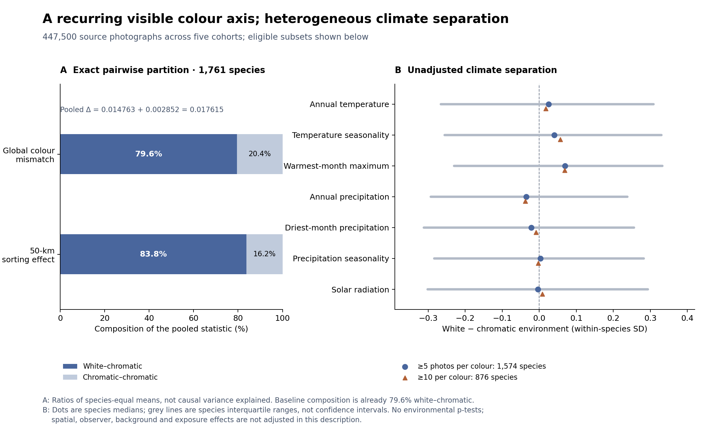

# FCP：種内の白―有色分化を、環境・色素機構・種横断の共通性へつなぐ

2026-10-18。対象は4,475種・447,500枚の真正な実測写真。FCPの種内比較を中心とし、MOISの種間花色組成や季節集計とは推定対象を分ける。

**後続の実行結果：** 本稿の記述段階に続き、3環境軸の同時種内モデル（二段階近似）、GIFTの植物形質による9比較、分子・器官別の証拠対応を実行した。[環境モデル・形質・分子対応の結果報告](FCP_447500_ENVIRONMENT_MODEL_TRAIT_BRIDGE_20261018.md)を参照。本稿で「設計」とした全項目が完了したわけではなく、系統を含む一段階GLMM、生リード再解析、適応度実験は未実行である。

**中心質問：同じ種の中で、どの環境にどの花色が現れ、その対応の共通性と違いを、色素経路・器官間の制御・繁殖様式で説明できるか。**

今回、(1) 元50 km空間効果の白―有色／有色―有色への厳密加法分解、(2) 全5コホートの7環境変数による種内環境差の記述診断を実行した。以下の階層環境モデル、系統を含む種別傾きの推定、分子の生データ再解析、適応度実験は設計であり、実行済み結果として扱わない。



## 1. 今回の実測結果：白―有色軸を優先する定量的な根拠

元解析と同じ1,761種、同じ写真、同じ全ペア分母と50 km以内の辺を用いた。白写真を削除せず、各写真ペアの不一致を次のように分けた。

\[
I(c_i\ne c_j)=I(\text{片方だけ白})+I(c_i\ne c_j,\ \text{両方有色}).
\]

したがって、種ごとの空間効果も \(\Delta_4=\Delta_{W-C}+\Delta_{C-C}\) となる。元の199回の種内ラベル入れ替えでも同じ分解を行い、保存済みの1,761×199＝350,439個の元total帰無値と完全一致した。加法恒等の最大数値誤差は1.94×10⁻¹⁶。

| 同じ1,761種の種等重み平均 | 種全体の不一致率 | 50 km以内の不一致率 | 差Δ | pooled差に占める記述的比 |
|---|---:|---:|---:|---:|
| 元の4色合計 | 0.224304520 | 0.206689618 | 0.017614902 | 100% |
| 白―有色 | 0.178479695 | 0.163716454 | **0.014763241** | **83.81%** |
| 有色―有色 | 0.045824825 | 0.042973165 | **0.002851661** | **16.19%** |

追加したpooledの2成分検定は、ともに上側p=0.005、今回2検定内のHolm補正後p=0.010。事後解析であり、以前の検定群やプロジェクト全体への多重性補正ではない。コホート別は記述のみとし、新たなp値を付けていない。白―有色成分の平均は全5群で正、有色―有色成分は第4群で負だった。

**83.81%は種の割合でも、原因を説明した分散割合でもない。** 種等重みの平均効果を分解した比である。もともとの種全体の異色ペア量でも白―有色成分が79.57%を占める。大部分が白を含む比較として現れることは示せるが、この比だけで白化に特有の生物学的機構の優越を検定したことにはならない。

写真上の複数状態の頻度にも、定義による差がある。

| ≥40枚が分類可能な3,297種に対する記述 | 種数 |
|---|---:|
| 2つ以上の粗い色状態が観察された | 3,029 |
| 白≥1枚かつ有色≥1枚 | 2,963：複数状態種の97.82%、全3,297種の89.87% |
| 白≥5枚かつ有色≥5枚 | 1,574：全3,297種の47.74% |

「1枚でも異なる色がある」という定義を、自然集団の遺伝的多型の頻度にしない。露出、淡色の閾値分類、花以外の領域、発達段階も含み得る。元H2の9色組成の白軸への二乗整列度Wも、白型頻度や白を含む多型種の割合ではない。

実測出力：[分解結果](../results/fcp_real_447500_white_axis_decomposition_20261018/result.json)、[成分集計](../results/fcp_real_447500_white_axis_decomposition_20261018/component_summary.csv)、[全種の写真組成](../results/fcp_real_447500_white_axis_decomposition_20261018/species_photo_composition.csv)。

## 2. 今回の実測結果：全5コホートの環境差

既存FCPの環境解析はBIO5・BIO14・日射の3変数だった。第三コホートのBIO5白方向の関連は、他コホートや観察者統制では一貫せず、共通の温度則としては確定していない。参照：[旧環境結果](../results/polymorphism_white_environment_mechanism_20260925/result.json)、[他コホート検証](../results/polymorphism_legacy_white_bio5_replication_20260925/result.json)、[観察者感度](../results/polymorphism_white_environment_observer_sensitivity_20260925/result.json)。

今回は固定済みWorldClim 2.1のBIO1/4/5/12/14/15と12か月平均日射を、各実測写真の座標へ対応させた。BIO5は**最暖月の最高気温**で、温度季節性はBIO4。[変数定義](https://www.worldclim.org/data/bioclim.html)、[平年値・単位](https://www.worldclim.org/data/worldclim21.html)に従う。10分グリッドの1970–2000年長期平年値であり、撮影日や花芽形成時の気象ではない。年平均日射はUV曝露そのものでもない。

- 分類済227,107枚のうち、全7変数が得られたのは227,078枚。29枚でラスタ値が欠測。
- 同じcomplete-case写真から、分類可能≥40枚かつ白・有色が各≥5枚：**1,574種・86,114枚**。
- 各≥10枚の感度パネル：**876種・47,402枚**。
- 主パネルはdiscovery / validation / prospective / wave4 / new_U100で184 / 167 / 196 / 180 / 847種。

各種の記述量は

\[
d_{sk}=\frac{\overline E_{W,sk}-\overline E_{C,sk}}{\mathrm{SD}(E_{sk}\mid\text{その種の全complete-case写真})}.
\]

各種の撮影環境のばらつきを尺度にした**環境的位置の差**であり、気候が1単位変わったときの白率の回帰係数ではない。全種を等重みで要約した。

| 変数 | 種中央値d | 種間の四分位範囲 | 観測差が正だった種割合 |
|---|---:|---:|---:|
| BIO1：年平均気温 | +0.0249 | [−0.2656, +0.3086] | 52.54% |
| BIO4：温度季節性 | +0.0403 | [−0.2553, +0.3301] | 53.68% |
| BIO5：最暖月最高気温 | **+0.0692** | [−0.2299, +0.3322] | **56.10%** |
| BIO12：年降水量 | −0.0348 | [−0.2929, +0.2381] | 46.76% |
| BIO14：最乾月降水量 | −0.0218 | [−0.3119, +0.2560] | 47.33% |
| BIO15：降水季節性 | +0.0032 | [−0.2839, +0.2819] | 50.32% |
| SRADmean：平均日射 | −0.0037 | [−0.3011, +0.2931] | 49.49% |

BIO5の原単位差の中央値は白側+0.1386°C、四分位範囲[−0.5595, +0.8457]°C。各色≥10枚でも標準化差中央値は+0.0687。コホート別のBIO5中央値は−0.0025 / +0.0846 / +0.0439 / +0.0690 / +0.0815であり、一律の強い温度応答ではない。

**この診断は未調整の記述で、p検定も要因重要度の順位付けもしていない。** 他の環境変数、種内空間構造、栽培、観察者、背景、白飛びを調整した同時モデルではない。全5コホート共通のnear-clip技術表もまだない。「観測差が正だった56.10%」を「真に高温へ白方向に反応する種が56.10%」と呼ばない。過去の技術調整済BIO5検定の再現とは別の推定対象である。

実測出力：[全7変数・5群の集計](../results/fcp_real_447500_environment_description_20261018/group_environment_summary.csv)、[対象・欠測・方法](../results/fcp_real_447500_environment_description_20261018/profile.json)。

## 3. 次の主解析：種内の環境対応を、種横断の普遍性へつなぐ

### 3.1 種内の効果と種間の生息環境を分ける

「白の多い種は暖地に分布する」と「同じ種の白型が有色型より暖かい場所にいる」は異なる問い。FCPは後者を主対象にする。種内中心化はこの混同を防ぐ基本操作である [1]。

写真i、種sについて、白を1とした二項モデルの設計は、

\[
\operatorname{logit}(p_{si})=\alpha_s+\sum_k(\beta_k+b_{sk})\widetilde E_{sik}+g_s(\mathrm{位置}_i)+u_{\mathrm{観察者}}+h_s(\mathrm{日付})+\gamma^\top Q_i.
\]

ここで、αsは種の基準白率、βk+bskは種ごとの環境傾き、gは種内空間構造、hは季節・撮影時点、Qは測定品質。日付は種内交絡の調整に用い、MOISの全体季節白率をFCPへ戻すものではない。縮小推定を用い、各40–100写真から13本の独立な自由傾きを安定して推定できると仮定しない。

主推定対象は、適格な各種の傾き・予測差を推定した後の種等重み平均、種間分散、潜在的な同方向種割合、未観測種への予測区間。単一の共通傾きが有意かだけで普遍性を判定しない。写真数や二項情報量で寄与が変わる共通傾きモデルと、種等重みの集約も区別する。

### 3.2 環境要因と植物の特徴を対応させる

| 機能仮説 | 優先環境軸 | 種別傾きの違いを説明する候補特徴 |
|---|---|---|
| 花の放射吸収と冷却の負担 | 高温、日射、水分、必要ならVPD・風 | 花のサイズ・形、花弁の透過/反射、花特異的な色素制御 |
| 色素経路の保護機能 | 低温・乾燥・強光 | 花と葉/茎の色素の結び付き、色素化学、生活形 |
| 送粉上の利益 | 送粉環境、開花時期 | 送粉者依存度、自家和合性・自殖、花形・報酬 |
| 栄養・水分制約 | 土壌、水収支、地形 | 草本/木本、一年草/多年草、資源配分 |

これらは候補仮説であり、画像から自動的に色素型や送粉機能を割り当てない。実測または独立に検証された形質データで関連付ける。候補特徴の欠測や、文献がある種だけへの選抜も記録する。

温度×水分、日射×水分など、機構に対応する少数の交互作用を事前指定する。すべての変数対を探索して事後的に物語を付けない。「最強の要因」は標準化係数の最大値ではなく、新しい場所での予測改善と、温度・水分・光など相関する変数群を外したときの改善量で評価する。これは予測上の寄与であり因果寄与とは別である。

### 3.3 PCAの使い方

PCAは併用できる。ただし生の全写真環境にPCAをかけると、熱帯種と温帯種などの種間の分布差が支配し得る。種内を問う主解析では、種内中心化した環境に、種等重みを反映した共分散を使う。標準化・PCA・欠測補完・軸数は訓練側で固定し、評価側へ適用する。

共通の物理尺度で割れば同じ環境変化量の反応、各種のSDで割ればその種の環境範囲に対する相対反応になる。この二つを同じ係数として比較しない。PCAの全体直交性は各種内の共線性や十分な環境範囲を保証しない。

主解析は機構を解釈できる少数の環境軸、補助解析は広い環境集合/PCAとする。今回の7変数の記述を13変数同時モデルや土壌・地形を含む全面検証と呼ばない。

## 4. 種内比較なら系統は不要か

同一種の白と有色を比較することで、種間の基準色、花の基本構造、共有する系統的背景を大きく揃えられる。種固定効果は種内で不変な差を吸収する。固定された観測種集合を記述するだけなら、系統補正は必須ではない。

一方、近縁種が似た色素制御や環境傾きを共有することは、種固定効果では消えない。未観測種への一般化や独立な反復を主張する段階では、種別傾きに系統共分散を持たせるモデルと、非系統の種間差を分ける [2]。

\[
\operatorname{Cov}(b_{\cdot k})=\sigma^2_{\mathrm{phy},k}A+\sigma^2_{\mathrm{sp},k}I.
\]

系統あり/なし、属・科の保持検証を比較する。既知種の新しい地域、未知種、新しい属・科をそれぞれ別の評価問題とする。写真のランダム分割だけで種を越えた一般化を評価しない [3]。未知種では切片が未推定なので、条件付き予測または明確に分離した少量の校正データを使う。

同じ種の内部にも集団遺伝構造・移住史・雑種化があり得る。これは種間系統樹だけでは調整できない。写真の環境対応から遺伝的反応規範や局所適応を推論するには、共通園または集団遺伝データとの対応が必要になる。

## 5. なぜ同一種で分かれるのか：競合する原因

| 原因仮説 | 同種内で分化する理由 | 他の仮説と区別する証拠 |
|---|---|---|
| 遺伝的差＋環境依存の選択 | 場所によって白・有色の相対適応度が変わる | 共通園で色差が保持され、環境操作で相対適応度が交差する |
| 可塑性 | 同じ遺伝子型でも環境で花色発現が変わる | クローン/同一系統を複数環境に置くと色が可逆的に変わる |
| 変異・発生の偏り | 同じ経路の異なる変化が白という終点へ到達しやすい | 独立変異の機能・組織を比較し、変異供給と選択後頻度を分ける |
| 器官間の制約の回避 | 花だけ変えれば葉・茎の保護機能を保持できる | 花弁と葉/茎を同時に測り、機能の分離を確認する |
| 移動・集団史 | 中立遺伝構造や移住によって色型が地理的に偏る | 中立マーカー、複数集団、環境を交差した実験 |

同種という分類は全個体が同じ遺伝子型であることを意味しない。また白―有色という共通の表現型が、すべて同じ原因から生じるとも限らない。

## 6. 色素のコストと利益：重要な仮説だが、白さはコストの測定ではない

Warren & MackenzieのNew Phytologist研究は5多型種を乾燥/十分な水の環境で比較し、条件によって有色と非有色の相対的な成績が変わることを示した。全身のアントシアニン有無という解釈を伴う系であり、花だけ色を失う系へそのまま一般化しない [4]。

Boechera strictaでは共通園・環境操作を組み合わせ、遺伝的な標高由来差と可塑性、食害、乾燥による着色、十分な水での白型の繁殖上の利点を調べている。花色への直接選択と、葉の防御への間接選択を分ける手本になる [5]。

一方、Vinca minorでは暗色花がより多くの放射を吸収し、冷却のための蒸散が増える。熱耐性が高くても自然放射下の温度上昇を相殺しきらない条件がある。したがって「有色なら高温に強い」という単一方向ではなく、光・水・冷却を含めた負担を問う必要がある [6]。

さらにMoricandia arvensisの白い夏花は、可視アントシアニンがなくてもUV吸収性フラボノイドを多く含む。白化が色素投資全体の消失ではなく、化学的な配分変更になり得る [7]。同じ白さから省資源を逆算しない。

作業仮説は、**「色素制御の器官特異性と生合成経路が、白―有色変異の生じやすさ・伴う機能差を決め、環境ごとの利益と負担がその分布を選別する」**とする。平均環境傾きが小さい場合でも、測定された器官間の結び付きや色素系で正負を事前予測できれば、条件付きの共通原理になる。どの方向も後から説明できる仮説にはしない。

## 7. 分子解析の単位と、今使える公開データ

白―紫/桃/青ではアントシアニン経路が有力な候補となるが、黄・橙・赤をすべてアントシアニンありと分類しない。カロテノイド、ベタレイン、液胞pHや輸送、色素の分解も別に扱う。可視RGBは色素量・化学・遺伝子型の直接測定ではない。

Parrya nudicaulisの白花はCHSの発現が花弁で低い一方、葉・萼で同じ低下を示さない。花弁と栄養器官の制御の分離を示す例で、原因MYBや色素生産費用を同定した研究ではない [8]。Silene littoreaではF3h1/Myb1a等の候補発現差が報告されるが、一貫して色型を分けるSNPや原因変異の機能検証が確立したと扱わない [9]。

分子の比較単位は**種×色型の対比×独立な変異/集団×組織**。種にPAL（花弁のみのアントシアニン消失）/WAL（全身の消失）のどちらか一つを付ける設計は避ける。同一種に両方の仕組みが存在し得る。現時点で全4,475種に機構ラベルがあるわけではない。

分子台帳には、独立な対比ID、野生/園芸、色型、化学的色素同定、花弁/葉/茎、発達段階、環境処理、生物反復、遺伝子/orthogroup、構造遺伝子coding変化・調節因子coding変化・cis/trans制御・発現相関の区別、証拠段階、公開アクセッションを保存する。「MYBが関与」と「cis-regulatory変異を同定」は同義ではない。

| 公開データ候補 | 実際の対比 | 最初に問えること | 限界 |
|---|---|---|---|
| Silene littorea：SRP033277 [9] | 3色型×3発達段階の9ライブラリ | 候補経路・paralog・段階依存の発現の再確認 | 各色×段階の独立生物反復が不足。技術的再シーケンスを反復として数えない |
| Parrya nudicaulis：SRA028419 [10] | 2集団×白/紫の4 pooledライブラリ | 2集団での経路の方向一貫性、CHSと他経路の比較 | pool内3–5個体を独立ライブラリと数えない。集団/微環境差が残る |

これらのraw-read再解析は今回実行していない。候補の発見に使えるが、2種の少数ライブラリから4,475種に共通する分子則を確定しない。公開データの追加探索は、花色と組織が対になり生物反復を識別できる研究を優先する。ゲノムに色素遺伝子があるだけの種や、葉のRNA-seqしかない種を花色機構の検証済み種にしない。

分子で問う共通性は「すべて同じ遺伝子」だけでなく、経路の同じ機能段階、調節/構造変化、花弁特異的制御の反復である。研究された目立つ変異や園芸種への偏りがあるため、文献件数を自然界の機構頻度にしない。

## 8. トレードオフを判別する最小の実験構造

環境モデルから選んだ温度・水分・光の候補を、同じ遺伝背景に近い白/有色系統へ交差させる。色型を一つの地域からだけ採り、環境と集団史を完全に重ねない。複数集団・独立家系を入れる。

- **遺伝性/可塑性**：共通園、クローンまたは分離家系を複数環境へ配置。
- **器官別の機能**：花弁と葉/茎のアントシアニン、UV吸収性成分、必要な色素系を同時測定。
- **負担と利益**：花の温度、水損失、障害・生存、種子生産を測定。可能なら種子数だけでなく繁殖成功を複数年評価。
- **送粉の寄与**：手授粉と自然授粉を分け、生理的な差と送粉過程の差を比較。
- **色素生産自体の費用**：花特異的な変化や近同質系統、可能なら遺伝子機能の救済を使う。発現低下だけで節約を実証したことにしない。

白/有色の相対適応度が環境によって交差すれば、環境依存のトレードオフを支持する。しかし、空間的に両色が存在することだけでは局所的な平衡選択を示さない。変異供給、可塑性、移住による維持との識別を保つ。

## 9. 実行・検証・次の成果物

今回の2つの実測解析は、元JPEGを再取得・再測色せずに実行した。白分解は4件、環境診断は6件の専用テストと全件計算を通過。環境入力は両ZIPのSHAと全18使用TIFFのZIP member一致まで認証し、元の空間帰無値も完全再現した。数値・コードは独立レビューを行った。これはローカル実行で、GitHub Actionsの新たな合格を意味しない。

```bash
python -m scripts.analysis.run_fcp_447500_white_axis_decomposition_20261018 \
  --extracted-root /path/to/extracted-original-release \
  --outdir /path/to/white-axis-decomposition

python scripts/analysis/summarize_fcp_447500_within_species_environment_20261018.py \
  --photos /path/to/extracted-original-release/measured/fcp_all4730_original_method_measured_photos.csv.gz \
  --worldclim-root /path/to/worldclim-with-authenticated-zips-and-extracted-bio-srad \
  --outdir /path/to/environment-description

PYTHONPATH=. python -m unittest discover -s tests \
  -p '*447500*20261018.py' -v
```

環境診断の完全な実行コマンドと入力/出力ハッシュは[execution receipt](../results/fcp_real_447500_environment_description_20261018/execution_receipt.json)にある。

次の成果物は、(i) 種別の環境傾きと未知種/属への予測を評価する階層モデル、(ii) その傾きの違いを色素系・器官間の結び付き・繁殖様式で説明する対比表、(iii) 独立な白/有色×組織の分子データ台帳。ここで示した設計と、今回の未調整記述・空間分解の実行結果を区別して進める。

## 一次文献・方法論

1. van de Pol & Wright (2009). Within- versus between-subject effects. [10.1016/j.anbehav.2008.11.006](https://doi.org/10.1016/j.anbehav.2008.11.006).
2. Hadfield & Nakagawa (2010). Comparative phylogenetic and multi-trait mixed models. [10.1111/j.1420-9101.2009.01915.x](https://doi.org/10.1111/j.1420-9101.2009.01915.x).
3. Roberts et al. (2017). Structured cross-validation. [10.1111/ecog.02881](https://doi.org/10.1111/ecog.02881).
4. Warren & Mackenzie (2001). Why are all colour combinations not equally represented as flower-colour polymorphisms? [10.1046/j.1469-8137.2001.00159.x](https://doi.org/10.1046/j.1469-8137.2001.00159.x).
5. Vaidya et al. (2018). Ecological causes and consequences of flower color polymorphism in a self-pollinating plant (Boechera stricta). [10.1111/nph.14998](https://doi.org/10.1111/nph.14998).
6. Li et al. (2026). Thermal regulation of flowers: color-driven differences in radiation absorption, cooling, and heat tolerance. [10.1111/nph.71163](https://doi.org/10.1111/nph.71163).
7. Narbona et al. (2026; online 2025). Heat drastically alters floral color and pigment composition without affecting flower conspicuousness. [10.1002/ajb2.70096](https://doi.org/10.1002/ajb2.70096).
8. Dick et al. (2011). Arctic mustard flower color polymorphism controlled by petal-specific downregulation. [10.1371/journal.pone.0018230](https://doi.org/10.1371/journal.pone.0018230).
9. Casimiro-Soriguer et al. (2016). Transcriptome and biochemical analysis of a flower color polymorphism in Silene littorea. [10.3389/fpls.2016.00204](https://doi.org/10.3389/fpls.2016.00204).
10. Butler et al. (2014). Transcriptome analysis of a petal anthocyanin polymorphism in Parrya nudicaulis. [10.1371/journal.pone.0101338](https://doi.org/10.1371/journal.pone.0101338).
