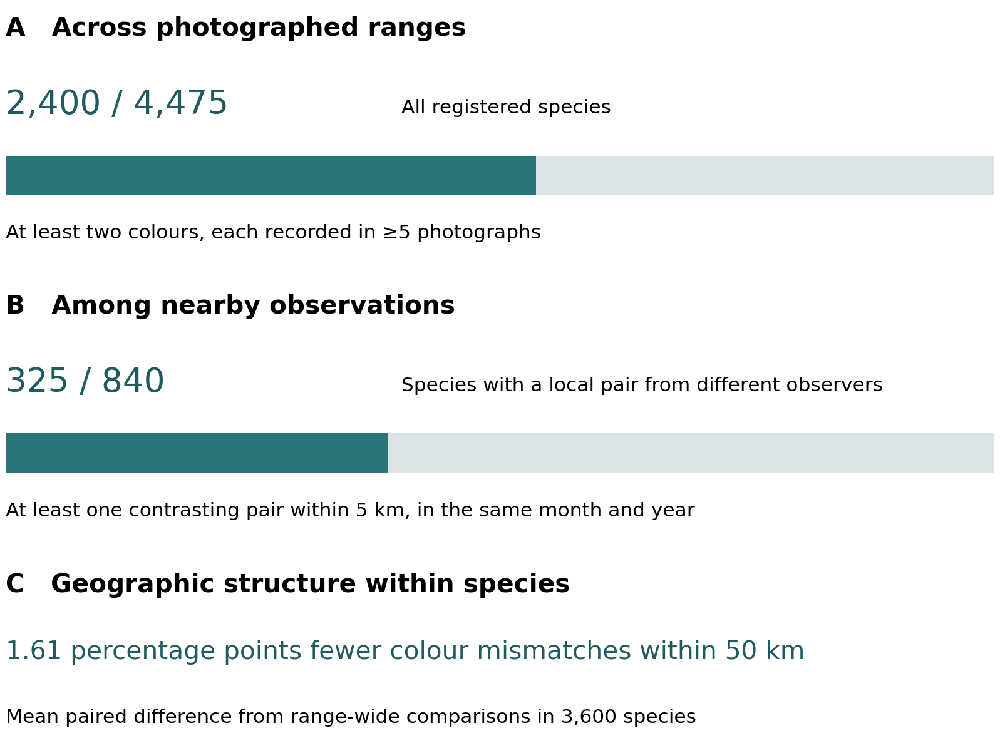
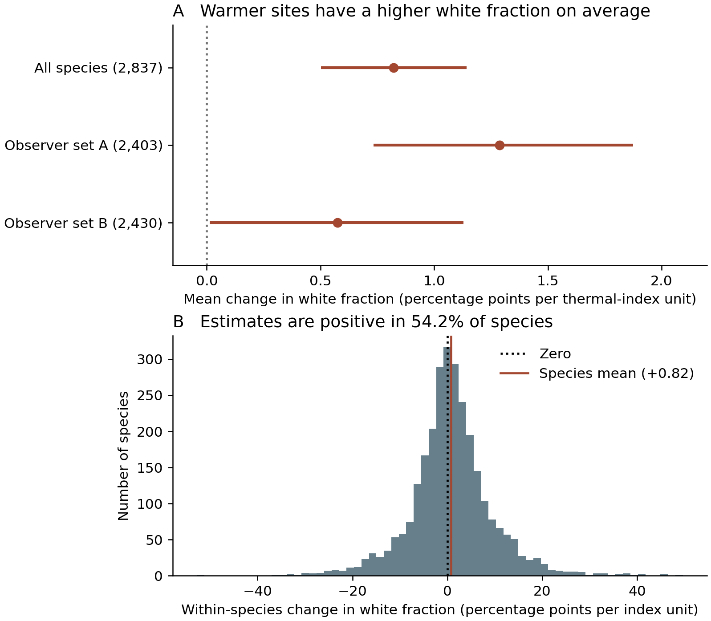

# Temperature and geographic structure of within-species flower colour variation in angiosperms

**Authors:** [Author list and order to be confirmed]

**Affiliations:** [Institutional affiliations to be confirmed]

**Corresponding author:** [Name and contact to be confirmed]

**Running title:** Temperature and within-species flower colour

## Summary

- Flower colour varies geographically within species. We asked whether warmer sites share a direction of colour change across species and how consistently individual species follow that direction.
- We selected 4,475 angiosperms by photographic coverage before assessing colour. We compared nearby and range-wide photographs and estimated within-species associations between the white fraction of the photographed flower region and a temperature index, accounting for broad geography, month and other climatic gradients.
- Conspecific photographs within 50 km differed in colour category 1.61 percentage points less often than range-wide pairs. Across 2,837 species with temperature estimates, the white fraction increased by a mean of 0.82 percentage points per within-species temperature-index unit. The mean was positive in two independent sets of photographers, yet only 54.2% of species estimates were positive. The middle half ranged from −3.46 to +4.96 percentage points.
- A small tendency towards white at warmer localities coexists with spatial clustering and considerable variation among species. Contrasting colours recorded near one another identify sites where their persistence and relative reproductive success can be tested in the field.

**Key words:** angiosperms, citizen science, flower colour, geographic variation, intraspecific variation, polymorphism, temperature

## Introduction

The geographic distribution of alternative flower colours poses a problem for the study of polymorphism. Two colours recorded for a named species may co-occur in a breeding population, replace one another across its range, or arise as a flower ages. Those observations suggest different explanations for the persistence of variation. A broad comparative survey can ask which visual contrasts recur and how they are distributed before asking whether distinct, heritable morphs coexist locally (Narbona et al., 2018).

Warmer localities may differ in the colours produced by the same genotype, in the frequencies of genotypes, or in the floral tissues and stages photographed. A repeated association across species would identify a direction of phenotypic variation along a temperature gradient. Demonstrating selection would also require evidence that the variants differ in reproductive success under those conditions.

Warren & Mackenzie (2001) showed that combinations of flower-colour variants occur at unequal frequencies in the British flora. Studies of geographic differences in floral colour have since linked colour to biotic and abiotic conditions across species (Dalrymple et al., 2020), and found that colour within individual species can be spatially structured even where the association with climate is weak (Luong et al., 2023). Within-species spatial differentiation may also reflect population history or local ecological processes (Schemske & Bierzychudek, 2007). This leaves open how often contrasting colours recur across a species’ photographed range, how often observers encounter them close together, and how those contrasts relate to environmental gradients.

We first asked how closely conspecific flowers resemble each other across geographic distances. We then tested whether the fraction of white pixels in the photographed flower region changes with temperature within species, how widely slopes vary among species and whether their mean recurs across independent observers. Finally, we compared precipitation and soil properties on the same geographic scale to put the thermal association in context.

## Materials and Methods

### Source photographs and the common taxonomic register

We selected species from georeferenced iNaturalist flowering records using photographic coverage before examining flower colour. Species entered the final sample when 100 eligible photographs could be retained under the observer limits. Prior evidence of flower-colour polymorphism was not a selection criterion. The final dataset comprised 4,475 angiosperm species with 100 photographs each (Supporting Methods S1).

A flower-region image pipeline combined detection and segmentation with a normalized nine-colour photographic palette. The components were white, yellow, orange, red, pink, magenta, purple, blue and bronze. For categorical analyses, an originally fixed classifier assigned images to white, yellow/orange, red/pink or blue/purple. Exactly **227,107 original photos (50.75%)** yielded classifiable colour measurements. The remaining 220,393 records were retained as unclassified rather than assigned a colour. Fig. 3 shows four original records alongside their archived measurement outcomes. The panels were selected to illustrate a visible colour difference, a discrepancy between petal appearance and the measured region, and a failed classification. Supporting Methods S1 and Table S1 identify the sources and selection procedure.

We use the term **photographic floral colour variation** for all source-derived traits. A photographed colour class is an observed appearance, not by itself a proven hereditary morph or a single biological floral organ. Species with insufficient classified photographs, geographic pairs or sampled climate contrasts are represented by missing estimates in the relevant analysis rather than inferred zero effects.

### Range-wide counts and local comparison opportunities

We used each registered species once in the range-wide count. We required five or more classified photographs in each of at least two of the four categories, irrespective of location. For the local comparison we screened all registered species for pairs of classified conspecific records from distinct identified observers, separated by at most 5 km and dated to the same calendar month and year. Only species with at least one eligible pair entered the local denominator. A species contributed once to the local numerator if any eligible pair had different labels. These descriptive counts have different sampling requirements. The 50-km mismatch statistic below addresses the separate question of excess geographic similarity.

### Species-conditional geographic structure

We estimated geographic colour organization using the same-species difference between **range-wide colour mismatch** and mismatch among conspecific photographic records within a chosen radius. For the four categorical appearances, this quantity is positive when local conspecific records are more similar than the species-wide photographed colour composition predicts. The principal comparison used a 50-km radius; additional thresholds and distance scales were treated as supporting analyses.

For each species, photo-colour labels were permuted among fixed sampled geographic positions, preserving the exact category counts, photo locations and source sampling opportunity. A species contributed one estimate to the across-species mean. We assessed 50-km photo-pair opportunity using the complete 4,475-taxon roster; species without eligible nearby classified photo pairs were not assigned a spatial effect. Observer thinning retained at most one photo per original observer within a named species.

To test whether spatial organization depended on the coarse four-colour discretization, we repeated spatial comparisons using **base-2 Jensen–Shannon divergence** (JSD) between the full original normalized nine-palette vectors. We compared 5-, 25-, 50-, 100- and 250-km distances, with month-matched colour-vector permutations preserving the photographic composition within each named species and calendar month. Genus and species sampling opportunities were retained at their observed values. The 50-km continuous analysis used 1,761 species under the strict photo-pair design; its observer-thinned counterpart contained 1,655 species.

### Climate sampling and species-level photographic colour associations

Original source locations were linked to the archived WorldClim 2.1 10-arcminute climate normals for BIO1 (annual mean temperature), BIO4 (temperature seasonality), BIO5 (maximum temperature of the warmest month), BIO12 (annual precipitation), BIO14 (precipitation of the driest month), BIO15 (precipitation seasonality) and mean annual solar radiation calculated from 12 monthly fields. These climate values describe the photographed locations, not experimental exposure or necessarily weather at flowering.

Because BIO1 and BIO5 represent correlated aspects of a common thermal gradient, our integrated climatic synthesis used **five fixed, colour-outcome-blind environmental domains**. Within each species, the seven original climate variables were standardized by their photographed standard deviations. The shared thermal level was (zBIO1 + zBIO5)/2; the shared precipitation amount was (zBIO12 + zBIO14)/2. BIO4 temperature seasonality, BIO15 precipitation seasonality and mean solar radiation were retained separately.

For each named species, the five domain variables were first adjusted for photographic calendar month and a broad geographic basis using Earth-centred latitude–longitude coordinates. The residual of the target climate domain was then projected against the other four domains. A domain was estimable only when at least 5% of its original sampled variance remained after adjustment. The source analysis additionally required at least 40 classified, climate-complete original photos, 20 distinct observers and five occupied WorldClim raster grid cells.

The climatic response was the signed covariance between the uniquely residualized domain and each photographic nine-palette fraction, with the exact expectation of within-species/calendar-month permutation removed. Dividing that covariance by the domain's residual variance yielded a **conditional, slope-like photographic association** on each species' standardized climate scale. This is distinct from the per-°C Firth log-odds coefficient and from a causal thermal response. We calculated species-equal mean vectors, their squared alignment with q, and whole-genus bootstrap intervals using 999 resamples. White-direction intervals were evaluated simultaneously across the five fixed environmental domains. All five original taxonomic cohorts were also compared descriptively, and each cohort was omitted in turn in a whole-genus sensitivity analysis.

### Independent-observer photographic replication

Two complementary observer analyses were performed. In the full-source climate model, we deterministically retained one original image per observer within each species and repeated the shared-thermal estimation.

We also tested whether the positive mean could be reproduced without sharing observers across separate photograph sets. Within each species, original observers were assigned to two colour-outcome-blind groups before photo-colour eligibility or climate filtering. The thermal–white coefficient was fitted using only one observer group and then refitted after exchanging the groups. Held-out models preserved the same five environmental domains, geographic/month adjustments and climatic residual requirements, with eligibility recalculated from the held-out photographs. A separate version retained one image per held-out observer. All source taxa remained in the four panel registers. Whole-genus bootstrap intervals used 999 resamples.

### Environmental differences at comparable geographic distances

In the 2,400 species with at least five photographs in each of two or more colour categories, we compared the environmental differences between same-colour and different-colour pairs at similar geographic distances. Paired records came from different observers and different 10-arcminute cells. We compared temperature, precipitation and SoilGrids estimates of pH, clay and total nitrogen on the same pairs, weighting species equally (Supporting Methods S5).

## Results

### Range-wide colour variation and local photographic contrasts

Across their photographed ranges, 2,400 of 4,475 species had at least five photographs in each of two or more colour categories. These counts describe repeated appearances across a species’ photographed range. At a finer scale, 840 species had observations by different photographers within 5 km in the same calendar month and year. In 325 of those species, at least one such pair had different colour labels (Fig. 1). Some local contrasts involved a colour too sparsely sampled to meet the range-wide threshold. The observations identify local sampling opportunities; even this criterion does not establish that the photographed plants exchanged pollen or belonged to a single breeding population. Multiple flowers, organs and developmental stages can contribute to a category, and the sampling frame does not estimate the global prevalence of flower-colour polymorphism.

Nearby conspecific photographs also resembled each other: four-category mismatch within 50 km was 1.61 percentage points lower than range-wide mismatch (3,600 species, P = 0.005; Fig. S2). In a stricter panel of 1,761 species the continuous nine-colour similarity excess was 0.01146 on the base-2 Jensen–Shannon divergence scale relative to month-preserving permutations (P = 0.005). This excess persisted after observer thinning (0.01123, 1,655 species).

### Temperature and the white fraction within species

All 2,837 species with estimable temperature coefficients contributed to the temperature-eligible summary, including those lacking an estimable precipitation coefficient. The mean change in white fraction was +0.00821 (+0.82 percentage points) per thermal-index unit. The median was +0.61 percentage points and the middle half ranged from −3.46 to +4.96 points (Fig. 2b). In total, 54.2% of estimates were positive. The squared alignment of the mean nine-colour vector was 85.4%. Averaging the coefficients before computing alignment allows opposing chromatic shifts in different species to cancel.

The mean white coefficient remained positive with one photograph per observer (+0.00800, 2,771 species), in all five species-disjoint acquisition cohorts, and after omission of each cohort. Two observer-disjoint folds (Fig. 2a) yielded means of +0.01288 (2,403 species; genus 95% interval +0.00733 to +0.01874) and +0.00575 (2,430 species; +0.00012 to +0.01128). Among 1,919 species estimable in both folds, the two species-specific coefficients had Pearson correlation 0.018 (Fig. S4b). Agreement in the direction of the mean therefore provides little information about which species have the largest coefficients. All folds draw on the same platform and measurement procedure.

### Precipitation and soil in geographic context

The mean temperature coefficient vector was more closely aligned with the white–chromatic axis than the mean precipitation vector in the matched sample, but this contrast narrowed when the largest cohort was omitted (Fig. S3, Table S3). In the separate distance-matched comparison, different-colour pairs had a slightly larger temperature difference than same-colour pairs (+0.0089 within-species SD, adjusted 95% interval +0.0017 to +0.0162). Precipitation, pH, clay and total nitrogen showed no consistent excess difference at this grid scale (Table S4).

## Discussion

Warm localities had a slightly higher photographic white fraction on average. The mean retained its sign when photographers were separated, while estimates for individual species varied in both directions and agreed poorly between observer sets. Pooling across species can reveal a small directional tendency even when the sign or magnitude for a particular species is uncertain. The geographic similarity among nearby flowers places this tendency in a spatially structured distribution of appearances.

### Why might a species retain more than one flower colour?

Across a geographic range, different colours could persist if their relative fitness changes among sites or years, or if migrants carry variants between locally differentiated populations. In Linanthus parryae, seed production of white and blue morphs varied among years and across a sharp geographic colour boundary (Schemske & Bierzychudek, 2007). Our temperature slopes describe geographic associations. Reciprocal transplants could test whether local conditions change relative fitness, while a common-garden temperature treatment could test whether a genotype changes colour across thermal environments.

Within a locality, pollinator behaviour could favour a colour when it is rare. Frequency manipulation in the rewardless orchid Dactylorhiza sambucina provides an experimental example (Gigord et al., 2001). Under negative frequency-dependent selection, an internal equilibrium is possible if each heritable morph can increase when rare and departures from equilibrium are reversed. Its frequency need not be one-half. An evolutionarily stable mixture would additionally have to resist invasion by alternative strategies. Neither photographic proportions nor the fraction of positive temperature coefficients estimates those fitness conditions.

Among the 325 species with local colour contrasts, marked plants flowering together could be followed across seasons to establish whether distinct, repeatable morphs coexist. Varying morph frequencies at replicated sites along the thermal gradient and measuring pollinator visits, pollen transfer and seed production would distinguish a rare-morph advantage from an advantage that changes with site temperature. Parentage data could also test whether matings depart from expectations based on local frequencies and flowering overlap.

### Which flower colours do photographs capture?

The two photographs of *Viola lutea* illustrate a change in visible flower colour that the nine fractions capture (Fig. 3a,b). In *Argemone albiflora*, conspicuous white petals surround a yellow centre, yet the extracted region yielded 64% yellow and only 3% white (Fig. 3c). Without an archived pixel mask the relative roles of region selection and palette assignment cannot be recovered for this image. In *Cistus ladanifer*, the photograph shows a white corolla with dark basal marks, but the horizontal-flip check rejected its colour measurement (Fig. 3d). Colour credibility thus depends on the organ and stage visible, the region retained and the measurement passing quality control. The proportion of all source images classified was 50.75%. These selected illustrations provide no estimate of error or climate-dependent missingness across the atlas.

An earlier flower-minus-background comparison with BIO5 gave a near-zero association (rho approximately −0.0033, P = 0.82). That comparison used a different response and predictor, so it qualifies the interpretation of the shared-temperature result without directly testing the same coefficient. Repeating the mean across photographers addresses reuse of individual records. It leaves open systematic differences in illumination, development, observer behaviour and organ visibility across climatic settings. Climate normals describe photographed locations, and a higher white fraction does not identify the concentration of any pigment. A direct botanical test would measure the same open floral organ under standardized illumination at multiple sites within species, with temperature and precipitation sampled separately.

### Conclusions

Across geographically structured observations, the white fraction increased slightly towards warmer sites when species were given equal weight. The wide distribution of slopes identifies the limits of that average as a description of individual species. Establishing how multiple colours persist will require measuring the performance of co-flowering variants across environments and frequencies.

## Acknowledgements

[Funding, data providers, field collaborators and computational contributors to be added after author verification.] We acknowledge the contributors to the photographic biodiversity observations on which the source atlas is based.

## Author contributions

[To be completed and approved by all authors.]

## Competing interests

[To be completed by the authors.]

## Data availability

The [original measured-photo release](https://github.com/zuizui0223/fcp/releases/tag/fcp-all4730-original-method-actual-colour-results-20261017) contains the frozen colour measurements. [Supporting Information](climate_colour/Supporting_Information.md) documents the images, full species register, climate coefficients, uncertainty estimates and source analyses. Photo credits and source links appear with Fig. 3 and in Table S1.

## References

Dalrymple RL, Kemp DJ, Flores-Moreno H, Laffan SW, White TE, Hemmings FA, Moles AT. 2020. Macroecological patterns in flower colour are shaped by both biotic and abiotic factors. *New Phytologist* **228**: 1972–1985. https://doi.org/10.1111/nph.16737

Gigord LDB, Macnair MR, Smithson A. 2001. Negative frequency-dependent selection maintains a dramatic flower color polymorphism in the rewardless orchid *Dactylorhiza sambucina* (L.) Soò. *Proceedings of the National Academy of Sciences USA* **98**: 6253–6255. https://doi.org/10.1073/pnas.111162598

Luong Y, Gasca-Herrera A, Misiewicz TM, Carter BE. 2023. A pipeline for the rapid collection of color data from photographs. *Applications in Plant Sciences* **11**: e11546. https://doi.org/10.1002/aps3.11546

Narbona E, Wang H, Ortiz PL, Arista M, Imbert E. 2018. Flower colour polymorphism in the Mediterranean Basin: occurrence, maintenance and implications for speciation. *Plant Biology* **20** (Suppl. 1): 8–20. https://doi.org/10.1111/plb.12575

Phipson B, Smyth GK. 2010. Permutation P-values should never be zero: calculating exact P-values when permutations are randomly drawn. *Statistical Applications in Genetics and Molecular Biology* **9**: Article 39. https://doi.org/10.2202/1544-6115.1585

Schemske DW, Bierzychudek P. 2007. Spatial differentiation for flower color in the desert annual *Linanthus parryae*: was Wright right? *Evolution* **61**: 2528–2543. https://doi.org/10.1111/j.1558-5646.2007.00219.x

Warren J, Mackenzie S. 2001. Why are all colour combinations not equally represented as flower-colour polymorphisms? *New Phytologist* **151**: 237–241. https://doi.org/10.1046/j.1469-8137.2001.00159.x

## Figures

**Figure 1. Range-wide and local records of within-species flower colour.** (a) All 4,475 species entered the range-wide screen. The numerator counts species with at least five photographs in each of at least two categories. (b) The local screen started from the same register; 840 species had a qualifying pair of classified records from different observers within 5 km in the same month and year. Of those, 325 had a pair with different colours. Grey represents species in each denominator that did not meet its numerator criterion. Species without a qualifying local pair are outside panel b. The local screen did not require the five-photograph threshold in panel a. (c) Difference in the proportion of mismatched pairs within 50 km relative to the photographed range (Fig. S2).

**Figure 2. Temperature and the white fraction of the photographed flower region.** (a) The mean coefficient across all temperature-eligible species and means from two disjoint observer sets. Bars give whole-genus bootstrap 95% intervals (4,000 resamples of the full temperature panel and archived intervals for the observer sets). (b) Distribution of all 2,837 species estimates. Each coefficient is the percentage-point change in white fraction per unit of the within-species thermal index. Zero separates estimated shifts towards and away from white. The middle half spans −3.46 to +4.96 points. Table S2 provides the underlying species estimates.

**Figure 3. What a flower-region measurement captures.** Bars below the images give the nine archived colour fractions within the measured region. (a,b) Photographs of *Viola lutea* differ in the relative amounts of purple and yellow. (c) *Argemone albiflora* has pale visible petals but the region was classified as yellow/orange. (d) The *Cistus ladanifer* record failed the horizontal-flip colour-stability check and contributed no colour vector. Panels show the full packet images; a fitted mask is unavailable. Images reproduced at reduced display size, all CC BY: (a) [ade sills](https://www.inaturalist.org/photos/357540213), (b) [Martin Wood-Weatherill](https://www.inaturalist.org/photos/670131413), (c) [Linda Jo Conn](https://www.inaturalist.org/photos/664177506), (d) [Andre Hosper](https://www.inaturalist.org/photos/23342465). Table S1 records photo IDs and measurements.
