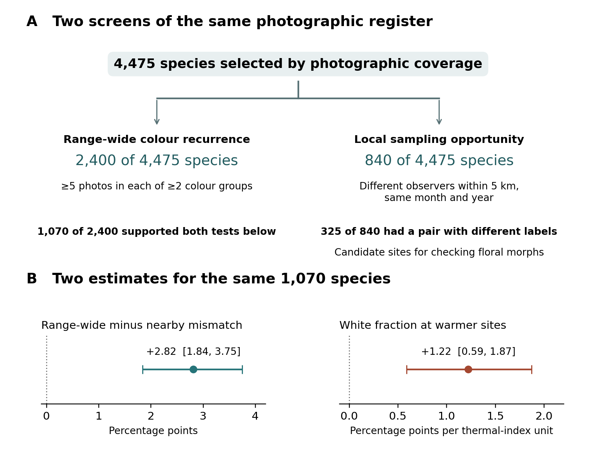
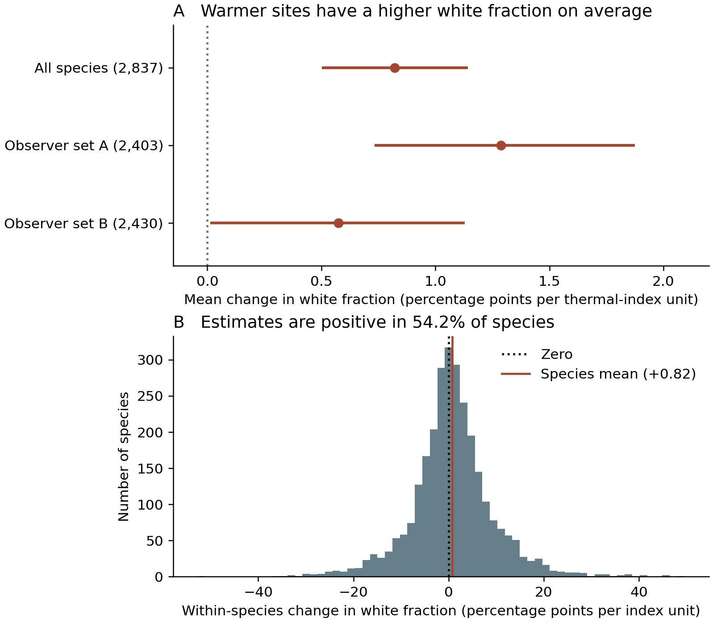
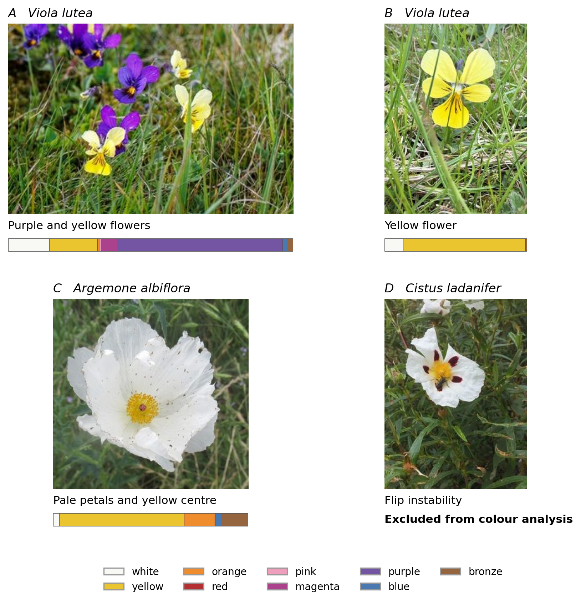

# Geographic structure and thermal variation in flower colour within angiosperm species

**Authors:** [Author list and order to be confirmed]

**Affiliations:** [Institutional affiliations to be confirmed]

**Corresponding author:** [Name and contact to be confirmed]

**Running title:** Temperature and within-species flower colour

## Summary

- Flower colour variation raises an evolutionary question: under what conditions do alternative forms persist across environments, and when might geographic differentiation become coupled to biased mating? We examined the geographic and thermal organization of colour within species as a comparative starting point.
- We assembled 100 photographs for each of 4,475 angiosperm species selected before colour assessment. Multiple colour categories recurred across the ranges of 2,400 species. We compared nearby and range-wide records and estimated within-species temperature associations with the white pixel fraction of the photographed flower region.
- In the same 1,070 species with both estimates, nearby pairs differed in colour category 2.82 percentage points less often than range-wide pairs (95% interval 1.84–3.75). White fraction increased by a mean of 1.22 percentage points per within-species thermal-index unit (0.59–1.87). The positive mean persisted in a separate comparison adjusting for precipitation and soil. Individual species estimates varied widely and agreed poorly between observer sets.
- Thus spatially structured floral appearances show a small shift towards white at warmer sites on average. These patterns motivate tests of how environment-dependent fitness and gene flow sustain variation, and whether floral differences alter mating among populations.

**Key words:** angiosperms, citizen science, flower colour, geographic variation, intraspecific variation, polymorphism, temperature

## Introduction

How does variation within a species persist as populations adapt to different environments, and under what conditions does that variation contribute to their reproductive divergence? Flower colour is relevant to both questions because pigmentation can affect performance under environmental stress and influence the visitors that move pollen. If alternative colours gain different advantages among sites, selection may produce a geographic mosaic of colour frequencies. Migration can connect those populations, while assortative pollen transfer could reduce exchange between forms and contribute to reproductive isolation. These outcomes depend on the interaction between selection and gene flow, and a polymorphism can persist without progressing towards speciation (Narbona et al., 2018).

Evidence connecting flower colour to reproductive divergence comes from particular systems. In *Mimulus aurantiacus*, divergence at a pigmentation regulator contributes to differences between ecotypes associated with pollinator-mediated isolation (Streisfeld et al., 2013). In *Phlox drummondii*, field experiments linked selection on pigment intensity to reduced hybridization with a related species (Hopkins & Rausher, 2012). Such cases raise a broader question about the distribution of potential variation within species. A colour contrast recorded across a range may reflect locally coexisting forms, geographic replacement or changes within individuals as flowers develop. Identifying the scale of a contrast is therefore necessary for testing its adaptive and reproductive consequences.

Warmer localities may differ in the colours produced by the same genotype, in the frequencies of genotypes, or in the floral tissues and stages photographed. A repeated association across species would identify a direction of phenotypic variation along a temperature gradient. Demonstrating selection would also require evidence that the variants differ in reproductive success under those conditions.

Warren & Mackenzie (2001) showed that combinations of flower-colour variants occur at unequal frequencies in the British flora. Studies of geographic differences in floral colour have since linked colour to biotic and abiotic conditions across species (Dalrymple et al., 2020), and found that colour within individual species can be spatially structured even where the association with climate is weak (Luong et al., 2023). Within-species spatial differentiation may also reflect population history or local ecological processes (Schemske & Bierzychudek, 2007). Sullivan & Koski (2021) followed pigmentation in herbarium records of 12 species with known anthocyanin polymorphisms over 124 years. A complementary geographic question begins before polymorphism is established: when species are sampled before their colour variation is known, how often do contrasting appearances recur across their ranges, how often are they recorded close together, and does temperature predict a common direction of change across those spatially structured records?

To extend comparison beyond species already recognized as polymorphic, we assembled repeated photographic records using species coverage before examining colour. Equal initial photo counts give each species a comparable sampling budget, while separate photographers and locations provide opportunities to assess geographic recurrence. This design includes species in which repeated colour contrasts are subsequently detected and species in which they are not detected. We first asked how closely conspecific flowers resemble each other across geographic distances. We then tested whether the fraction of white pixels in the photographed flower region changes with temperature within species, how widely slopes vary among species and whether their mean recurs across independent observers. Finally, we compared precipitation and soil properties on the same geographic scale to put the thermal association in context.

## Materials and Methods

### Source photographs and the common taxonomic register

We selected species from georeferenced iNaturalist flowering records using photographic coverage before examining flower colour. Species entered the final sample when 100 eligible photographs could be retained under the observer limits. Prior evidence of flower-colour polymorphism was not a selection criterion. The final dataset comprised 4,475 angiosperm species with 100 photographs each (Supporting Methods S1). Candidate discovery used a global equal-area grid and metadata filters for flowering, research-grade identification, georeferencing, positional accuracy and image licence. Five cohorts contained distinct species, and photo identity checks removed cross-cohort reuse. The sampling effort was fixed before colour measurement. Species with abundant eligible records and places visited by photographers are better represented, so geographic coverage and image availability define the scope of inference.

A flower-region image pipeline combined detection and segmentation with a normalized nine-colour photographic palette. The components were white, yellow, orange, red, pink, magenta, purple, blue and bronze. For categorical analyses, an originally fixed classifier assigned images to white, yellow/orange, red/pink or blue/purple. Exactly **227,107 original photos (50.75%)** yielded classifiable colour measurements. The remaining 220,393 records were retained as unclassified rather than assigned a colour. Fig. 3 shows four original records alongside their archived measurement outcomes. The panels were selected to illustrate a visible colour difference, a discrepancy between petal appearance and the measured region, and a failed classification. Supporting Methods S1 and Table S1 identify the sources and selection procedure.

We use the term **photographic floral colour variation** for all source-derived traits. A photographed colour class is an observed appearance, not by itself a proven hereditary morph or a single biological floral organ. Species with insufficient classified photographs, geographic pairs or sampled climate contrasts are represented by missing estimates in the relevant analysis rather than inferred zero effects.

### Estimand-specific species eligibility and common-support audit

The 4,475-species taxonomic register is common to all questions, but not every species provides an estimable quantity for every question. A species lacking a classifiable pair within 50 km has no observed geographic mismatch contrast; a species lacking enough independently sampled climatic cells and photographers has no comparable conditional thermal coefficient. These are distinct **sampling-opportunity gates**, not different biological definitions of the population. Primary means therefore use all species eligible for each estimand, and a separate, stricter overlap comparison uses the identical eligible species for geography and climate. Missing estimates are never replaced by zero.

In an additional **post hoc** source-level eligibility audit, we joined the frozen four-category all-species registry, the 4,475-row climate coefficient table and the overlap table by iNaturalist taxon ID; we verified species and acquisition-cohort identities and equality of the archived coefficients. We then computed natural-eligibility, repeated-colour and exact-overlap species-equal means. To measure the effect of sample selection on estimates, we resampled the **1,634 observed genera** with replacement 2,500 times (seed 20261119), recomputing both means in each draw, and formed percentile 95% intervals for their **paired differences**. This audit uses existing species-level coefficients and therefore does not propagate photo-level coefficient-fitting uncertainty or correct sample selection by inverse probability. Taxon-level flags and code are archived in `scripts/analysis/fcp4475_eligibility_matched_audit_20261119.py` and `results/fcp4475_matched_eligibility_effect_audit_20261119.json`.

### Range-wide counts and local comparison opportunities

We used each registered species once in the range-wide count. We required five or more classified photographs in each of at least two of the four categories, irrespective of location. For the local comparison we screened all registered species for pairs of classified conspecific records from distinct identified observers, separated by at most 5 km and dated to the same calendar month and year. Only species with at least one eligible pair entered the local denominator. A species contributed once to the local numerator if any eligible pair had different labels. These descriptive counts have different sampling requirements. The 50-km mismatch statistic below addresses the separate question of excess geographic similarity. We retained the eligible species for each primary question and repeated the principal spatial and thermal comparisons on identical species (Supporting Information, Table S10).

### Species-conditional geographic structure

We estimated geographic colour organization using the same-species difference between **range-wide colour mismatch** and mismatch among conspecific photographic records within a chosen radius. For the four categorical appearances, this quantity is positive when local conspecific records are more similar than the species-wide photographed colour composition predicts. The principal comparison used a 50-km radius; additional thresholds and distance scales were treated as supporting analyses.

For each species, photo-colour labels were permuted among fixed sampled geographic positions, preserving the exact category counts, photo locations and source sampling opportunity. A species contributed one estimate to the across-species mean. We assessed 50-km photo-pair opportunity using the complete 4,475-taxon roster; species without eligible nearby classified photo pairs were not assigned a spatial effect. Observer thinning retained at most one photo per original observer within a named species.

To test whether spatial organization depended on the coarse four-colour discretization, we repeated spatial comparisons using **base-2 Jensen–Shannon divergence** (JSD) between the full original normalized nine-palette vectors. We compared 5-, 25-, 50-, 100- and 250-km distances, with month-matched colour-vector permutations preserving the photographic composition within each named species and calendar month. Genus and species sampling opportunities were retained at their observed values. The 50-km continuous analysis used 1,761 species under the strict photo-pair design; its observer-thinned counterpart contained 1,655 species.

### Climate sampling and species-level photographic colour associations

Original source locations were linked to the archived WorldClim 2.1 10-arcminute climate normals for BIO1 (annual mean temperature), BIO4 (temperature seasonality), BIO5 (maximum temperature of the warmest month), BIO12 (annual precipitation), BIO14 (precipitation of the driest month), BIO15 (precipitation seasonality) and mean annual solar radiation calculated from 12 monthly fields. These climate values describe the photographed locations, not experimental exposure or necessarily weather at flowering.

Because BIO1 and BIO5 represent correlated aspects of a common thermal gradient, our integrated climatic synthesis used **five fixed, colour-outcome-blind environmental domains**. Within each species, the seven original climate variables were standardized by their photographed standard deviations. The shared thermal level was (zBIO1 + zBIO5)/2; the shared precipitation amount was (zBIO12 + zBIO14)/2. BIO4 temperature seasonality, BIO15 precipitation seasonality and mean solar radiation were retained separately.

For each named species, the five domain variables were first adjusted for photographic calendar month and a broad geographic basis using Earth-centred latitude–longitude coordinates. The residual of the target climate domain was then projected against the other four domains. A domain was estimable only when at least 5% of its original sampled variance remained after adjustment. The source analysis additionally required at least 40 classified, climate-complete original photos, 20 distinct observers and five occupied WorldClim raster grid cells.

In a paired sensitivity analysis we also fitted the thermal slope on exactly the same photographs before and after adding soil pH, clay content and total nitrogen to the climate, month and geography adjustments (Table S9). The climatic response in the primary model was the signed covariance between the uniquely residualized domain and each photographic nine-palette fraction, with the exact expectation of within-species/calendar-month permutation removed. Dividing that covariance by the domain's residual variance yielded a **conditional, slope-like photographic association** on each species' standardized climate scale. This is distinct from the per-°C Firth log-odds coefficient and from a causal thermal response. We calculated species-equal mean vectors, their squared alignment with q, and whole-genus bootstrap intervals using 999 resamples. White-direction intervals were evaluated simultaneously across the five fixed environmental domains. All five original taxonomic cohorts were also compared descriptively, and each cohort was omitted in turn in a whole-genus sensitivity analysis.

### Independent-observer photographic replication

Two complementary observer analyses were performed. In the full-source climate model, we deterministically retained one original image per observer within each species and repeated the shared-thermal estimation.

We also tested whether the positive mean could be reproduced without sharing observers across separate photograph sets. Within each species, original observers were assigned to two colour-outcome-blind groups before photo-colour eligibility or climate filtering. The thermal–white coefficient was fitted using only one observer group and then refitted after exchanging the groups. Held-out models preserved the same five environmental domains, geographic/month adjustments and climatic residual requirements, with eligibility recalculated from the held-out photographs. A separate version retained one image per held-out observer. All source taxa remained in the four panel registers. Whole-genus bootstrap intervals used 999 resamples.

### Classification success and between-year photographic recurrence

We tested whether the probability of obtaining a classified photograph varied with the within-species thermal index, retaining failed and successful attempts. We also examined repeat visits to the same 10-arcminute cell in the same calendar month in different years. We compared the number of repeat detections of both white and nonwhite categories to a permutation distribution conditional on initial detections, species, month and photographic effort (Supporting Methods S7, Tables S7–S8).

### Environmental differences at comparable geographic distances

In the 2,400 species with at least five photographs in each of two or more colour categories, we compared the environmental differences between same-colour and different-colour pairs at similar geographic distances. Paired records came from different observers and different 10-arcminute cells. We compared temperature, precipitation and SoilGrids estimates of pH, clay and total nitrogen on the same pairs, weighting species equally (Supporting Methods S5).

## Results

### Range-wide colour variation and local photographic contrasts

Across their photographed ranges, 2,400 of 4,475 species had at least five photographs in each of two or more colour categories. These counts describe repeated appearances across a species’ photographed range. At a finer scale, 840 species had observations by different photographers within 5 km in the same calendar month and year. In 325 of those species, at least one such pair had different colour labels (Fig. 1). Among the 2,400 species meeting the range-wide threshold, 415 had a qualifying local pair and 228 of those had contrasting labels. A single close pair can include a colour too sparsely recorded to meet the range-wide threshold. The observations identify local sampling opportunities; even this criterion does not establish that the photographed plants exchanged pollen or belonged to a single breeding population. Multiple flowers, organs and developmental stages can contribute to a category, and the sampling frame does not estimate the global prevalence of flower-colour polymorphism.

Nearby conspecific photographs also resembled each other: four-category mismatch within 50 km was 1.61 percentage points lower than range-wide mismatch (3,600 species, P = 0.005; Fig. S2). In a stricter panel of 1,761 species the continuous nine-colour similarity excess was 0.01146 on the base-2 Jensen–Shannon divergence scale relative to month-preserving permutations (P = 0.005). This excess persisted after observer thinning (0.01123, 1,655 species).

White-labelled photographs made up 45.2% of the 111,059 classified records in the 2,400 species with repeated colour contrasts. Within species, the median share was 44.4%, but the middle half ranged from 19.5% to 69.6%. Only 475 species (19.8%) had 40–60% white records (Fig. S5). Even among the 2,210 species with at least five white and five nonwhite records, the median was 48.7% and only 21.5% fell in that band. These frequencies count photographs assigned to a category. The temperature analysis below measures the fraction of retained flower-region pixels assigned to white within each photograph.

Of 104 eligible species–cell–month combinations, 38 contained white and nonwhite photographs in the index year. Both categories were detected again by different observers in 12 of the 38 combinations, each representing a different species. The conditional null predicted 14.8 repeat detections (central 95% randomization range 10–20; one-sided P = 0.911 for excess recurrence). Repeat visits thus document examples of recurrence, with no evidence for an excess above that expected from the sampled colour frequencies and effort.

### Temperature and the white fraction within species

All 2,837 species with estimable temperature coefficients contributed to the temperature-eligible summary, including those lacking an estimable precipitation coefficient. The mean change in white fraction was +0.00821 (+0.82 percentage points) per thermal-index unit. The median was +0.61 percentage points and the middle half ranged from −3.46 to +4.96 points (Fig. 2b). In total, 54.2% of estimates were positive. In the 1,376 species eligible for decomposition, 67.8% of the signed mean thermal–white association arose between the four photographic categories (genus 95% interval 44.2–85.4%, Supporting Results S3). This links the pixel measurement to shifts in the mix of photographed appearances. The squared alignment of the mean nine-colour vector was 85.4%. Averaging the coefficients before computing alignment allows opposing chromatic shifts in different species to cancel.

The mean white coefficient remained positive with one photograph per observer (+0.00800, 2,771 species), in all five species-disjoint acquisition cohorts, and after omission of each cohort. Two observer-disjoint folds (Fig. 2a) yielded means of +0.01288 (2,403 species; genus 95% interval +0.00733 to +0.01874) and +0.00575 (2,430 species; +0.00012 to +0.01128). Among 1,919 species estimable in both folds, the two species-specific coefficients had Pearson correlation 0.018 (Fig. S4b). Agreement in the direction of the mean therefore provides little information about which species have the largest coefficients. All folds draw on the same platform and measurement procedure.

Among 2,820 species with both a thermal colour estimate and an estimable classification-success slope, the mean probability of a successful classification changed by −0.30 percentage points per thermal-index unit (whole-genus bootstrap 95% interval −0.76 to +0.16). Selection of different floral organs or colour-dependent errors among successful classifications remain possible (Supporting Methods S7).

Among the 1,070 species with repeated colour categories and estimates of both spatial structure and temperature, nearby pairs differed in colour 2.82 percentage points less often than range-wide pairs (95% interval 1.84–3.75). The mean increase in photographic white fraction was 1.22 points per thermal-index unit (0.59–1.87). These are two means over identical species (Fig. 1b; Table S10). Their magnitudes describe separate properties of the photographs.

### How species eligibility changes the apparent effects

The original 4,475-taxon registry joined one-to-one to both the common-species table and the climate-coefficient table. Of the 2,400 taxa with at least five photographic records in at least two coarse colour categories, 1,902 had a geographic mismatch coefficient and 1,376 had a thermal coefficient, with 1,070 in the intersection. These are overlapping, not sequential, exclusions. The thermal coefficient was undefined for 1,638 of the 4,475 taxa: 1,178 had fewer than 40 classifiable photographs, 399 had some estimable climatic domain but no separately identifiable thermal domain after adjustment for month, geography and other climate domains, 60 had no identifiable climate domain, and one lacked five climate raster cells. The geographic effect was undefined for 875 taxa lacking a classified within-50-km photo pair. These exclusions describe **estimability**, not an absence of biological effects. Across all eligible species, geographic range-wide minus 50-km mismatch was **+1.61 percentage points** (3,600 taxa), versus **+2.82 points** in the overlap set (1,070 taxa). The overlap-minus-all difference was **+1.21 points** (post hoc whole-genus bootstrap 95% interval **+0.42 to +1.98**). In contrast, the thermal–white-fraction mean was **+0.82 points** per standardized thermal-index unit across 2,837 eligible taxa and **+1.22** on the overlap set; its shift was **+0.40 points** (95% interval **−0.05 to +0.82**). Thus, the average sign survived paired-species restriction, but the selected common panel showed a substantively larger geographic contrast.

Species in the overlap set had a higher average proportion of classifiable original photos (**55.1%** versus **50.8%** across all 4,475 taxa) and more local classified photo pairs (median **49.5** versus **24**); eligibility is consequently informative about observed opportunity. Using the 2,400 repeated-colour taxa as the reference instead of the full eligible sets yielded geographic means of +2.31 points for 1,902 taxa and thermal means of +1.24 points for 1,376 taxa. These estimates cannot be presented as identical-population effects. On the 1,070 taxa observed for both estimands, the unadjusted species-level Pearson correlation between the geographic and thermal coefficients was only **+0.062** (genus bootstrap 95% interval +0.003 to +0.123). This small exploratory association is unadjusted for geography, photographer sampling, sampled thermal range and coefficient reliability; the two positive group means do not establish a shared causal driver or mediation. All results here concern the original photographic classification and remain susceptible to colour-dependent organ/stage errors.

### Precipitation and soil in geographic context

The mean temperature coefficient vector was more closely aligned with the white–chromatic axis than the mean precipitation vector in the matched sample, but this contrast narrowed when the largest cohort was omitted (Fig. S3, Table S3). In the separate distance-matched comparison, different-colour pairs had a slightly larger temperature difference than same-colour pairs (+0.0089 within-species SD, adjusted 95% interval +0.0017 to +0.0162). Precipitation, pH, clay and total nitrogen showed no consistent excess difference at this grid scale (Table S4). For the distinct question of a directional shift towards white, 1,253 species had sufficient support for paired climate and soil models. On the same 68,575 photographs, the mean thermal slope was +1.40 percentage points per index unit with climate, month and geography adjustment (95% interval +0.86 to +1.94) and +1.14 after adding soil pH, clay and total nitrogen (+0.53 to +1.75). The paired coefficient change was −0.26 points (−0.60 to +0.08; Table S9). The positive association therefore persisted conditional on the measured grid-scale covariates; the magnitude of attenuation was uncertain.

## Discussion

The spatial scale at which colours recur matters for understanding their persistence. Nearby records shared a colour more often than expected from the range-wide composition of the same species. Superimposed on this geographic structure, warm localities had a slightly higher photographic white fraction on average. The mean retained its sign when photographers were separated, while estimates for individual species varied in both directions and agreed poorly between observer sets. Pooling across species can reveal a small directional tendency even when the sign or magnitude for a particular species is uncertain. The geographic similarity among nearby flowers places this tendency in a spatially structured distribution of appearances. The added eligibility audit further shows why the different reported species counts should not be pooled as though exchangeable: retaining only taxa with both spatial and climate estimates makes the observed geographic effect appreciably larger, whereas the mean thermal effect is less sensitive to that restriction. Hence the scientifically supported comparison is across estimand-specific opportunities, with a matched-taxon sensitivity analysis—not a claim that every taxon has the same biological response.

### What does an intermediate white frequency tell us about diversity?

The pooled frequency of white records was near one-half, yet most species fell outside the 40–60% band. A range containing mostly white plants at one site and mostly coloured plants at another could yield the same overall frequency as local populations in which the two types commonly coexist. Colour diversity also depends on the starting frequency. For two types, the chance that two independently sampled individuals differ is 2p(1 − p), where p is the local white frequency. An increase in p from 0.1 to 0.3 raises this probability from 0.18 to 0.42, whereas an increase from 0.7 to 0.9 lowers it from 0.42 to 0.18. A thermal shift towards white therefore has no single implication for local diversity. The three nonwhite photo categories themselves contain additional variation.

### When could investment in pigment pay?

If producing a particular pigment draws resources away from producing flowers, ovules or seeds, a low-pigment morph could gain a reproductive advantage under resource limitation. That prediction depends on what the pathway does elsewhere in the plant and on what pollinators do with the signal. In five species, pigmented plants produced more seed than white-flowered plants under drought, and the ordering reversed under ample water (Warren & Mackenzie, 2001). In *Abronia fragrans*, pink-flowered populations in part of the range had smaller displays, yet a greenhouse study found no consistent association between pigmentation and other inflorescence traits across the range (Jaeger et al., 2026). These results motivate measuring the opportunity cost of pigment under defined conditions. White-looking tissues can contain colourless or UV-absorbing compounds, and yellow, pink and purple appearances may arise from different pathways. The photographed white fraction measures neither pigment investment nor a resource saving.

### Under what conditions could both morphs persist?

Across a geographic range, different colours could persist if their relative fitness changes among sites or years, or if migrants carry variants between locally differentiated populations. In Linanthus parryae, seed production of white and blue morphs varied among years and across a sharp geographic colour boundary (Schemske & Bierzychudek, 2007). A long-lived seed bank can also allow the same population to retain alternatives when relative fitness changes between years, depending on how much each year contributes to recruitment (Turelli et al., 2001). Introgression can also supply colour alleles: in monkeyflowers, shared haplotypes at a flower-colour locus implicate historical transfer between lineages (Stankowski & Streisfeld, 2015). The origin of a variant and its present maintenance pose distinct questions. The photographic atlas contains no locus ancestry or fitness measurements. Our temperature slopes describe geographic associations. Reciprocal transplants could test whether local conditions change relative fitness, while a common-garden temperature treatment could test whether a genotype changes colour across thermal environments.

A fixed extra cost of colour, like a frequency-independent pollinator advantage, can favour one morph throughout a population. Even if their effects exactly cancel, equal returns alone provide no force restoring a 1:1 mixture after a disturbance. A stabilizing mechanism requires the fitness ranking to change. In a simple two-morph model, white must increase when rare and coloured individuals must increase when white is common. The crossing can occur at any frequency, and its location could change along a temperature gradient if pigmentation alters survival or reproduction. Calling the mixture evolutionarily stable adds a stronger condition: alternative heritable strategies must also fail to invade. Neither a pooled white frequency near one-half nor mixed photographs at one site tests invasion fitness.

Pollinators can supply the required feedback in some systems. Rare morphs gained a reproductive advantage in frequency-manipulated arrays of the rewardless orchid *Dactylorhiza sambucina* (Gigord et al., 2001). By contrast, in *Ipomoea purpurea*, pollinators visited white and pigmented plants equally often at two frequencies in an experiment on the A locus, although genotypes differed in total siring success (Fehr & Rausher, 2004). Models that combine pollination with survival also predict different fitness landscapes as preference and neighbouring flower frequencies change (Tenhumberg et al., 2023). The relevant benefit is a contribution to future generations. A conspicuous display or a higher visit rate alone does not establish that benefit.

The atlas identifies localities for discriminating these explanations: different observers recorded contrasting photographic labels close together in 325 species. Establishing a difference in the same organ at a comparable flowering stage is a first step before interpreting those labels as morphs. Repeated censuses of marked, simultaneously flowering individuals would establish local frequencies and persistence. In species with heritable variants, a common-garden comparison across temperature and resource treatments could measure pigment chemistry, flower production and seed output under standardized hand pollination. In parallel, frequency manipulations at fixed plant density with open pollination could measure pollen export, siring and seed production. A pigment-related allocation cost predicts reduced reproductive investment under equal pollen supply; rare-morph advantage predicts a reversal in relative performance as frequencies change. Comparing these responses among temperatures would show whether the local balance moves. Spatial replacement, developmental plasticity and locally maintained polymorphism can thus be distinguished even when they give similar regional colour totals.

### When could colour differentiation contribute to reproductive divergence?

The positive geographic and thermal means in the same 1,070 species establish a shared comparative context for this question. They do not measure the flow of genes among sites. Under an adaptive hypothesis, the relative reproductive success of verified colour forms would change among environments, allowing different forms to predominate in different parts of a range. Persistent migration could sustain alternatives within connected populations even when local frequencies are strongly unequal. Temperature-dependent plasticity and population history could also contribute to the observed geographic associations. Reciprocal transplants, common gardens and neutral genomic structure would help discriminate these possibilities.

Flower colour could further affect the connectivity of populations if pollinator movement generates assortative pollen transfer. This hypothesis predicts fewer crosses between forms than expected from their local flowering abundance, spatial positions and phenology. Measurements of floral visitation sequences, pollen transfer and offspring parentage across contact sites would connect visible differentiation to mating. Genetic differentiation at pigmentation loci relative to the genomic background could then test whether a colour boundary accompanies restricted exchange. Smooth colour gradients and abrupt transitions provide different sampling targets, but their shapes alone do not identify selection or reproductive isolation.

The *Mimulus* and *Phlox* examples show that colour can participate in the evolution of reproductive barriers, including reinforcement where hybridization is costly (Streisfeld et al., 2013; Hopkins & Rausher, 2012). In our survey, organ-verified colour differences, heritability, relative fitness and gene flow remain to be established. The geographic organization of photographic appearances provides hypotheses about where selection and connectivity may interact. Whether those interactions preserve polymorphism or contribute to reproductive divergence requires direct evidence at the population level.

### Which flower colours do photographs capture?

The two photographs of *Viola lutea* illustrate a change in visible flower colour that the nine fractions capture (Fig. 3a,b). In *Argemone albiflora*, conspicuous white petals surround a yellow centre, yet the extracted region yielded 64% yellow and only 3% white (Fig. 3c). Without an archived pixel mask the relative roles of region selection and palette assignment cannot be recovered for this image. In *Cistus ladanifer*, the photograph shows a white corolla with dark basal marks, but the horizontal-flip check rejected its colour measurement (Fig. 3d). Colour credibility thus depends on the organ and stage visible, the region retained and the measurement passing quality control. The proportion of all source images classified was 50.75%. In a temperature- and label-blind exploratory audit by a single AI reader, 66 of 128 sampled near-pair draws allowed comparison of corresponding organs at similar apparent stages. Of 32 readable pairs originally labelled as different, three retained a difference between the four colour groups. A white-label frequency contrast in this sample was sensitive to the treatment of unreadable pairs (Table S11). This audit addresses interpretation of pair labels. It did not refit the continuous white-pixel slope.

An earlier flower-minus-background comparison with BIO5 gave a near-zero association (rho approximately −0.0033, P = 0.82). That comparison used a different response and predictor, so it qualifies the interpretation of the shared-temperature result without directly testing the same coefficient. Repeating the mean across photographers addresses reuse of individual records. It leaves open systematic differences in illumination, development, observer behaviour and organ visibility across climatic settings. Climate normals describe photographed locations, and a higher white fraction does not identify the concentration of any pigment. A direct botanical test would measure the same open floral organ under standardized illumination at multiple sites within species, with temperature and precipitation sampled separately.

### Conclusions

Across geographically structured observations, the white fraction increased slightly towards warmer sites when species were given equal weight. The wide distribution of slopes identifies the limits of that average as a description of individual species. Intermediate pooled colour frequencies concealed wide differences among species. The range-wide and nearby records identify sites where the two explanations make different predictions. Geographic replacement predicts differences in morph frequencies among populations; local maintenance requires variants to persist within a population across generations. Verifying corresponding floral organs and following local forms through time would connect this broad survey to tests of environment-dependent fitness. Combining those tests with pollen transfer and parentage would reveal when geographic differences are sustained within connected populations and when they accompany restricted mating.

## Acknowledgements

[Funding, data providers, field collaborators and computational contributors to be added after author verification.] We acknowledge the contributors to the photographic biodiversity observations on which the source atlas is based.

## Author contributions

[To be completed and approved by all authors.]

## Competing interests

[To be completed by the authors.]

## Data availability

The [original measured-photo release](https://github.com/zuizui0223/fcp/releases/tag/fcp-all4730-original-method-actual-colour-results-20261017) contains the frozen colour measurements. [Supporting Information](climate_colour/Supporting_Information.md) documents the images, full species register, climate coefficients, uncertainty estimates and source analyses. Photo credits and source links appear with Fig. 3 and in Table S1.

## References

Dalrymple RL, Kemp DJ, Flores-Moreno H, Laffan SW, White TE, Hemmings FA, Moles AT. 2020. Macroecological patterns in flower colour are shaped by both biotic and abiotic factors. *New Phytologist* **228**: 1972–1985. https://doi.org/10.1111/nph.16737

Fehr C, Rausher MD. 2004. Effects of variation at the flower-colour A locus on mating system parameters in *Ipomoea purpurea*. *Molecular Ecology* **13**: 1839–1847. https://doi.org/10.1111/j.1365-294X.2004.02182.x

Gigord LDB, Macnair MR, Smithson A. 2001. Negative frequency-dependent selection maintains a dramatic flower color polymorphism in the rewardless orchid *Dactylorhiza sambucina* (L.) Soò. *Proceedings of the National Academy of Sciences USA* **98**: 6253–6255. https://doi.org/10.1073/pnas.111162598

Hopkins R, Rausher MD. 2012. Pollinator-mediated selection on flower color allele drives reinforcement. *Science* **335**: 1090–1092. https://doi.org/10.1126/science.1215198

Jaeger SL, Darby AG, Berardi AE, Harter BT, Buchloh TD, LoPresti EF. 2026. Pollinator, herbivore, and climatic selective pressures differ across a floral color transition zone. *American Journal of Botany* **113**: e70142. https://doi.org/10.1002/ajb2.70142

Luong Y, Gasca-Herrera A, Misiewicz TM, Carter BE. 2023. A pipeline for the rapid collection of color data from photographs. *Applications in Plant Sciences* **11**: e11546. https://doi.org/10.1002/aps3.11546

Narbona E, Wang H, Ortiz PL, Arista M, Imbert E. 2018. Flower colour polymorphism in the Mediterranean Basin: occurrence, maintenance and implications for speciation. *Plant Biology* **20** (Suppl. 1): 8–20. https://doi.org/10.1111/plb.12575

Phipson B, Smyth GK. 2010. Permutation P-values should never be zero: calculating exact P-values when permutations are randomly drawn. *Statistical Applications in Genetics and Molecular Biology* **9**: Article 39. https://doi.org/10.2202/1544-6115.1585

Schemske DW, Bierzychudek P. 2007. Spatial differentiation for flower color in the desert annual *Linanthus parryae*: was Wright right? *Evolution* **61**: 2528–2543. https://doi.org/10.1111/j.1558-5646.2007.00219.x

Stankowski S, Streisfeld MA. 2015. Introgressive hybridization facilitates adaptive divergence in a recent radiation of monkeyflowers. *Proceedings of the Royal Society B* **282**: 20151666. https://doi.org/10.1098/rspb.2015.1666

Streisfeld MA, Young WN, Sobel JM. 2013. Divergent selection drives genetic differentiation in an R2R3-MYB transcription factor that contributes to incipient speciation in *Mimulus aurantiacus*. *PLoS Genetics* **9**: e1003385. https://doi.org/10.1371/journal.pgen.1003385

Sullivan CN, Koski MH. 2021. The effects of climate change on floral anthocyanin polymorphisms. *Proceedings of the Royal Society B* **288**: 20202693. https://doi.org/10.1098/rspb.2020.2693

Tenhumberg B, Dellinger AS, Smith SD. 2023. Modelling pollinator and nonpollinator selection on flower colour variation. *Journal of Ecology* **111**: 746–760. https://doi.org/10.1111/1365-2745.14057

Turelli M, Schemske DW, Bierzychudek P. 2001. Stable two-allele polymorphisms maintained by fluctuating fitnesses and seed banks: protecting the blues in *Linanthus parryae*. *Evolution* **55**: 1283–1298. https://doi.org/10.1111/j.0014-3820.2001.tb00651.x

Warren J, Mackenzie S. 2001. Why are all colour combinations not equally represented as flower-colour polymorphisms? *New Phytologist* **151**: 237–241. https://doi.org/10.1046/j.1469-8137.2001.00159.x

## Figures

**Figure 1. Geographic structure and the thermal colour gradient in the same species.** (a) Both screens started with 4,475 species. Range-wide recurrence required at least five photographs in each of two or more colour categories. Eligibility for the local screen required a pair from different observers within 5 km in the same month and year; 325 of the 840 eligible species had contrasting labels. The screens overlap: 228 of the 415 locally eligible species meeting the range-wide threshold had contrasting labels. A label describes a photographed region that may include several organs (Fig. 3). (b) Both panels weight the same 1,070 species equally. The left estimate is the range-wide probability of a colour mismatch minus the probability within 50 km. The right estimate is the change in white pixel fraction per unit of the within-species thermal index after adjustment for geography, month and other climatic gradients. Points are means and bars are 95% whole-genus bootstrap intervals (5,000 resamples; Table S10).

**Figure 2. Temperature and the white fraction of the photographed flower region.** (a) The mean coefficient across all temperature-eligible species and means from two disjoint observer sets. Bars give whole-genus bootstrap 95% intervals (4,000 resamples of the full temperature panel and archived intervals for the observer sets). (b) Distribution of all 2,837 species estimates. Each coefficient is the percentage-point change in white fraction per unit of the within-species thermal index. Zero separates estimated shifts towards and away from white. The middle half spans −3.46 to +4.96 points. Of the 1,919 species estimable in both observer sets, 50.2% had matching signs (Fig. S4b). Table S2 provides the underlying species estimates.

**Figure 3. What a flower-region measurement captures.** Bars below the images give the nine archived colour fractions within the measured region. (a,b) Photographs of *Viola lutea* differ in the relative amounts of purple and yellow. (c) *Argemone albiflora* has pale visible petals but the region was classified as yellow/orange. (d) The *Cistus ladanifer* record failed the horizontal-flip colour-stability check and contributed no colour vector. Panels show the full packet images; a fitted mask is unavailable. Images reproduced at reduced display size, all CC BY: (a) [ade sills](https://www.inaturalist.org/photos/357540213), (b) [Martin Wood-Weatherill](https://www.inaturalist.org/photos/670131413), (c) [Linda Jo Conn](https://www.inaturalist.org/photos/664177506), (d) [Andre Hosper](https://www.inaturalist.org/photos/23342465). Table S1 records photo IDs and measurements.
