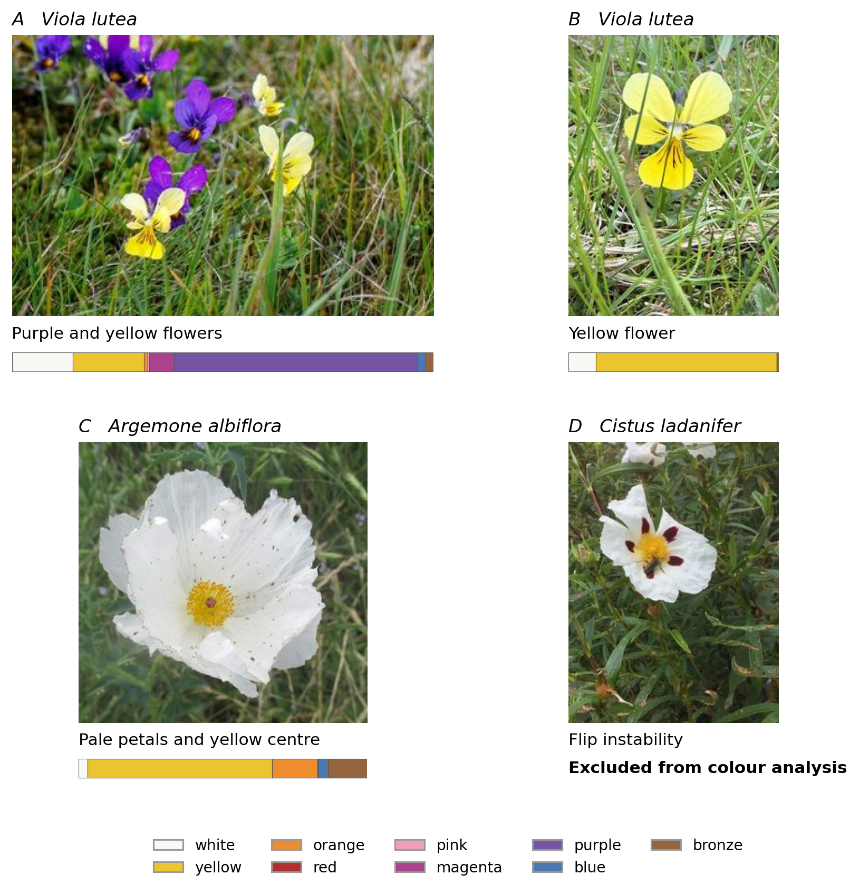
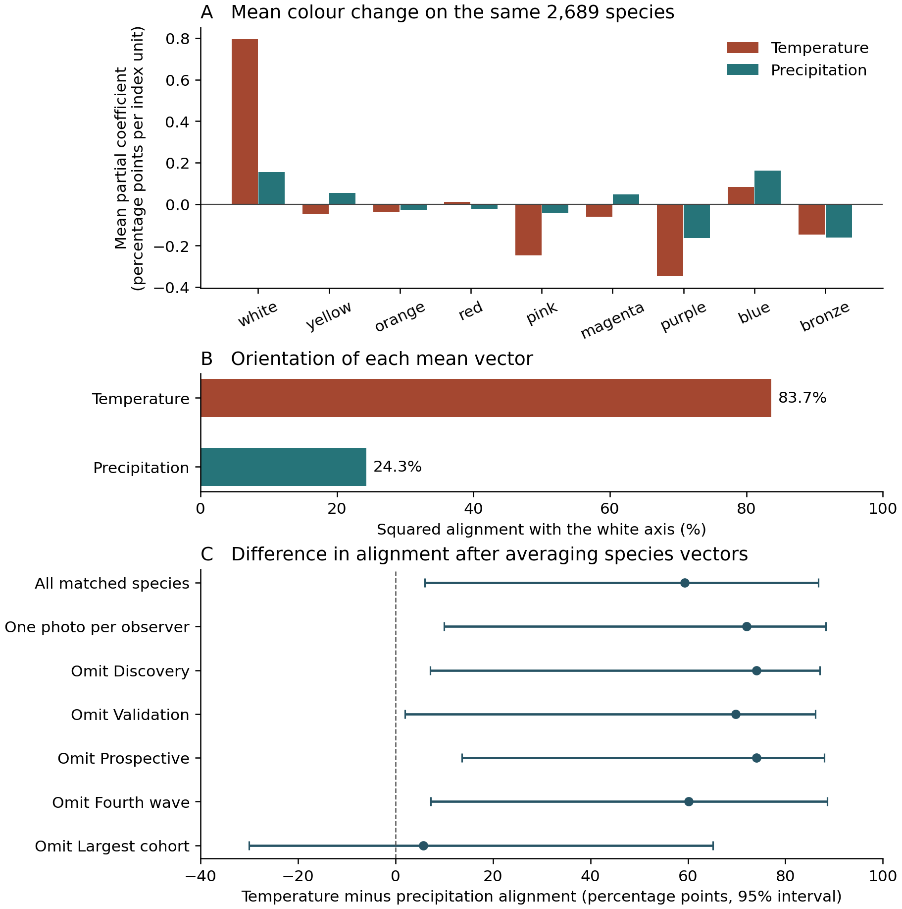
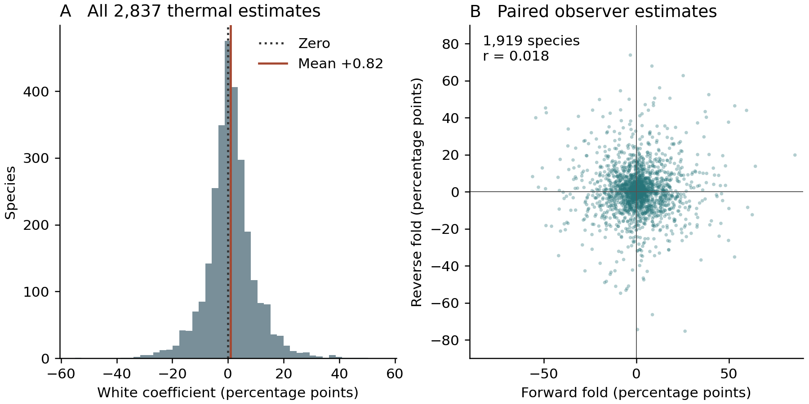

# Mean within-species photographic flower colour shifts align more closely with white along temperature than precipitation gradients

**Authors:** [Author list and order to be confirmed]

**Affiliations:** [Institutional affiliations to be confirmed]

**Corresponding author:** [Name and contact to be confirmed]

**Running title:** Climate and within-species floral colour

## Summary

- Understanding flower-colour polymorphism requires knowing which colour differences recur within species and how they are distributed. We asked whether temperature and precipitation track different directions of within-species photographic variation.
- We estimated within-species coefficients for nine colour fractions from flower photographs. For 2,689 species with both climate estimates, we compared the alignment of each mean coefficient vector with the white–chromatic axis, repeated the comparison after omitting each acquisition cohort, and compared the two alignments within each species.
- Alignment was 83.7% for temperature and 24.3% for precipitation, a difference of 59.4 percentage points (paired genus-bootstrap 95% interval 6.0 to 86.8). Omitting the largest cohort yielded 74.8% and 69.1%, respectively, a difference of 5.7 points (−30.1 to 65.2).
- Temperature had the greater alignment in 1,345 of 2,689 species (50.0%). The pooled contrast reflects the direction retained when signed coefficients are averaged across species. Its magnitude depends on which species are included, and the underlying photographs can capture different floral organs and stages.

**Key words:** angiosperms, citizen science, flower-colour polymorphism, geographic variation, intraspecific variation, precipitation, temperature

## Introduction

The geographic distribution of alternative flower colours poses a problem for the study of polymorphism. Two colours recorded for a named species may co-occur in a breeding population, replace one another across its range, or arise as a flower ages. Those observations suggest different explanations for the persistence of variation. A broad comparative survey can ask which visual contrasts recur and how they are distributed before asking whether distinct, heritable morphs coexist locally (Narbona et al., 2018).

A pale and a deeply coloured flower of the same species may differ in the amount of pigmentation across the corolla, the extent of a coloured patch, or which floral tissues are visible. The distinction matters when asking how floral colour varies along environmental gradients. Two gradients can both be associated with colour and yet involve different contrasts among white, yellow, purple and other components of the flower.

Warren & Mackenzie (2001) showed that combinations of flower-colour variants occur at unequal frequencies in the British flora. Studies of geographic differences in floral colour have since linked colour to biotic and abiotic conditions across species (Dalrymple et al., 2020), and found that colour within individual species can be spatially structured even where the association with climate is weak (Luong et al., 2023). Within-species spatial differentiation may also reflect population history or local ecological processes (Schemske & Bierzychudek, 2007). These studies motivate a comparative question. When climate varies across the range of a single species, which components of floral colour change together, and does the average direction of change depend on the environmental gradient?

We compared two gradients measured at photographic localities: a shared temperature index and a precipitation-amount index. Within each species we estimated how the fractions of nine photographic colours varied along each gradient, accounting for the other climate domains, broad geography and observation month. We then asked two questions on exactly the same taxa. Which gradient aligns more closely with white after averaging the signed colour changes across species? How often does that ordering occur when the two directions are compared within each species? This paired comparison is the focus of our synthesis of existing analyses. We use the complete photographic atlas to describe the underlying colour and spatial variation and independent groups of photographers to assess how well the temperature association repeats at the level of the mean and the individual species.

## Materials and Methods

### Source photographs and the common taxonomic register

The study used a single frozen observational source comprising **4,475 named angiosperm species, each with 100 originally sampled photographs** (447,500 unique image records). Five species-disjoint acquisition cohorts contributed 500 discovery, 500 validation, 499 prospective, 498 fourth-wave and 2,478 additional species. All cohorts used the same iNaturalist-based sampling source and a fixed location-blind colour measurement procedure. The complete species register, rather than only taxa meeting a later statistical threshold, was retained throughout the synthesis.

A flower-region image pipeline combined detection and segmentation with a normalized nine-colour photographic palette. The components were white, yellow, orange, red, pink, magenta, purple, blue and bronze. For categorical analyses, an originally fixed classifier assigned images to white, yellow/orange, red/pink or blue/purple. Exactly **227,107 original photos (50.75%)** yielded classifiable colour measurements. The remaining 220,393 records were retained as unclassified rather than assigned a colour. Fig. 1 shows four original records alongside their archived measurement outcomes. The panels were selected to illustrate a visible colour difference, a discrepancy between petal appearance and the measured region, and a failed classification. Supporting Methods S1 and Table S1 identify the sources and selection procedure.

We use the term **photographic floral colour variation** for all source-derived traits. A photographed colour class is an observed appearance, not by itself a proven hereditary morph or a single biological floral organ. Species with insufficient classified photographs, geographic pairs or sampled climate contrasts are represented by missing estimates in the relevant analysis rather than inferred zero effects.

### Climate sampling and species-level photographic colour associations

Original source locations were linked to the archived WorldClim 2.1 10-arcminute climate normals for BIO1 (annual mean temperature), BIO4 (temperature seasonality), BIO5 (maximum temperature of the warmest month), BIO12 (annual precipitation), BIO14 (precipitation of the driest month), BIO15 (precipitation seasonality) and mean annual solar radiation calculated from 12 monthly fields. These climate values describe the photographed locations, not experimental exposure or necessarily weather at flowering.

We first quantified the signed within-species association between white-category photographic observations and BIO5, including a source-wide univariate Firth logistic estimator expressed in log odds per 1°C. The full source yielded 4,112 species with white and nonwhite classified photos suitable for this climatic comparison. As a separate continuous-colour analysis, we related the nine photo-palette fractions to climate variables, retaining both signed white-fraction covariance and nine-dimensional colour-vector direction.

Because BIO1 and BIO5 represent correlated aspects of a common thermal gradient, our integrated climatic synthesis used **five fixed, colour-outcome-blind environmental domains**. Within each species, the seven original climate variables were standardized by their photographed standard deviations. The shared thermal level was (zBIO1 + zBIO5)/2; the shared precipitation amount was (zBIO12 + zBIO14)/2. BIO4 temperature seasonality, BIO15 precipitation seasonality and mean solar radiation were retained separately.

For each named species, the five domain variables were first adjusted for photographic calendar month and a broad geographic basis using Earth-centred latitude–longitude coordinates. The residual of the target climate domain was then projected against the other four domains. A domain was estimable only when at least 5% of its original sampled variance remained after adjustment. The source analysis additionally required at least 40 classified, climate-complete original photos, 20 distinct observers and five occupied WorldClim raster grid cells.

The climatic response was the signed covariance between the uniquely residualized domain and each photographic nine-palette fraction, with the exact expectation of within-species/calendar-month permutation removed. Dividing that covariance by the domain's residual variance yielded a **conditional, slope-like photographic association** on each species' standardized climate scale. This is distinct from the per-°C Firth log-odds coefficient and from a causal thermal response. We calculated species-equal mean vectors, their squared alignment with q, and whole-genus bootstrap intervals using 999 resamples. White-direction intervals were evaluated simultaneously across the five fixed environmental domains. All five original taxonomic cohorts were also compared descriptively, and each cohort was omitted in turn in a whole-genus sensitivity analysis.

### Quantifying species-level colour diversity and recurring colour directions

For the four frozen photographic colour categories, species-level sampled colour diversity was summarized by the Gini–Simpson index, D = 1 − Σ p_k², where p_k is the observed species-wide proportion of classifiable source photos in category k. The finite-sample-corrected form, 1 − Σ n_k(n_k − 1)/[n(n − 1)], was retained as a sampling sensitivity. This index represents diversity among the photographed records, including differences between locations, and is not equivalent to the frequency of multiple inherited morphs within a breeding population.

To characterize the **direction of continuous colour variation**, we normalized each nine-palette vector, applied a Hellinger transformation and identified a deterministic two-mode displacement axis within each species. The sign of the axis is arbitrary, so agreement with the fixed white–chromatic contrast was measured by the squared projection W_i = (u_i · q)², where u_i is the fitted species-level unit displacement vector and q is a fixed unit vector contrasting white with the eight nonwhite palette components. The species-equal mean W estimates the tendency for photographic colour displacement to align with the white–chromatic direction.

A matched source null preserved species composition, photo-colour category counts and acquisition cohorts while shuffling complete nine-colour photo vectors within the frozen source constraints. The complete 4,475-taxon white-axis analysis was refitted in each of 199 null worlds. Monte Carlo probabilities used the plus-one correction, so P = 0.005 is the minimum reportable value from 199 permutations (Phipson & Smyth, 2010). Previous smaller, species-disjoint confirmation cohorts were preserved as supporting historical analyses rather than silently pooled with the complete-source test.

### Species-conditional geographic structure

We estimated geographic colour organization using the same-species difference between **range-wide colour mismatch** and mismatch among conspecific photographic records within a chosen radius. For the four categorical appearances, this quantity is positive when local conspecific records are more similar than the species-wide photographed colour composition predicts. The principal comparison used a 50-km radius; additional thresholds and distance scales were treated as supporting analyses.

For each species, photo-colour labels were permuted among fixed sampled geographic positions, preserving the exact category counts, photo locations and source sampling opportunity. A species contributed one estimate to the across-species mean. We assessed 50-km photo-pair opportunity using the complete 4,475-taxon roster; species without eligible nearby classified photo pairs were not assigned a spatial effect. Observer thinning retained at most one photo per original observer within a named species.

To test whether spatial organization depended on the coarse four-colour discretization, we repeated spatial comparisons using **base-2 Jensen–Shannon divergence** (JSD) between the full original normalized nine-palette vectors. We compared 5-, 25-, 50-, 100- and 250-km distances, with month-matched colour-vector permutations preserving the photographic composition within each named species and calendar month. Genus and species sampling opportunities were retained at their observed values. The 50-km continuous analysis used 1,761 species under the strict photo-pair design; its observer-thinned counterpart contained 1,655 species.

In a separate earlier analysis, we compared species-wide sampled colour diversity D with geographic organization in the discovery and validation cohorts using observer and photographic effort covariates and species-conditional matched nulls. These are distinct estimands from the average range-wide minus local mismatch.

### Decomposing colour-category composition and colour shifts within categories

The original four photo-colour labels make it possible to express the climatic covariance of the full nine-palette vector as the exact sum of covariance **between photographic categories** and covariance **within photographic categories**. We estimated these two components on the same taxa and the same model. For the between-category component, a species required at least five classified photos in each of at least two original photographic colour categories. Because covariance vectors can cancel, the ratio of a signed category-between mean to its signed total is described strictly as an algebraic contribution rather than as an explained biological variance share.

The temperature and precipitation directions were compared again on **exactly the same species** with identifiable conditional photo-colour relationships to both climate domains. For each climatic domain, we computed the squared white-axis projection of the cross-species mean nine-colour coefficient vector; whole genera were resampled to quantify uncertainty in the *difference in direction* between domains. This is a geometric comparison of recorded photographic appearances, not a quantification of pigment pathways.

### Independent-observer photographic replication

Two complementary observer analyses were performed. In the full-source climate model, we deterministically retained one original image per observer within each species and repeated the shared-thermal estimation.

We also tested whether the positive mean could be reproduced without sharing observers across separate photograph sets. Within each species, original observers were assigned to two colour-outcome-blind groups before photo-colour eligibility or climate filtering. The thermal–white coefficient was fitted using only one observer group and then refitted after exchanging the groups. Held-out models preserved the same five environmental domains, geographic/month adjustments and climatic residual requirements, with eligibility recalculated from the held-out photographs. A separate version retained one image per held-out observer. All source taxa remained in the four panel registers. Whole-genus bootstrap intervals used 999 resamples.

### Contrasting colour-space geometry with ecological allocation

Finally, we compared the species-level geometric score W with geographic mismatch depletion and the original species BIO5 association in a common source-linked registry. Rank associations were adjusted for source photographic classifiability, photographed colour diversity, baseline white-label abundance, observer/sample opportunities and acquisition cohort, as appropriate. Genus bootstrap uncertainty was calculated without treating individual photograph pairs as independent species replicates. The analysis asks whether the **direction** of colour variation and its **geographic or climatic arrangement** can be summarized by one species-level metric, rather than inferring independence of evolutionary mechanisms.

The complete-source spatial and climatic comparisons were retrospective. The smaller prospective cohort addressed colour geometry before the later climatic synthesis. Defining the environmental indices without reference to individual photo colours protects their construction from outcome-dependent weighting. It does not make the later comparison prospective. For Fig. 2 we display the archived component estimates on common species support. In a retrospective sensitivity analysis we omitted each acquisition cohort in turn and recomputed the paired difference in alignment of the two mean vectors, resampling whole genera 4,000 times within each retained panel (Table S3). Separately we calculated squared alignment for each species and counted how often its temperature alignment exceeded its precipitation alignment. Each species contributed one comparison. For Fig. 3 we summarize the distribution of the archived species coefficients, retaining one row per taxon and leaving unestimable values missing (Table S2).

## Results

### The pooled difference in white-axis alignment depends on the species included

The two climatic gradients were both estimable in 2,689 species. Across exactly these taxa the mean temperature vector pointed predominantly along the white–chromatic axis (83.7% squared alignment), whereas the mean precipitation vector had a smaller projection on the same axis (24.3%; Fig. 2). The difference of 59.4 percentage points had a genus-bootstrap 95% interval of 6.0–86.8 points. With one photograph per species per observer the paired estimates were 84.8% and 12.7% (2,625 species; difference 72.0 points, 95% interval 10.0–88.3). The corresponding means of the white component on the original matched taxa were +0.80 and +0.15 percentage points per unit of the respective climate index. Individual chromatic components of the precipitation vector were less consistently resolved. The data distinguish white-axis alignment more clearly than they identify a particular precipitation-associated hue.

In the largest acquisition cohort, 1,480 species had estimates for both climate domains. After omitting these species, the remaining 1,209 had temperature alignment of 74.8% and precipitation alignment of 69.1%. The paired difference narrowed to 5.7 percentage points (95% interval −30.1 to 65.2; Fig. 2c). The largest change was in the precipitation vector, whose alignment rose from 24.3% to 69.1%. Omitting any one of the four other cohorts yielded differences of 60.1–74.0 points (Table S3).

Computing alignment within each species before comparison gave greater temperature alignment in 1,345 of 2,689 species (50.0%). Mean species-specific alignments were 36.9% for temperature and 36.2% for precipitation. Thus the pronounced difference between the two pooled vectors coexisted with an almost even split in the ordering of individual estimates. The 54.2% reported below addresses a separate question: the sign of the temperature coefficient for white alone in the larger temperature-eligible panel.

### The average temperature association coexists with substantial species variation

All 2,837 species with estimable temperature coefficients contributed to the temperature-eligible summary, including those lacking an estimable precipitation coefficient. The mean change in white fraction was +0.00821 (+0.82 percentage points) per thermal-index unit. The median was +0.61 percentage points and the middle half ranged from −3.46 to +4.96 points (Fig. 3a). In total, 54.2% of estimates were positive. The squared alignment of the mean nine-colour vector was 85.4%. Averaging the coefficients before computing alignment allows opposing chromatic shifts in different species to cancel.

The mean white coefficient remained positive with one photograph per observer (+0.00800, 2,771 species), in all five species-disjoint acquisition cohorts, and after omission of each cohort. Two observer-disjoint folds yielded means of +0.01288 (2,403 species; genus 95% interval +0.00733 to +0.01874) and +0.00575 (2,430 species; +0.00012 to +0.01128). Among 1,919 species estimable in both folds, the two species-specific coefficients had Pearson correlation 0.018 (Fig. 3b). Agreement in the direction of the mean therefore provides little information about which species have the largest coefficients. All folds draw on the same platform and measurement procedure.

### Overall colour variation and geographic structure

Of the 4,475 species, 4,189 had photographs assigned to at least two of the four colour categories. Requiring at least five photographs in each of two or more categories retained 2,400 species. These counts describe repeated appearances across a species’ photographed range. Multiple flowers, organs and developmental stages can contribute to a category, and the sampling frame does not estimate the global prevalence of flower-colour polymorphism.

Across 4,475 species the mean alignment of within-species colour variation with the white–chromatic axis was 0.47887, compared with a composition- and cohort-preserving null median of 0.43204 (199 permutations, upper P = 0.005; Fig. S1). Nearby conspecific photographs also resembled each other: four-category mismatch within 50 km was 1.61 percentage points lower than range-wide mismatch (3,600 species, P = 0.005; Fig. S2). In a stricter panel of 1,761 species the continuous nine-colour similarity excess was 0.01146 on the base-2 Jensen–Shannon divergence scale relative to month-preserving permutations (P = 0.005). This excess persisted after observer thinning (0.01123, 1,655 species).

At the species level, white-axis alignment was weakly associated with geographic mismatch depletion (adjusted rank correlation +0.034) and with the signed single-variable BIO5 white-category coefficient (−0.009). The latter comparison uses a categorical response and a different climate predictor from Fig. 2. In 1,376 eligible species, the total continuous thermal–white coefficient (+0.01243) comprised +0.00843 between photographic categories and +0.00400 within categories. Supporting Results S3 gives the denominators and uncertainty for these complementary analyses.

## Discussion

Averaging the signed colour coefficients across 2,689 species retained a stronger white–chromatic direction along temperature than along precipitation. Normalizing each species vector first gives a different view: about half the species had the stronger estimated alignment for temperature. Species can contribute unequally to the direction of a mean even when each species has equal weight, because their coefficient vectors vary in magnitude and opposing components cancel. Directions estimated from weak individual vectors are especially uncertain. The comparison extends earlier work on unequal frequencies of colour combinations (Warren & Mackenzie, 2001) by asking which continuous colour changes persist when averaged across taxa.

Matching species removes differences in taxon membership between the two climate indices within each panel. It leaves the pooled result sensitive to which taxa enter that panel. Omitting the largest cohort brought the mean precipitation vector much closer to the white axis and left the temperature–precipitation difference poorly resolved. The omission changes both species composition and sample size; the available comparison cannot attribute the shift to a biological feature of that cohort.

The prominent white component has two qualifications. First, the mean precipitation vector was smaller in magnitude as well as less white-aligned (Fig. 2a). The broad interval on the difference leaves considerable uncertainty about its size. The evidence supports a difference in orientation more readily than a specific alternative pigmentation response to rainfall. Second, the positive thermal association is small relative to the spread of individual estimates. Species differed in available climate range, number of classified records and photographic conditions. Poor agreement of individual coefficients between observer groups means that this dataset cannot separate biological heterogeneity from estimation error well enough to rank thermal responsiveness.

### Which flower colours do photographs capture?

The two photographs of *Viola lutea* illustrate a change in visible flower colour that the nine fractions capture (Fig. 1a,b). In *Argemone albiflora*, conspicuous white petals surround a yellow centre, yet the extracted region yielded 64% yellow and only 3% white (Fig. 1c). Without an archived pixel mask the relative roles of region selection and palette assignment cannot be recovered for this image. In *Cistus ladanifer*, the photograph shows a white corolla with dark basal marks, but the horizontal-flip check rejected its colour measurement (Fig. 1d). Colour credibility thus depends on the organ and stage visible, the region retained and the measurement passing quality control. The proportion of all source images classified was 50.75%. These selected illustrations provide no estimate of error or climate-dependent missingness across the atlas.

An earlier flower-minus-background comparison with BIO5 gave a near-zero association (rho approximately −0.0033, P = 0.82). That comparison used a different response and predictor, so it qualifies the interpretation of the shared-temperature result without directly testing the same coefficient. Repeating the mean across photographers addresses reuse of individual records. It leaves open systematic differences in illumination, development, observer behaviour and organ visibility across climatic settings. Climate normals describe photographed locations, and a higher white fraction does not identify the concentration of any pigment. A direct botanical test would measure the same open floral organ under standardized illumination at multiple sites within species, with temperature and precipitation sampled separately.

### From geographic variation to local flower-colour polymorphism

Photographs close together were more similar in colour even when the species-wide composition and observation month were preserved. Local sampling, regional population history and spatially structured environments could all contribute. The small association between white-axis geometry and local mismatch indicates that knowing how a species varies in colour gave little predictive information about how strongly its colours clustered geographically. Low repeatability of individual climatic estimates further limits inferences about coupling of these processes. Species-level causal pathways or the maintenance of inherited colour morphs require population, developmental or genetic evidence (Narbona et al., 2018; Wessinger & Rausher, 2012).

### When might colour differentiation contribute to speciation?

Spatial sorting of alternative appearances suggests two distinct field questions. Do colour variants differ in performance across environments, and do they exchange less pollen where they meet? In *Linanthus parryae*, reciprocal transplants supported local selection on flower colour across a sharp geographic transition, while the assayed allozyme markers showed little corresponding differentiation (Schemske & Bierzychudek, 2007). In *Phlox drummondii*, common-garden experiments in sympatry with *P. cuspidata* linked increased flower-colour intensity to pollinator-mediated reinforcement (Hopkins & Rausher, 2012). The latter mechanism concerns mating between already differentiated taxa and illustrates one context in which a colour difference can strengthen isolation.

The atlas can guide comparisons of sites where contrasting appearances recur locally and sites where they replace one another. Repeated censuses of flowering individuals and common-garden or progeny observations could establish local morph frequencies and whether colour differences persist across environments. Where stable morphs meet, pollinator transitions, paternity and gene flow relative to geographic distance would test for assortative mating. A climate-associated change in morph frequency can occur with extensive interbreeding. The present records contain no mating or lineage-splitting outcomes from which to infer reproductive isolation or speciation rates.

### Conclusions

Across the complete matched sample, the mean within-species photographic colour vector aligned more closely with white for temperature than for precipitation. The gap narrowed when the largest cohort was omitted, and the two gradients were almost equally likely to have the greater estimated alignment within individual species. For research on flower-colour polymorphism, these observations identify recurring contrasts and geographic settings in which local morph coexistence, inheritance and mating can be tested directly.

## Acknowledgements

[Funding, data providers, field collaborators and computational contributors to be added after author verification.] We acknowledge the contributors to the photographic biodiversity observations on which the source atlas is based.

## Author contributions

[To be completed and approved by all authors.]

## Competing interests

[To be completed by the authors.]

## Data availability

The [original measured-photo release](https://github.com/zuizui0223/fcp/releases/tag/fcp-all4730-original-method-actual-colour-results-20261017) contains the frozen colour measurements. [Supporting Information](climate_colour/Supporting_Information.md) documents the images, full species register, climate coefficients, uncertainty estimates and source analyses. Photo credits and source links appear with Fig. 1 and in Table S1.

## References

Dalrymple RL, Kemp DJ, Flores-Moreno H, Laffan SW, White TE, Hemmings FA, Moles AT. 2020. Macroecological patterns in flower colour are shaped by both biotic and abiotic factors. *New Phytologist* **228**: 1972–1985. https://doi.org/10.1111/nph.16737

Hopkins R, Rausher MD. 2012. Pollinator-mediated selection on flower color allele drives reinforcement. *Science* **335**: 1090–1092. https://doi.org/10.1126/science.1215198

Luong Y, Gasca-Herrera A, Misiewicz TM, Carter BE. 2023. A pipeline for the rapid collection of color data from photographs. *Applications in Plant Sciences* **11**: e11546. https://doi.org/10.1002/aps3.11546

Narbona E, Wang H, Ortiz PL, Arista M, Imbert E. 2018. Flower colour polymorphism in the Mediterranean Basin: occurrence, maintenance and implications for speciation. *Plant Biology* **20** (Suppl. 1): 8–20. https://doi.org/10.1111/plb.12575

Phipson B, Smyth GK. 2010. Permutation P-values should never be zero: calculating exact P-values when permutations are randomly drawn. *Statistical Applications in Genetics and Molecular Biology* **9**: Article 39. https://doi.org/10.2202/1544-6115.1585

Schemske DW, Bierzychudek P. 2007. Spatial differentiation for flower color in the desert annual *Linanthus parryae*: was Wright right? *Evolution* **61**: 2528–2541. https://doi.org/10.1111/j.1558-5646.2007.00219.x

Warren J, Mackenzie S. 2001. Why are all colour combinations not equally represented as flower-colour polymorphisms? *New Phytologist* **151**: 237–241. https://doi.org/10.1046/j.1469-8137.2001.00159.x

Wessinger CA, Rausher MD. 2012. Lessons from flower colour evolution on targets of selection. *Journal of Experimental Botany* **63**: 5741–5749. https://doi.org/10.1093/jxb/ers267

## Figures

**Figure 1. What a flower-region measurement captures.** Bars below the images give the nine archived colour fractions within the measured region. (a,b) Photographs of *Viola lutea* differ in the relative amounts of purple and yellow. (c) *Argemone albiflora* has pale visible petals but the region was classified as yellow/orange. (d) The *Cistus ladanifer* record failed the horizontal-flip colour-stability check and contributed no colour vector. Panels show the full packet images; a fitted mask is unavailable. Images reproduced at reduced display size, all CC BY: (a) [ade sills](https://www.inaturalist.org/photos/357540213), (b) [Martin Wood-Weatherill](https://www.inaturalist.org/photos/670131413), (c) [Linda Jo Conn](https://www.inaturalist.org/photos/664177506), (d) [Andre Hosper](https://www.inaturalist.org/photos/23342465). Table S1 records photo IDs and measurements.

**Figure 2. Climate-associated photographic colour shifts and their sensitivity to species composition.** (a) Mean signed coefficients for nine colours on the same 2,689 species, in percentage points per within-species index unit. (b) Squared white-axis alignment calculated after averaging each domain's vectors. (c) Temperature minus precipitation alignment of the mean vectors. Points and bars show differences and paired whole-genus bootstrap 95% intervals. Omission rows exclude one cohort from the original panel at a time. The observer-thinned analysis uses its own matched panel. Table S3 gives both alignments and sample sizes. At species level, temperature had greater alignment in 1,345 of 2,689 comparisons.

**Figure 3. Species variation in the temperature association.** (a) All 2,837 eligible white-fraction coefficients, one estimate per species. The mean is +0.82 percentage points and 54.2% are positive. (b) Each point represents the same species measured by two disjoint sets of observers. All 1,919 complete pairs are shown. Coefficients use the within-species thermal index; their scale differs from log odds per degree Celsius. Table S2 gives estimates for all taxa, including missing values for ineligible comparisons.
