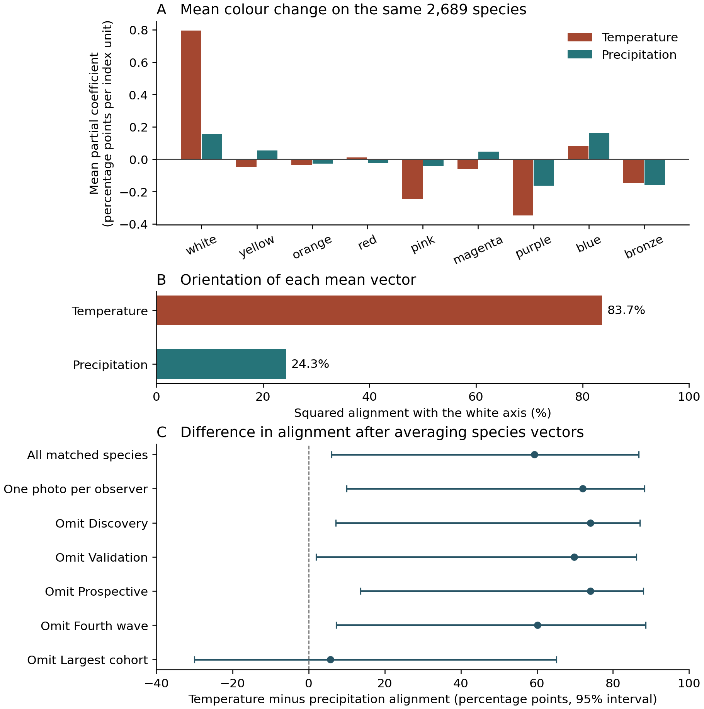
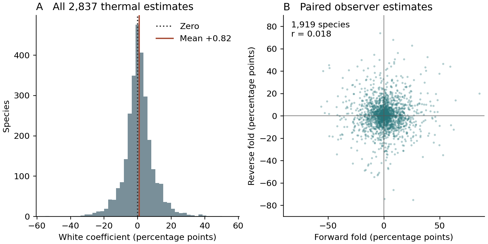
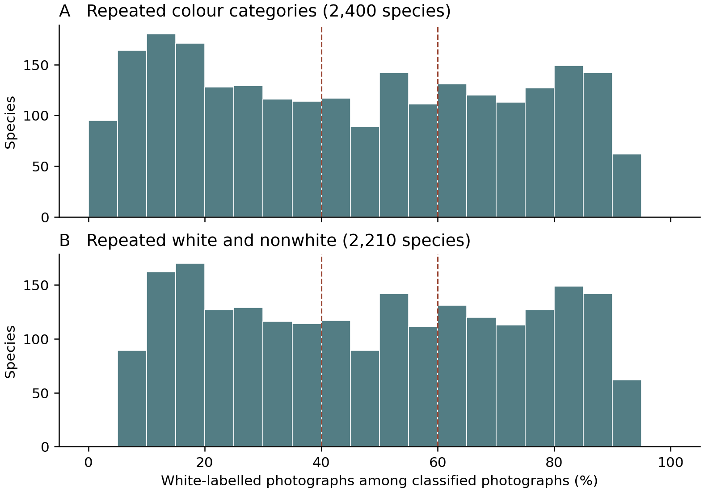

# Supporting Information

**Temperature and geographic structure of within-species flower colour variation in angiosperms**

## Methods S1. Photographs, measurement and eligibility

The source comprised 100 photographs per species, assembled in five cohorts with distinct species. The [sampling protocol](https://github.com/zuizui0223/fcp/blob/d061b3ac8dc00d751008f8fadb933453963e8a9c/docs/POLYMORPHISM_42111_FRAME_PROVENANCE_20260918.md) documents the geographic grid, flowering-record filters and selection before colour assessment. A location-blind pipeline detected a flower region, segmented it and counted pixels assigned to a fixed palette. The nine retained colour fractions sum to one for a classified image. Four coarse labels summarize white, yellow/orange, red/pink and blue/purple appearances. Images with failed or uncertain measurements were excluded from the colour calculations. Across 447,500 records, 227,107 passed and 220,393 did not. The 100 records per species therefore do not imply equal numbers of usable images, localities or observers. Missing estimates remain blank in Table S2.

Figure 3 uses four purposefully selected photographs from an earlier licensed image-review packet. We matched each packet image to the archived measurement by photo ID. Two records show contrasting colours in one species, one shows disagreement between visible petal colour and region colour, and one illustrates rejection. The photograph displayed is the packet rendition, not a reconstruction of the segmentation mask. Panel C cannot identify precisely which pixels produced the fitted composition. Panel D is omitted from every colour estimate; the blank palette entries in Table S1 encode that exclusion. This selection illustrates measurement outcomes and cannot estimate their frequencies. The earlier exploratory organ and stage review also identified possible bud and fruit contributions. Independent human organ adjudication was incomplete in that review.

**Table S1. Photo identity and colour extraction.** The accompanying file `Table_S1_photographs.csv` supplies the full nine fractions, original label, mask-pixel count, exclusion reason, source URL, licence, attribution and checksum of each displayed photograph. These are full images resized for display. Photographer credits and the CC BY licence designation are transcribed from the archived attribution fields.

| Panel | Species and iNaturalist photo | Archived outcome | White | Yellow | Purple |
|---|---|---|---:|---:|---:|
| A | *Viola lutea*, [357540213](https://www.inaturalist.org/photos/357540213), ade sills | Blue/purple | 14.4% | 16.9% | 57.7% |
| B | *Viola lutea*, [670131413](https://www.inaturalist.org/photos/670131413), Martin Wood-Weatherill | Yellow/orange | 13.0% | 86.1% | 0.0% |
| C | *Argemone albiflora*, [664177506](https://www.inaturalist.org/photos/664177506), Linda Jo Conn | Yellow/orange | 3.2% | 63.8% | 0.0% |
| D | *Cistus ladanifer*, [23342465](https://www.inaturalist.org/photos/23342465), Andre Hosper | Horizontal-flip colour instability | — | — | — |

## Methods S2. Climate coefficients and common species support

At each locality WorldClim 2.1 climate normals were sampled at 10 arcminutes. The thermal index was the mean of within-species standardized BIO1 and BIO5. The precipitation amount index was the mean of standardized BIO12 and BIO14. BIO4, BIO15 and mean solar radiation supplied three additional domains. For each target domain the source analysis removed broad Earth-centred geographic coordinates and month effects and residualized against the four other domains. The slope divides the within-species covariance, corrected for its within-month permutation expectation, by residual predictor variance. At least 40 classifiable climate-complete records, 20 observers, five grid cells and 5% residual predictor variance were required for the primary panel. The index unit depends on the sampled within-species climate distribution. Temperature coefficients in Fig. S4 are expressed as percentage points of photographic white fraction per index unit.

Each species contributed one nine-component coefficient vector per estimable domain. The paired comparison retained only taxa with both vectors. For a species-equal mean vector v and unit contrast q = (8, −1, −1, −1, −1, −1, −1, −1, −1)/√72, alignment equals (v · q)²/(v · v). It measures the direction of a mean vector. It is invariant to its length and sign. The signed component means in Fig. S3a supply information lost on squaring. Uncertainty in the difference used 999 whole-genus bootstrap samples with the same genera drawn for both domains. The original matched panel represents 1,088 genera. The marginal 95% intervals for temperature and precipitation alignment were 54.6–92.5% and 0.06–73.6%, respectively. Direct paired inference used the interval for the difference.

**Table S2. Analysis population and species coefficients.** The machine-readable companion `Table_S2_species_coefficients.csv.gz` contains one row per taxon in the complete register. The taxon ID joins all source tables. The first fields give the species, genus, cohort, source classifiability count, count used by the climate workflow and workflow status. That workflow may return before counting complete records in an ineligible species. The 18 columns beginning `thermal_level_` or `precip_amount_` give the nine signed total coefficients on the original fraction scale. Multiply by 100 for Fig. S3a or Fig. S4. The final two columns are the unthinned held-out thermal–white coefficients indexed by observer-fold direction. Empty fields indicate unavailable coefficients.

| Population | Species | Quantity estimated |
|---|---:|---|
| Complete register | 4,475 | Within-species colour geometry |
| Temperature eligible | 2,837 | White coefficient distribution |
| Precipitation eligible | 3,022 | Precipitation coefficient availability |
| Both domains eligible | 2,689 | Paired temperature and precipitation directions |
| Both domains, one photograph per observer | 2,625 | Paired sensitivity on thinned records |
| Forward / reverse observer folds | 2,403 / 2,430 | Means on each eligible fold |
| Both observer folds | 1,919 | Correlation of paired species coefficients |

## Results S3. Paired climate contrasts and supporting sensitivity analyses

The complete and observer-thinned comparisons use the original 999 genus-bootstrap draws. For each new omission comparison we retained the original paired species outside the omitted cohort and drew whole genera with replacement 4,000 times (NumPy default random generator, seed 20261111 for each panel). Both domains shared each draw. Dividing the summed coefficient vectors by the number of species in each resample retained equal species weights. We computed the difference of the two squared alignments in each draw and used its 2.5th and 97.5th percentiles. These exploratory intervals apply to each retained panel separately.

**Table S3. Difference in white-axis alignment of the mean temperature and precipitation vectors.** Within each row, both mean vectors use identical species. Alignment is a percentage; differences and percentile intervals are in percentage points. The largest cohort is the additional acquisition wave (source label `new_U100`). Counts are retained species.

| Analysis panel | Species | Temperature (%) | Precipitation (%) | Difference (95% interval) |
|---|---:|---:|---:|---:|
| All matched species | 2,689 | 83.7 | 24.3 | 59.4 (6.0 to 86.8) |
| One photo per observer | 2,625 | 84.8 | 12.7 | 72.0 (10.0 to 88.3) |
| Omit Discovery | 2,376 | 82.0 | 8.0 | 74.0 (7.1 to 87.1) |
| Omit Validation | 2,383 | 80.7 | 10.9 | 69.8 (1.9 to 86.2) |
| Omit Prospective | 2,384 | 85.1 | 11.1 | 74.0 (13.6 to 88.0) |
| Omit Fourth wave | 2,404 | 87.1 | 27.0 | 60.1 (7.3 to 88.6) |
| Omit Largest cohort | 1,209 | 74.8 | 69.1 | 5.7 (−30.1 to 65.2) |

The largest deletion removes 1,480 of the 2,689 matched species. The temperature alignment remains high, while the precipitation alignment rises and the interval for the difference spans zero. To summarize species-level ordering, we applied the same squared-projection formula to each of the two nonzero vectors within each species before counting the larger alignment. Temperature had greater estimated alignment in 1,345 species (50.0%). The average of individual alignments was 36.9% for temperature and 36.2% for precipitation. These descriptive estimates include species with weak vectors whose directions are imprecise.

Across the five climatic domains, the simultaneous intervals for the white-axis projection excluded zero for thermal level and temperature seasonality. Only thermal level retained a positive white-component interval when accounting for all 45 domain-by-colour comparisons. Precipitation amount, precipitation seasonality and solar radiation showed no resolved common white-axis direction in the five-domain comparison. The temperature-eligible original panel gave mean white coefficient +0.008209; the simultaneous five-domain interval for its scaled white-axis projection was +0.004237 to +0.013177. For one photograph per observer the mean white coefficient was +0.008002 (2,771 species) and squared mean alignment was 87.1%. For this separate temperature-only summary, each acquisition-cohort omission retained a positive mean and a positive lower genus-bootstrap limit. Removal of the largest cohort left 1,273 species (mean +0.009373; 95% interval +0.004232 to +0.014099). A separate categorical analysis using BIO5 alone gave +0.02189 log odds of white per °C across 4,112 species (genus 95% interval +0.00846 to +0.03489). This estimator differs in both outcome and units from the continuous shared-temperature coefficient.

For the 1,376 species with at least five photos in each of at least two categories and estimable decomposition, the between-category term comprised 67.8% of the signed mean thermal–white coefficient (genus 95% interval 44.2–85.4%). The corresponding observer-thinned panel gave 66.1% (1,299 species; 39.2–84.3%). Since the labels derive from the photographic palette, this algebraic split does not identify inherited or developmental components.

The range-wide category counts use the [unified species ledger](https://github.com/zuizui0223/fcp/blob/d0745596609784f316bae03f24527d8eaf6d7bbb/results/fcp_np_all4475_unified_species_ledger_20261021.csv). For each taxon we counted how many of the four columns beginning `miss_coarse_photo_` reached one photograph or five photographs. The number of taxa with at least two qualifying categories was 4,189 or 2,400, respectively, from the full register of 4,475. Each photo contributes a categorical observation; these thresholds impose no requirement for distinct individuals or a common breeding site. For the finer-scale description, 840 species had a positive count in the ledger field for 5-km same-year, same-month, different-observer pairs; 325 of those had a positive count for different-category pairs under the same filter. Species without an eligible pair contribute no information on this comparison. These are observed counts without a null-model test.

The complete-register white-axis score exceeded its null median by 0.04683. Each of 199 random worlds retained coarse colour counts and source cohort structure. The smallest attainable plus-one probability was 0.005. For the 50-km comparison, the strict categorical panel required at least 40 classified photographs and 30 local pairs; its mean mismatch depletion was 0.01761 (1,761 species). With the broader pair eligibility and one photo per observer, depletion was 0.01590 (3,592 species). The continuous distance test permuted complete nine-colour vectors within species and calendar month. Earlier discovery and validation panels also yielded modest positive adjusted rank associations between photo diversity and spatial organization (+0.12664, 369 species, P = 0.007; +0.09929, 363 species, P = 0.025). These were separate cohorts and estimands.

**Figure S1.** Mean squared white-axis alignment of within-species colour displacements in the original five cohorts and complete source. Full-register mean 0.47887 (genus-bootstrap 95% interval 0.46874–0.48978); source-matched null median 0.43204.

**Figure S2.** Source summary of categorical geographic comparisons. Positive depletion means that conspecific pairs within 50 km differed less often in their photographic colour categories than pairs sampled across the species' recorded range. The continuous JSD comparison in the text uses a separate month-preserving null.

## Supporting analyses of colour geometry and climate

### Quantifying species-level colour diversity and recurring colour directions

For the four frozen photographic colour categories, species-level sampled colour diversity was summarized by the Gini–Simpson index, D = 1 − Σ p_k², where p_k is the observed species-wide proportion of classifiable source photos in category k. The finite-sample-corrected form, 1 − Σ n_k(n_k − 1)/[n(n − 1)], was retained as a sampling sensitivity. This index represents diversity among the photographed records, including differences between locations, and is not equivalent to the frequency of multiple inherited morphs within a breeding population.

To characterize the **direction of continuous colour variation**, we normalized each nine-palette vector, applied a Hellinger transformation and identified a deterministic two-mode displacement axis within each species. The sign of the axis is arbitrary, so agreement with the fixed white–chromatic contrast was measured by the squared projection W_i = (u_i · q)², where u_i is the fitted species-level unit displacement vector and q is a fixed unit vector contrasting white with the eight nonwhite palette components. The species-equal mean W estimates the tendency for photographic colour displacement to align with the white–chromatic direction.

A matched source null preserved species composition, photo-colour category counts and acquisition cohorts while shuffling complete nine-colour photo vectors within the frozen source constraints. The complete 4,475-taxon white-axis analysis was refitted in each of 199 null worlds. Monte Carlo probabilities used the plus-one correction, so P = 0.005 is the minimum reportable value from 199 permutations (Phipson & Smyth, 2010). Previous smaller, species-disjoint confirmation cohorts were preserved as supporting historical analyses rather than silently pooled with the complete-source test.

In a separate earlier analysis, we compared species-wide sampled colour diversity D with geographic organization in the discovery and validation cohorts using observer and photographic effort covariates and species-conditional matched nulls. These are distinct estimands from the average range-wide minus local mismatch.

We first quantified the signed within-species association between white-category photographic observations and BIO5, including a source-wide univariate Firth logistic estimator expressed in log odds per 1°C. The full source yielded 4,112 species with white and nonwhite classified photos suitable for this climatic comparison. As a separate continuous-colour analysis, we related the nine photo-palette fractions to climate variables, retaining both signed white-fraction covariance and nine-dimensional colour-vector direction.

### Decomposing colour-category composition and colour shifts within categories

The original four photo-colour labels make it possible to express the climatic covariance of the full nine-palette vector as the exact sum of covariance **between photographic categories** and covariance **within photographic categories**. We estimated these two components on the same taxa and the same model. For the between-category component, a species required at least five classified photos in each of at least two original photographic colour categories. Because covariance vectors can cancel, the ratio of a signed category-between mean to its signed total is described strictly as an algebraic contribution rather than as an explained biological variance share.

The temperature and precipitation directions were compared again on **exactly the same species** with identifiable conditional photo-colour relationships to both climate domains. For each climatic domain, we computed the squared white-axis projection of the cross-species mean nine-colour coefficient vector; whole genera were resampled to quantify uncertainty in the *difference in direction* between domains. This is a geometric comparison of recorded photographic appearances, not a quantification of pigment pathways.

Finally, we compared the species-level geometric score W with geographic mismatch depletion and the original species BIO5 association in a common source-linked registry. Rank associations were adjusted for source photographic classifiability, photographed colour diversity, baseline white-label abundance, observer/sample opportunities and acquisition cohort, as appropriate. Genus bootstrap uncertainty was calculated without treating individual photograph pairs as independent species replicates. The analysis asks whether the **direction** of colour variation and its **geographic or climatic arrangement** can be summarized by one species-level metric, rather than inferring independence of evolutionary mechanisms.

The complete-source spatial and climatic comparisons were retrospective. The smaller prospective cohort addressed colour geometry before the later climatic synthesis. Defining the environmental indices without reference to individual photo colours protects their construction from outcome-dependent weighting. It does not make the later comparison prospective. For Fig. S3 we display the archived component estimates on common species support. In a retrospective sensitivity analysis we omitted each acquisition cohort in turn and recomputed the paired difference in alignment of the two mean vectors, resampling whole genera 4,000 times within each retained panel (Table S3). Separately we calculated squared alignment for each species and counted how often its temperature alignment exceeded its precipitation alignment. Each species contributed one comparison. For Fig. S4 we summarize the distribution of the archived species coefficients, retaining one row per taxon and leaving unestimable values missing (Table S2).

Among the 2,689 species with estimates for both climatic gradients, the mean temperature vector pointed predominantly along the white–chromatic axis (83.7% squared alignment), whereas the mean precipitation vector had a smaller projection on the same axis (24.3%; Fig. S3). The difference of 59.4 percentage points had a genus-bootstrap 95% interval of 6.0–86.8 points. With one photograph per species per observer the paired estimates were 84.8% and 12.7% (2,625 species; difference 72.0 points, 95% interval 10.0–88.3). The corresponding means of the white component on the original matched taxa were +0.80 and +0.15 percentage points per unit of the respective climate index. Individual chromatic components of the precipitation vector were less consistently resolved. The data distinguish white-axis alignment more clearly than they identify a particular precipitation-associated hue.

After omitting the largest acquisition cohort, the remaining 1,209 species had temperature alignment of 74.8% and precipitation alignment of 69.1%. The paired difference narrowed to 5.7 percentage points (95% interval −30.1 to 65.2; Fig. S3c). The largest change was in the precipitation vector, whose alignment rose from 24.3% to 69.1%. Omitting any one of the four other cohorts yielded differences of 60.1–74.0 points (Table S3).

Computing alignment within each species before comparison gave greater temperature alignment in 1,345 of 2,689 species (50.0%). Mean species-specific alignments were 36.9% for temperature and 36.2% for precipitation. Thus the pronounced difference between the two pooled vectors coexisted with an almost even split in the ordering of individual estimates. The 54.2% reported below addresses a separate question: the sign of the temperature coefficient for white alone in the larger temperature-eligible panel.

At the species level, white-axis alignment was weakly associated with geographic mismatch depletion (adjusted rank correlation +0.034) and with the signed single-variable BIO5 white-category coefficient (−0.009). The latter comparison uses a categorical response and a different climate predictor from Fig. S3. In 1,376 eligible species, the total continuous thermal–white coefficient (+0.01243) comprised +0.00843 between photographic categories and +0.00400 within categories. Supporting Results S3 gives the denominators and uncertainty for these complementary analyses.

**Figure S3. Climate-associated photographic colour shifts and their sensitivity to species composition.** (a) Mean signed coefficients for nine colours on the same 2,689 species, in percentage points per within-species index unit. (b) Squared white-axis alignment calculated after averaging each domain's vectors. (c) Temperature minus precipitation alignment of the mean vectors. Points and bars show differences and paired whole-genus bootstrap 95% intervals. Omission rows exclude one cohort from the original panel at a time. The observer-thinned analysis uses its own matched panel. Table S3 gives both alignments and sample sizes. At species level, temperature had greater alignment in 1,345 of 2,689 comparisons.

**Figure S4. Species variation in the temperature association.** (a) All 2,837 eligible white-fraction coefficients, one estimate per species. The mean is +0.82 percentage points and 54.2% are positive. (b) Each point represents the same species measured by two disjoint sets of observers. All 1,919 complete pairs are shown. Coefficients use the within-species thermal index; their scale differs from log odds per degree Celsius. Table S2 gives estimates for all taxa, including missing values for ineligible comparisons.

## Supporting Methods S5. Distance-matched environmental contrasts

We retained 110,628 classified photographs with coordinates, an identified observer and all seven environmental measurements across 2,400 species. SoilGrids mean pH, clay and total nitrogen at 5–15 cm depth were aggregated from the 1-km products to the WorldClim 2.1 10-arcminute grid. These values describe a grid cell rather than soil sampled at a plant. We standardized each final climate index and soil property within species. For each property we subtracted the mean absolute environmental difference of same-colour pairs from that of different-colour pairs within species and distance bands defined by floor[log(1 + distance in km)/log(1.05)]. Only bands with both types of pair contributed. Band weights were the product of the two pair counts divided by their sum. Species were then weighted equally.

**Table S4. Environmental contrasts on matched geographic distances.** The main analysis includes 2,564,753 pairs across 1,055 genera. Positive estimates indicate greater separation of different-colour pairs in within-species SD units. Intervals use 10,000 whole-genus bootstrap samples with Bonferroni correction for five properties.

| Property | Mean difference | Adjusted 95% interval |
|---|---:|---:|
| Temperature | +0.0089 | +0.0017 to +0.0162 |
| Precipitation | +0.0016 | −0.0062 to +0.0090 |
| Soil pH | −0.0015 | −0.0090 to +0.0057 |
| Clay | −0.0008 | −0.0082 to +0.0063 |
| Total nitrogen | +0.0012 | −0.0069 to +0.0093 |

The temperature estimate was positive in 48.7% of species. Intervals for all three soil contrasts included zero with narrower distance bands, after retaining one photograph per observer within species, and for pairs from the same calendar month. After additional adjustment for temperature and precipitation differences within distance bands, the soil estimates across 2,387 eligible species were −0.0025 (pH), −0.0015 (clay) and −0.0016 (nitrogen), with all three adjusted intervals spanning zero. Table_S4_environment.csv reports the main and sensitivity estimates. Table_S5_climate_adjusted_soil.csv reports the climate-adjusted comparison.

## Supporting analysis S6. White labels across species and local neighbourhoods

We divided white-category records by all classified records for each species. Nonwhite pools three photographic categories. The repeated-colour screen requires two of the four categories with five records each, so both qualifying categories can be nonwhite. In the complete 4,475-species register, 107,956 of 227,107 photographs were classified white (47.5%). In the repeated-colour panel, 50,229 of 111,059 were white (45.2%). Retaining the lowest photo ID per species and observer gave 48,537 of 107,406 (45.2%), with 479 of 2,400 species in the descriptive 40–60% band. The band illustrates dispersion; it is not a test of an equilibrium or a correction for photographic detectability. The thermal-panel percentage of positive slopes and the continuous pixel fraction have different denominators.

**Figure S5. Distribution of observed white-category frequencies.** Bars count species, each weighted once. Dashed lines mark 40% and 60%. Panel A includes all species with repeated appearances in any two categories. Panel B additionally requires at least five white and five nonwhite photographs within this panel. Table S6 supplies counts before and after observer thinning.

For a stricter local description we selected one neighbourhood per species without using colour. Candidate records had coordinate uncertainty at most 5 km, a known observer and the same calendar month and year. All records lay within 2.5 km of a focal photo coordinate, hence at most 5 km apart by recorded positions. Each observer contributed the lowest photo ID in that window. We kept the window with most observers, breaking ties by lowest centre photo ID. Among the 2,400 species, 77 provided at least three observers under this rule (280 records, median three per neighbourhood). In 37 of 77, all sampled records fell on one side of the white/nonwhite split. Only nine neighbourhoods contained five or more observers. A three-record sample cannot fall in the 40–60% band. These sparse counts do not estimate the distribution of equilibrium frequencies; observer identity also does not guarantee distinct plants. This stricter subset is separate from the 325 species with a different-colour pair. The source dates and positions may span distinct flowering individuals, stages or populations.

Run `python white_frequencies.py MEASURED_CSV` using the verified measured-photo release to reproduce Table S6; the other input is the archived species ledger.

## Data sources and reproduction

- [Original measured-photo archive](https://github.com/zuizui0223/fcp/releases/tag/fcp-all4730-original-method-actual-colour-results-20261017). The compressed measured-photo CSV has SHA256 `8e7f10f0427927208485b2da6fa9c46bb681d6f3611e53b8dfdc606cfc8dabe6`. [Licensed image packet](https://github.com/zuizui0223/fcp/actions/runs/39931967531) and [organ/stage pilot](https://github.com/zuizui0223/fcp/pull/264).
- [Climate coefficient archive](https://github.com/zuizui0223/fcp/actions/runs/40066224301). Table S2 uses the original NPZ `conditional_slope` array, component `total`, joined by `inat_taxon_id`. Original NPZ SHA256 `77eca75f7909bcee53ec3d24766d6d6db1140d654b86b26fae81bb3bbcd15378`. [Cohort omission analysis](https://github.com/zuizui0223/fcp/actions/runs/40066704796).
- [Observer-fold archive](https://github.com/zuizui0223/fcp/actions/runs/40080001765). For Table S2, select `test_photo_mode=all_heldout`, pivot `heldout_thermal_white_slope` by `direction` and join by taxon ID. Original CSV SHA256 `079241c220a5f5993a17d361a2ea5fc276c7d13e99a168111cc14a3f51ce7253`.
- Table S3 can be rebuilt with `python cohort_contrast.py` from Table S2 and the archived original and observer-thinned contrasts. Figures 1–3 and S3–S4 can be rebuilt with `python render_figures.py` in the companion directory using NumPy, pandas, Matplotlib and Pillow. The script reads the unified species ledger, the accompanying tables and the four source photographs. The plots summarize existing fitted coefficients; no climate models are refitted.

- Soil inputs and SHA256 hashes are listed in soil/raster_manifest.json. Run soil/range_soil.py on the measured-photo release, unified ledger, Table S2, soil raster directory and archived WorldClim directory, followed by soil/conditional.py on the output directory. The [WorldClim raster archive](https://github.com/zuizui0223/fcp/releases/tag/fcp-worldclim-2.1-10m-20260925) supplies the temperature and precipitation inputs.
