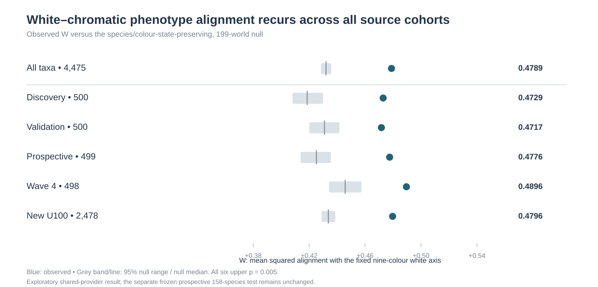
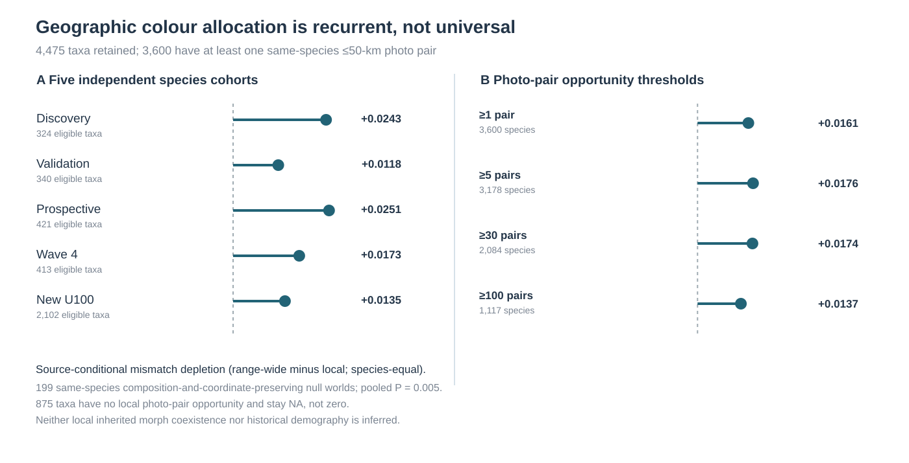

# Supporting Information

**Within-species flower colour variation across photographed ranges and among nearby observations in 4,475 angiosperms**

## Methods S1. Photographs, measurement and eligibility

The source comprised 100 photographs per species, assembled in five cohorts with distinct species. The [sampling protocol](https://github.com/zuizui0223/fcp/blob/d061b3ac8dc00d751008f8fadb933453963e8a9c/docs/POLYMORPHISM_42111_FRAME_PROVENANCE_20260918.md) documents the geographic grid, flowering-record filters and selection before colour assessment. A location-blind pipeline detected a flower region, segmented it and counted pixels assigned to a fixed palette. The nine retained colour fractions sum to one for a classified image. Four coarse labels summarize white, yellow/orange, red/pink and blue/purple appearances. Images with failed or uncertain measurements were excluded from the colour calculations. Across 447,500 records, 227,107 passed and 220,393 did not. The 100 records per species therefore do not imply equal numbers of usable images, localities or observers. Missing estimates remain blank in Table S2.

Figure 2 uses four purposefully selected photographs from an earlier licensed image-review packet. We matched each packet image to the archived measurement by photo ID. Two records show contrasting colours in one species, one shows disagreement between visible petal colour and region colour, and one illustrates rejection. The photograph displayed is the packet rendition, not a reconstruction of the segmentation mask. Panel C cannot identify precisely which pixels produced the fitted composition. Panel D is omitted from every colour estimate; the blank palette entries in Table S1 encode that exclusion. This selection illustrates measurement outcomes and cannot estimate their frequencies. The earlier exploratory organ and stage review also identified possible bud and fruit contributions. Independent human organ adjudication was incomplete in that review.

**Table S1. Photo identity and colour extraction.** The accompanying file `Table_S1_photographs.csv` supplies the full nine fractions, original label, mask-pixel count, exclusion reason, source URL, licence, attribution and checksum of each displayed photograph. These are full images resized for display. Photographer credits and the CC BY licence designation are transcribed from the archived attribution fields.

| Panel | Species and iNaturalist photo | Archived outcome | White | Yellow | Purple |
|---|---|---|---:|---:|---:|
| A | *Viola lutea*, [357540213](https://www.inaturalist.org/photos/357540213), ade sills | Blue/purple | 14.4% | 16.9% | 57.7% |
| B | *Viola lutea*, [670131413](https://www.inaturalist.org/photos/670131413), Martin Wood-Weatherill | Yellow/orange | 13.0% | 86.1% | 0.0% |
| C | *Argemone albiflora*, [664177506](https://www.inaturalist.org/photos/664177506), Linda Jo Conn | Yellow/orange | 3.2% | 63.8% | 0.0% |
| D | *Cistus ladanifer*, [23342465](https://www.inaturalist.org/photos/23342465), Andre Hosper | Horizontal-flip colour instability | — | — | — |

## Methods S2. Climate coefficients and common species support

At each locality WorldClim 2.1 climate normals were sampled at 10 arcminutes. The thermal index was the mean of within-species standardized BIO1 and BIO5. The precipitation amount index was the mean of standardized BIO12 and BIO14. BIO4, BIO15 and mean solar radiation supplied three additional domains. For each target domain the source analysis removed broad Earth-centred geographic coordinates and month effects and residualized against the four other domains. The slope divides the within-species covariance, corrected for its within-month permutation expectation, by residual predictor variance. At least 40 classifiable climate-complete records, 20 observers, five grid cells and 5% residual predictor variance were required for the primary panel. The index unit depends on the sampled within-species climate distribution. Temperature coefficients in Fig. 4 are expressed as percentage points of photographic white fraction per index unit.

Each species contributed one nine-component coefficient vector per estimable domain. The paired comparison retained only taxa with both vectors. For a species-equal mean vector v and unit contrast q = (8, −1, −1, −1, −1, −1, −1, −1, −1)/√72, alignment equals (v · q)²/(v · v). It measures the direction of a mean vector. It is invariant to its length and sign. The signed component means in Fig. 3a supply information lost on squaring. Uncertainty in the difference used 999 whole-genus bootstrap samples with the same genera drawn for both domains. The original matched panel represents 1,088 genera. The marginal 95% intervals for temperature and precipitation alignment were 54.6–92.5% and 0.06–73.6%, respectively. Direct paired inference used the interval for the difference.

**Table S2. Analysis population and species coefficients.** The machine-readable companion `Table_S2_species_coefficients.csv.gz` contains one row per taxon in the complete register. The taxon ID joins all source tables. The first fields give the species, genus, cohort, source classifiability count, count used by the climate workflow and workflow status. That workflow may return before counting complete records in an ineligible species. The 18 columns beginning `thermal_level_` or `precip_amount_` give the nine signed total coefficients on the original fraction scale. Multiply by 100 for Fig. 3a or Fig. 4. The final two columns are the unthinned held-out thermal–white coefficients indexed by observer-fold direction. Empty fields indicate unavailable coefficients.

| Population | Species | Quantity estimated |
|---|---:|---|
| Complete register | 4,475 | Within-species colour geometry |
| Temperature eligible | 2,837 | White coefficient distribution |
| Precipitation eligible | 3,022 | Precipitation coefficient availability |
| Both domains eligible | 2,689 | Paired temperature and precipitation directions |
| Both domains, one photograph per observer | 2,625 | Paired sensitivity on thinned records |
| Forward / reverse observer folds | 2,403 / 2,430 | Means on each eligible fold |
| Both observer folds | 1,919 | Correlation of paired species coefficients |

## Results S3. Paired climate contrasts and supporting sensitivity analyses

The complete and observer-thinned comparisons use the original 999 genus-bootstrap draws. For each new omission comparison we retained the original paired species outside the omitted cohort and drew whole genera with replacement 4,000 times (NumPy default random generator, seed 20261111 for each panel). Both domains shared each draw. Dividing the summed coefficient vectors by the number of species in each resample retained equal species weights. We computed the difference of the two squared alignments in each draw and used its 2.5th and 97.5th percentiles. These exploratory intervals apply to each retained panel separately.

**Table S3. Difference in white-axis alignment of the mean temperature and precipitation vectors.** Within each row, both mean vectors use identical species. Alignment is a percentage; differences and percentile intervals are in percentage points. The largest cohort is the additional acquisition wave (source label `new_U100`). Counts are retained species.

| Analysis panel | Species | Temperature (%) | Precipitation (%) | Difference (95% interval) |
|---|---:|---:|---:|---:|
| All matched species | 2,689 | 83.7 | 24.3 | 59.4 (6.0 to 86.8) |
| One photo per observer | 2,625 | 84.8 | 12.7 | 72.0 (10.0 to 88.3) |
| Omit Discovery | 2,376 | 82.0 | 8.0 | 74.0 (7.1 to 87.1) |
| Omit Validation | 2,383 | 80.7 | 10.9 | 69.8 (1.9 to 86.2) |
| Omit Prospective | 2,384 | 85.1 | 11.1 | 74.0 (13.6 to 88.0) |
| Omit Fourth wave | 2,404 | 87.1 | 27.0 | 60.1 (7.3 to 88.6) |
| Omit Largest cohort | 1,209 | 74.8 | 69.1 | 5.7 (−30.1 to 65.2) |

The largest deletion removes 1,480 of the 2,689 matched species. The temperature alignment remains high, while the precipitation alignment rises and the interval for the difference spans zero. To summarize species-level ordering, we applied the same squared-projection formula to each of the two nonzero vectors within each species before counting the larger alignment. Temperature had greater estimated alignment in 1,345 species (50.0%). The average of individual alignments was 36.9% for temperature and 36.2% for precipitation. These descriptive estimates include species with weak vectors whose directions are imprecise.

The temperature-eligible original panel gave mean white coefficient +0.008209; the simultaneous five-domain interval for its scaled white-axis projection was +0.004237 to +0.013177. For one photograph per observer the mean white coefficient was +0.008002 (2,771 species) and squared mean alignment was 87.1%. For this separate temperature-only summary, each acquisition-cohort omission retained a positive mean and a positive lower genus-bootstrap limit. Removal of the largest cohort left 1,273 species (mean +0.009373; 95% interval +0.004232 to +0.014099). A separate categorical analysis using BIO5 alone gave +0.02189 log odds of white per °C across 4,112 species (genus 95% interval +0.00846 to +0.03489). This estimator differs in both outcome and units from the continuous shared-temperature coefficient.

For the 1,376 species with at least five photos in each of at least two categories and estimable decomposition, the between-category term comprised 67.8% of the signed mean thermal–white coefficient (genus 95% interval 44.2–85.4%). The corresponding observer-thinned panel gave 66.1% (1,299 species; 39.2–84.3%). Since the labels derive from the photographic palette, this algebraic split does not identify inherited or developmental components.

The range-wide category counts use the [unified species ledger](https://github.com/zuizui0223/fcp/blob/d0745596609784f316bae03f24527d8eaf6d7bbb/results/fcp_np_all4475_unified_species_ledger_20261021.csv). For each taxon we counted how many of the four columns beginning `miss_coarse_photo_` reached one photograph or five photographs. The number of taxa with at least two qualifying categories was 4,189 or 2,400, respectively, from the full register of 4,475. Each photo contributes a categorical observation; these thresholds impose no requirement for distinct individuals or a common breeding site. For the finer-scale description, 840 species had a positive count in the ledger field for 5-km same-year, same-month, different-observer pairs; 325 of those had a positive count for different-category pairs under the same filter. Species without an eligible pair contribute no information on this comparison. These are observed counts without a null-model test.

The complete-register white-axis score exceeded its null median by 0.04683. Each of 199 random worlds retained coarse colour counts and source cohort structure. The smallest attainable plus-one probability was 0.005. For the 50-km comparison, the strict categorical panel required at least 40 classified photographs and 30 local pairs; its mean mismatch depletion was 0.01761 (1,761 species). With the broader pair eligibility and one photo per observer, depletion was 0.01590 (3,592 species). The continuous distance test permuted complete nine-colour vectors within species and calendar month. Earlier discovery and validation panels also yielded modest positive adjusted rank associations between photo diversity and spatial organization (+0.12664, 369 species, P = 0.007; +0.09929, 363 species, P = 0.025). These were separate cohorts and estimands.

**Figure S1.** Mean squared white-axis alignment of within-species colour displacements in the original five cohorts and complete source. Full-register mean 0.47887 (genus-bootstrap 95% interval 0.46874–0.48978); source-matched null median 0.43204.

**Figure S2.** Source summary of categorical geographic comparisons. Positive depletion means that conspecific pairs within 50 km differed less often in their photographic colour categories than pairs sampled across the species' recorded range. The continuous JSD comparison in the text uses a separate month-preserving null.

## Data sources and reproduction

- [Original measured-photo archive](https://github.com/zuizui0223/fcp/releases/tag/fcp-all4730-original-method-actual-colour-results-20261017). The compressed measured-photo CSV has SHA256 `8e7f10f0427927208485b2da6fa9c46bb681d6f3611e53b8dfdc606cfc8dabe6`. [Licensed image packet](https://github.com/zuizui0223/fcp/actions/runs/39931967531) and [organ/stage pilot](https://github.com/zuizui0223/fcp/pull/264).
- [Climate coefficient archive](https://github.com/zuizui0223/fcp/actions/runs/40066224301). Table S2 uses the original NPZ `conditional_slope` array, component `total`, joined by `inat_taxon_id`. Original NPZ SHA256 `77eca75f7909bcee53ec3d24766d6d6db1140d654b86b26fae81bb3bbcd15378`. [Cohort omission analysis](https://github.com/zuizui0223/fcp/actions/runs/40066704796).
- [Observer-fold archive](https://github.com/zuizui0223/fcp/actions/runs/40080001765). For Table S2, select `test_photo_mode=all_heldout`, pivot `heldout_thermal_white_slope` by `direction` and join by taxon ID. Original CSV SHA256 `079241c220a5f5993a17d361a2ea5fc276c7d13e99a168111cc14a3f51ce7253`.
- Table S3 can be rebuilt with `python cohort_contrast.py` from Table S2 and the archived original and observer-thinned contrasts. Figures 1–4 can be rebuilt with `python render_figures.py` in the companion directory using NumPy, pandas, Matplotlib and Pillow. The script reads the unified species ledger, the accompanying tables and the four source photographs. The plots summarize existing fitted coefficients; no climate models are refitted.
